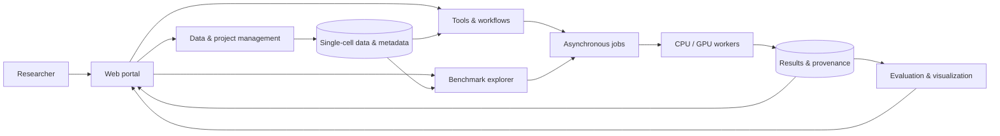

<div align="center">
  

  # single-cell.ai

  **An extensible platform for single-cell data analysis, method development, and reproducible benchmarking**

  *From data to discovery — in a shared, AI-ready research environment.*

  [Overview](#overview) · [Features](#key-capabilities) · [Quick start](#quick-start) · [Python package](#python-package-oscb) · [Documentation](#documentation) · [Contributing](#contributing)
</div>

---

## Overview

**single-cell.ai** is a project-centered research platform that brings together single-cell datasets, analytical methods, computational workflows, interactive visualizations, and benchmark evaluations. It is designed for both **biologists**, who need accessible workflows without extensive programming, and **computational scientists**, who develop and systematically compare analytical methods.

The platform connects an interactive web interface with Python/R analysis tools and containerized computing. A common data and project layer helps researchers track input datasets, preprocessing choices, analysis parameters, outputs, and collaboration permissions across an analysis.

The associated **Open Single-Cell Benchmarks (OSCB)** Python package supports programmatic dataset loading and task-specific evaluation.

### What you can do

- **Manage datasets and projects** — organize public or private datasets, metadata, input files, analysis results, and access permissions.
- **Analyze without writing code** — configure quality control, normalization, imputation, integration, clustering, annotation, and visualization in the browser.
- **Run guided workflows** — use Clustering, Integration, and Annotation workflows composed of reusable analysis steps.
- **Compare biological results** — explore UMAP/t-SNE embeddings, cell-type predictions, marker genes, quality metrics, and processing outputs.
- **Benchmark algorithms** — evaluate methods using task-relevant scientific measures and, where recorded, computational resource usage.
- **Extend the platform** — integrate analysis tools, workflows, runtime environments, Python utilities, and APIs.
- **Collaborate reproducibly** — keep datasets, settings, jobs, and outputs together within a project.

> **Project scope:** Available methods and compute backends depend on the deployed configuration. Planned AI-agent functionality should not be assumed to be available in every deployment.

## How it works



The platform combines four interacting layers:

| Layer | Responsibilities |
| --- | --- |
| **Applications and APIs** | Browser workflows, project collaboration, data exploration, visualization, and programmatic access |
| **Workflow and tools engine** | Configurable steps for preprocessing, integration, annotation, benchmarking, and evaluation |
| **Single-cell data layer** | Datasets, metadata, project ownership, sharing, and traceable outputs |
| **Computational infrastructure** | Containerized services, asynchronous task queues, CPU/GPU workers, and persistent storage |

## Key capabilities

### Analysis tools

| Category | Available methods / utilities |
| --- | --- |
| Quality control | Bioconductor, Scanpy, Seurat, Dropkick |
| Imputation | MAGIC, SAVER |
| Normalization | LogCPM, LogCP10K, sctransform, DESeq2, scran, TMM, RLE, UpperQuartile, TPM, FPKM, Pearson residuals |
| Integration | Seurat, Harmony, LIGER, scVI |
| Annotation | CellTypist, scANVI, SingleR |
| Formatting | Data conversion utilities |
| Visualization | UMAP, t-SNE, and interactive exploration of analysis outputs |

Methods are not interchangeable: choose them according to assay type, batch structure, reference availability, and biological objectives.

### Built-in workflows

| Workflow | Typical stages | Expected outputs |
| --- | --- | --- |
| **Clustering** | QC → normalization → optional imputation → feature selection / clustering | Cluster assignments, embeddings, diagnostic figures |
| **Integration** | QC → preprocessing → batch integration → downstream assessment | Integrated representations and batch-aware visualizations |
| **Annotation** | QC → integration → CellTypist / scANVI / SingleR → review | Candidate cell identities, confidence scores where available, marker and embedding plots |

### Benchmarking

The benchmark framework covers seven analysis areas: **Clustering**, **Cell Type Annotation**, **Cell–Cell Communication**, **Imputation**, **Batch Integration**, **Multimodal Data Integration**, and **Trajectory Inference**.

The supplied documentation snapshot describes **74 public dataset records**, approximately **1.61 million estimated cells**, and **three species** (human, mouse, and planaria). These are catalog statistics from that snapshot, **not a live count or a claim that every dataset has results for every task**.

## Repository structure

The public repository contains the following top-level components:

```text
.
├── api/                  # Python API, analysis services and task execution
├── nginx/                # Reverse-proxy configuration
├── oscb-cli/oscb/        # OSCB command-line source
├── oscb-pypi/            # Python package source
├── oscb-ui/              # Web application and related services
├── docker-compose.yml   # Compose deployment example
├── initMongo.js          # MongoDB initialization script
└── README.md
```

## Quick start

### Prerequisites

- Git and a Linux-compatible Docker environment
- Docker Engine and the **Docker Compose** plugin
- Sufficient RAM and disk space for container images and single-cell datasets
- An NVIDIA GPU, drivers, and container runtime **only when enabling GPU workers**
- Local configuration and secure credentials for all required backing services

> **Important:** The Compose configurations checked in the public repository contain host-specific absolute paths and deployment-specific settings. **Do not run them unchanged on a public server.** Review bind mounts, exposed ports, service hostnames, database initializers, worker GPU reservations, and all credentials first.

### 1. Clone the repository

```bash
git clone https://github.com/cirisjl/single-cell.ai.git
cd single-cell.ai
```

### 2. Configure the deployment

Review `docker-compose.yml`, `.env`, and service-specific environment files. Set environment-specific addresses and storage directories, and provision **new secrets** via a secure configuration mechanism. Avoid committing local credentials or modifying production data directories unintentionally.

### 3. Validate, build, and start

```bash
# Inspect the resolved Compose configuration before deployment
docker compose -f docker-compose.yml config --quiet

# Start the configured stack
docker compose -f docker-compose.yml up -d --build

# Inspect service status
docker compose -f docker-compose.yml ps
```

When the frontend is enabled and its configured port is published, the Compose example makes the React web interface available at **http://localhost:3000**. The API uses port `5005`, Node.js services include `3001`, and Directus uses `8055` in the checked configuration; access depends on port bindings and local firewall settings.

### 4. Inspect logs or stop

```bash
docker compose -f docker-compose.yml logs -f celery-api

docker compose -f docker-compose.yml down
```

Do **not** add `-v` to `down` unless you deliberately intend to remove Compose-managed volumes. Existing database and dataset storage may contain irreplaceable research data.

> **Deployment guides:** The project documentation also describes Docker Compose, Kubernetes, and Helm-based deployments. The Kubernetes and Helm examples need site-specific secrets, storage, images, and ingress settings before production use.

## Python package (OSCB)

Install the Python package in an isolated environment:

```bash
python -m pip install oscb
```

Example: load a dataset by an identifier from the benchmark catalog.

```python
from oscb.data import DataLoader

data = DataLoader(
    benchmarks_id="h-PBMC-11989-Adam-2022",
    data_folder="./datasets/",
)

if data is None:
    raise RuntimeError("Dataset could not be loaded; verify the identifier and access")

print(type(data).__name__)
```

Depending on the dataset and task, the loader may return an `AnnData` or `MuData` object. The `oscb.evaluator.eval` interface provides task-specific evaluation; its arguments differ across clustering, annotation, integration, and other benchmark categories.

## Documentation

The documentation is organized into six areas:

| Section | Guides |
| --- | --- |
| **Deployment** | Docker Compose, Kubernetes, Helm |
| **Analyses** | Data Management, Tools, Workflows, Job Management, Sample Report |
| **Benchmarks** | Create New Benchmarks, Explore Benchmarks |
| **Python Packages** | Installation, Data Loader, Evaluators |
| **API** | FastAPI Endpoints |
| **Tutorials** | Annotation Workflow, Identify Outliers, Refine Annotation |

For a first analysis, a suggested sequence is **upload/select a dataset → configure a workflow → run and monitor the job → explore outputs → review annotations or benchmark results**.

## Technology stack

The codebase and associated deployment materials use **React**, **Node.js**, **Python**, **R** and single-cell analysis libraries, together with **Celery**, **RabbitMQ**, **Redis**, **MongoDB**, **MySQL**, **Directus**, **Docker Compose**, and deployment configurations for **Kubernetes/Helm**. Exact versions and required services depend on the chosen branch and configuration.

## Contributing

Issues, documentation improvements, reproducible bug reports, and method integrations are welcome through GitHub:

1. Check [existing issues](https://github.com/cirisjl/single-cell.ai/issues) before opening a duplicate.
2. Describe the dataset or workflow, method versions, configuration, expected result, and observed behavior. Exclude credentials, protected datasets, and other private information.
3. Create a feature branch and submit a focused pull request with an explanation and test evidence when practical.
4. For a new analysis method, document supported input types, parameters, runtime dependencies, outputs, error handling, and evaluation criteria.

## Security and reproducibility

- Never commit API keys, passwords, private certificates, or identifiable research data.
- Use secrets management and environment-specific configuration for all deployments.
- Pin container images and record package versions for reproducible analyses.
- Preserve dataset provenance, preprocessing settings, random seeds, and job logs where supported.
- Restrict administrative endpoints and apply access control to private datasets.

---

<div align="center">
  <strong>single-cell.ai</strong> · Data · Methods · Workflows · Benchmarks · Discovery
</div>
