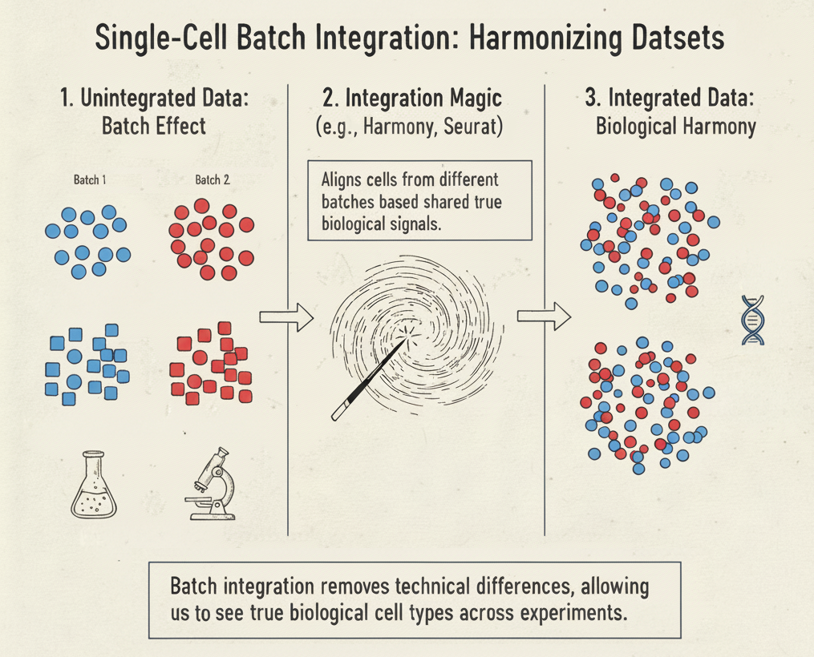
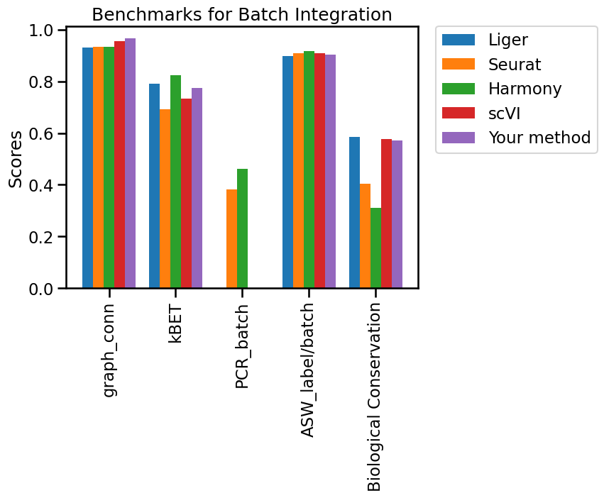
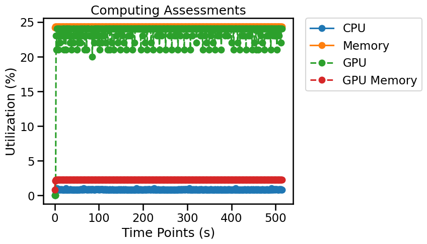

## Overview

Batch integration reduces unwanted technical differences among datasets while preserving meaningful biological variation. Methods may return corrected expression, an integrated embedding, or a neighborhood graph. Assess both batch mixing and cell-type preservation: an apparently well-mixed embedding can hide overcorrection.



*Single-cell RNA sequencing (scRNA-seq) experiments often face a pervasive challenge known as the "batch effect," where technical variations introduced during sample collection, preparation, or sequencing can create artificial differences between datasets (batches), even when the underlying biological samples are similar. As depicted in the figure's "Unintegrated Data" (Panel 1), cells of the same biological type (e.g., T Cells, represented by circles) from different batches (e.g., Batch 1 in blue, Batch 2 in red) appear as distinct, non-overlapping groups, while different cell types from the same batch might erroneously appear closer than they truly are. This technical noise complicates direct comparisons and downstream analyses, hindering the identification of true biological cell types and states. Single-cell batch integration methods, therefore, are critical computational techniques (illustrated as "Integration Magic" in Panel 2) designed to harmonize these diverse datasets. These methods work by identifying and aligning shared biological signals across different batches, effectively removing technical biases while preserving genuine biological distinctions. The outcome is "Integrated Data" (Panel 3), where cells of the same biological type (e.g., all T Cells, regardless of original batch) are correctly grouped together, allowing for accurate identification of cell populations and robust comparative analyses across multiple experiments.*

## Evaluation metrics

This task evaluates Batch Integration methods by assessing their success in removing technical batch effects while preserving true biological variation (including ARI, ASW batch/label, Cell Cycle Conservation, cLISI, HVG overlap, Isolated label ASW, Isolated label F1 score, and NMI) within single-cell data. Methods are provided with multi-batch, consistently labeled data (either normalized or unnormalized) and produce either a feature matrix, low-dimensional embedding, or neighborhood graph as integrated output. This output is subsequently evaluated using specific metrics that quantify both batch effect removal and biological variance conservation, with the task framework drawing from the most recent and comprehensive single-cell data integration benchmark.

A workflow for creating Batch Integration benchmarks is available on [single-cell.ai](https://www.single-cell.ai/), where cell type label and batch key are stored in `adata.obs`.

- **ARI:** Adjusted Rand index between derived clusters and reference cell-type labels; higher values indicate better agreement. ARI can be negative. [^1]
- **ASW batch/label:** Batch-mixing or biological-label silhouette scores computed from the integrated representation. Interpret the batch and label versions separately. [^1]
- **Cell Cycle Conservation:** Extent to which cell-cycle-associated signal is preserved after integration. [^1]
- **cLISI:** Cell-type local inverse Simpson index; neighborhoods dominated by one type have low cLISI (near 1), supporting cell-type separation. [^1]
- **Graph Connectivity:** Connectivity of same-label cells in the neighborhood graph; higher values indicate better preservation of biological populations. [^1]
- **HVG overlap:** Overlap of highly variable genes before and after integration, where applicable to the method and data representation. [^1]
- **Isolated label ASW:** Separation of labels that appear in few batches; higher values generally indicate better preservation. [^1]
- **Isolated label F1 score:** F1 score for recovering isolated cell populations after integration. [^1]
- **kBET:** Tests local batch mixing. A lower rejection rate generally indicates less detectable batch structure; transformed benchmark scores may reverse the direction. [^2]
- **NMI:** Normalized mutual information between clusters and reference labels; 0–1, with higher agreement being better. [^1]
- **PC Regression:** Proportion of variance in the integrated representation attributable to batch effects; lower raw R² generally suggests better correction. [^1]

> **Interpretation:** Benchmark metrics describe different properties. Read them together, check class imbalance and dataset design, and verify whether each reported metric is a raw value or a transformed score.

## Python Packages

Install OSCB with `python -m pip install oscb` (see [Installation](doc/?doc=installation)). All examples use the OSCB [`DataLoader`](doc/?doc=data_loader) and [`eval`](doc/?doc=evaluators) interfaces described in this documentation. **These examples assume you have already generated predictions with your own method.**

### 1. Load a benchmark dataset

```python
from oscb.data import DataLoader

benchmark_id = "BI-h-PBMC-23589-Hao-2021"
adata = DataLoader(benchmark_id, data_folder="./datasets/")
```

An example identifier is supplied above. You can use a different ID from the platform's [Benchmarks](doc/?doc=benchmarks) page. Dataset storage locations and matrix layers depend on the downloaded dataset; check the object before analysis rather than assuming `X` always contains raw counts.

### 2. Evaluate predictions on an OSCB benchmark

**Required method output:** An integrated `AnnData` object called `adata_int` returned by your integration method, with cells aligned to the original `adata`.
> **Prerequisite:** Run your integration method first to produce the `adata_int` object or embedding used below. These are not created by the evaluator.


```python
from oscb.evaluator import eval

# Replace the method-specific keys/objects with the outputs of your algorithm.
results_dict = eval(adata, adata_int, benchmarks_id=benchmark_id, method="Your method")
```

When a benchmark ID is provided, the evaluator can compare your method with the existing benchmark results. Availability of plots or supported comparisons may depend on the benchmark.



### 3. Evaluate your own labeled data

The original and integrated objects should represent the same cells, and the batch/label columns must exist in the input metadata. Do not expect every cell type to be present in every batch; assess isolated populations and possible overcorrection. Replace the illustrated observation keys and species with values from your data.

```python
from oscb.evaluator import eval

results_dict = eval(adata, adata_int, task="Batch Integration", batch_key="batch", label_key="cell_type", species="human", method="Your method")
```

### 4. Save results

```python
from oscb.evaluator import write_json

write_json(results_dict, file_path="./output.json")
```

### 5. Monitor resource utilization (optional)

OSCB's `Monitor` can record CPU/memory use and, when supported, GPU utilization. Start it before your algorithm runs and stop it when processing completes.

```python
from oscb.utilization import Monitor

monitor = Monitor(1)  # Sampling interval in seconds
try:
    # Run your analysis here; the evaluator does not execute your method.
    pass
finally:
    monitor.stop()
```



## References
[^1]: Luecken, M. D., Büttner, M., Chaichoompu, K., Danese, A., Interlandi, M., Mueller, M. F., Strobl, D. C., Zappia, L., Dugas, M., Colomé-Tatché, M., & Theis, F. J. (2021). Benchmarking atlas-level data integration in single-cell genomics. Nature Methods, 19(1), 41–50. https://doi.org/10.1038/s41592-021-01336-8
[^2]: Büttner, M., Miao, Z., Wolf, F. A., Teichmann, S. A., & Theis, F. J. (2018). A test metric for assessing single-cell RNA-seq batch correction. Nature Methods, 16(1), 43–49. https://doi.org/10.1038/s41592-018-0254-1
