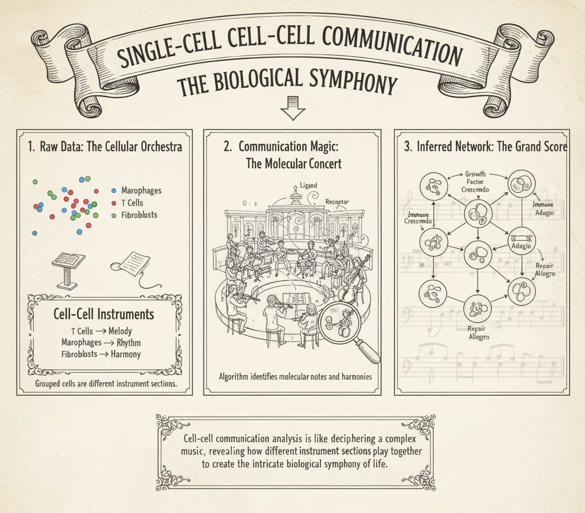
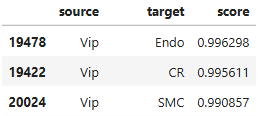
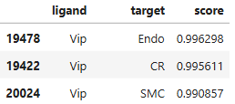
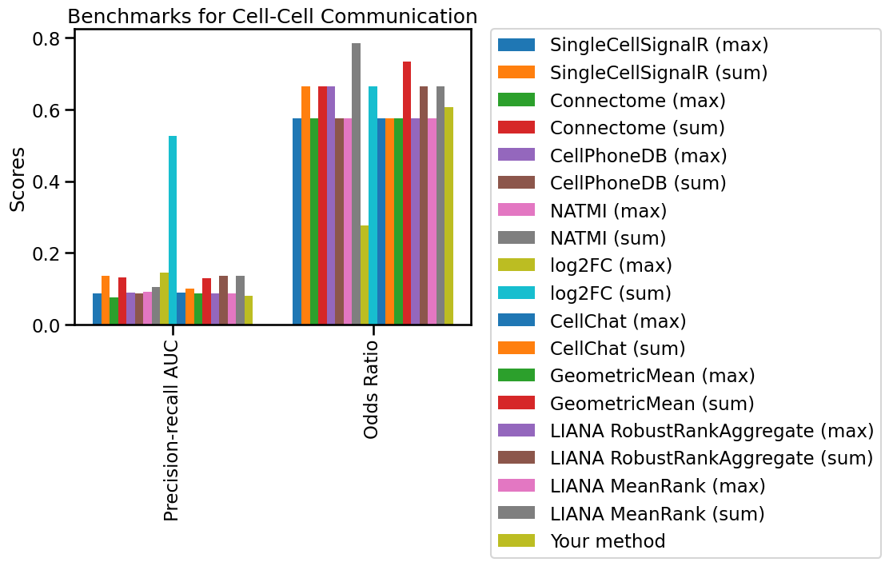
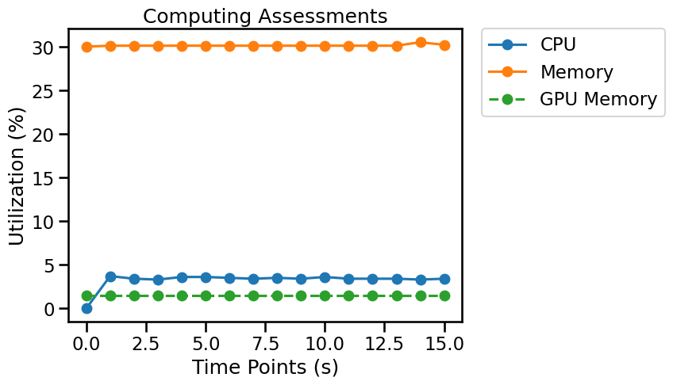

## Overview

Cell–cell communication analysis infers candidate signaling interactions from molecular evidence such as ligand and receptor expression. These predictions generate hypotheses; transcriptional co-expression alone does not demonstrate physical contact, pathway activation, or functional signaling.



*Cell-cell communication is a fundamental biological process that enables cells to interact, coordinate, and orchestrate complex functions within tissues and organs. In the context of single-cell analysis, understanding these intricate dialogues has become paramount. By analyzing the diverse molecular signals exchanged between individual cells, bioinformatics approaches can decipher the "biological symphony" — identifying which cell types are the "orchestra sections," what "molecular instruments" (ligand-receptor pairs) they "play," and how their "musical scores" (signaling pathways) lead to a harmonious or sometimes discordant biological outcome. This allows researchers to construct an "inferred network" or "grand score" of interactions, revealing the dynamic social landscape of cells and providing crucial insights into developmental processes, disease progression, and therapeutic interventions.*

## Evaluation metrics

When assessing Cell-Cell Communication (CCC), the Precision-Recall Area Under the Curve (AUC) offers a robust metric to evaluate the overall performance of a prediction model, particularly when dealing with imbalanced datasets where true communication events might be rare. It quantifies the trade-off between identifying relevant interactions (precision) and finding all relevant interactions (recall) across various thresholds. Complementing this, the Odds Ratio provides a straightforward measure to quantify the association between two cell types communicating via a specific ligand-receptor pair, indicating how much more likely an interaction is to occur between those specific cell types compared to random chance.

A workflow for creating Cell-Cell Communication benchmarks is available on [single-cell.ai](https://www.single-cell.ai/), where cell type label is stored in `adata.obs` and CCC target is in `adata.uns["ccc_target"]`.

- **Odds Ratio:** Strength of enrichment/association between candidate signaling interactions and their targets, relative to the benchmark null or comparison group. [^1]
- **Precision-recall AUC:** Area under the precision–recall curve for ranking predicted interactions against positives; especially informative for class-imbalanced targets. [^2]

> **Interpretation:** Benchmark metrics describe different properties. Read them together, check class imbalance and dataset design, and verify whether each reported metric is a raw value or a transformed score.

**Accepted prediction layouts**





## Python Packages

Install OSCB with `python -m pip install oscb` (see [Installation](doc/?doc=installation)). All examples use the OSCB [`DataLoader`](doc/?doc=data_loader) and [`eval`](doc/?doc=evaluators) interfaces described in this documentation. **These examples assume you have already generated predictions with your own method.**

### 1. Load a benchmark dataset

```python
from oscb.data import DataLoader

benchmark_id = "CCC-m-10x_Brain-14249-Tasic-2016"
adata = DataLoader(benchmark_id, data_folder="./datasets/")
```

An example identifier is supplied above. You can use a different ID from the platform's [Benchmarks](doc/?doc=benchmarks) page. Dataset storage locations and matrix layers depend on the downloaded dataset; check the object before analysis rather than assuming `X` always contains raw counts.

### 2. Evaluate predictions on an OSCB benchmark

**Required method output:** A prediction table at `adata.uns["your_method"]`; for custom evaluation, a corresponding target table at `adata.uns["ccc_target"]`.

```python
from oscb.evaluator import eval

# Replace the method-specific keys/objects with the outputs of your algorithm.
results_dict = eval(adata, benchmarks_id=benchmark_id, ccc_pred=adata.uns["your_method"], method="Your method")
```

When a benchmark ID is provided, the evaluator can compare your method with the existing benchmark results. Availability of plots or supported comparisons may depend on the benchmark.



### 3. Evaluate your own labeled data

Use a `pandas.DataFrame` with `source`, `target`, and `score` columns for source–target prediction, or `ligand`, `target`, and `score` for ligand–target prediction, matching the benchmark format and identifiers. Replace the illustrated observation keys and species with values from your data.

```python
from oscb.evaluator import eval

results_dict = eval(adata, task="Cell-Cell Communication", ccc_pred=adata.uns["your_method"], ccc_target=adata.uns["ccc_target"], method="Your method")
```

### 4. Save results

```python
from oscb.evaluator import write_json

write_json(results_dict, file_path="./output.json")
```

### 5. Monitor resource utilization (optional)

OSCB's `Monitor` can record CPU/memory use and, when supported, GPU utilization. Start it before your algorithm runs and stop it when processing completes.

```python
from oscb.utilization import Monitor

monitor = Monitor(1)  # Sampling interval in seconds
try:
    # Run your analysis here; the evaluator does not execute your method.
    pass
finally:
    monitor.stop()
```



## References
[^1]: Bland, J. M. (2000). Statistics notes: The odds ratio. BMJ, 320(7247), 1468–1468. https://doi.org/10.1136/bmj.320.7247.1468
[^2]: Davis, J., & Goadrich, M. (2006). The relationship between precision-recall and ROC curves. Proceedings of the 23rd International Conference on Machine Learning - ICML 06. https://doi.org/10.1145/1143844.1143874
