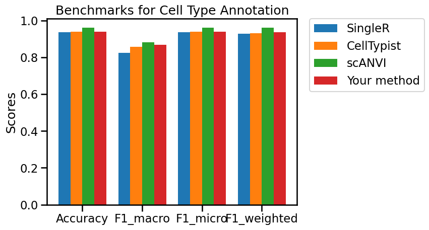
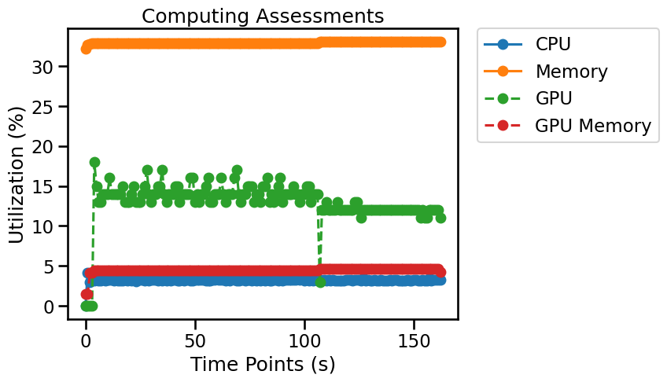

## Overview

Cell-type annotation assigns interpretable biological labels to individual cells or clusters using marker genes, reference datasets, or trained classifiers. Evaluate predictions against curated labels when available, and inspect marker expression and uncertain or previously unseen cell states before accepting assignments.


*In the intricate world of single-cell analysis, identifying the distinct types of cells present in a biological sample is a foundational step, often likened to a "Cellular Detective" or "Librarian" at work. Initially, computational methods like clustering group cells into distinct populations based on their gene expression profiles, but these clusters remain anonymous "mystery books" or "unsorted books" without assigned biological identities. Cell type annotation is the critical process of assigning meaningful labels—such as T cells, B cells, or macrophages—to these anonymous clusters. This "Annotation Magic" is achieved by comparing the molecular fingerprints of each cluster, often specific marker genes, against known biological references. By carefully sorting and cataloging these cellular identities, we transform raw, uncharacterized data into a rich, interpretable map of the cellular landscape, unlocking profound insights into biological processes, disease mechanisms, and therapeutic targets.*

## Evaluation metrics

Metrics for cell type annotation quantify how accurately clusters match known cell types, ensuring consistency and distinctiveness. These measures are crucial for validating annotations, comparing methods, and guaranteeing the reliability of biological insights.

- **Accuracy:** Fraction of cells assigned the correct reference label. [^1]
- **F1 macro:** Unweighted mean of class-level F1 scores; highlights rare-class performance. [^1]
- **F1 micro:** F1 calculated from global class-level counts; in single-label multiclass classification it equals accuracy. [^1]
- **F1 weighted:** Support-weighted mean of class-level F1 scores; emphasizes abundant classes. [^1]

> **Interpretation:** Benchmark metrics describe different properties. Read them together, check class imbalance and dataset design, and verify whether each reported metric is a raw value or a transformed score.

## Python Packages

Install OSCB with `python -m pip install oscb` (see [Installation](doc/?doc=installation)). All examples use the OSCB [`DataLoader`](doc/?doc=data_loader) and [`eval`](doc/?doc=evaluators) interfaces described in this documentation. **These examples assume you have already generated predictions with your own method.**

### 1. Load a benchmark dataset

```python
from oscb.data import DataLoader

benchmark_id = "CT-h-PBMC-11989-Adam-2022"
adata = DataLoader(benchmark_id, data_folder="./datasets/")
```

An example identifier is supplied above. You can use a different ID from the platform's [Benchmarks](doc/?doc=benchmarks) page. Dataset storage locations and matrix layers depend on the downloaded dataset; check the object before analysis rather than assuming `X` always contains raw counts.

### 2. Evaluate predictions on an OSCB benchmark

**Required method output:** Predicted labels already stored in `adata.obs["scANVI_predicted"]` (or your method-specific column).

```python
from oscb.evaluator import eval

# Replace the method-specific keys/objects with the outputs of your algorithm.
results_dict = eval(benchmarks_id=benchmark_id, labels_pred=adata.obs["scANVI_predicted"], method="Your method")
```

When a benchmark ID is provided, the evaluator can compare your method with the existing benchmark results. Availability of plots or supported comparisons may depend on the benchmark.



### 3. Evaluate your own labeled data

Ground-truth and predicted labels must be aligned cell by cell. Check species, tissue, reference coverage, and label vocabulary; benchmark scores can conceal errors in rare populations. Replace the illustrated observation keys and species with values from your data.

```python
from oscb.evaluator import eval

# Replace the method-specific keys/objects with the outputs of your algorithm.
results_dict = eval(task="Cell Type Annotation", labels=adata.obs["cell_type"], labels_pred=adata.obs["scANVI_predicted"], method="Your method")
```

### 4. Save results

```python
from oscb.evaluator import write_json

write_json(results_dict, file_path="./output.json")
```

### 5. Monitor resource utilization (optional)

OSCB's `Monitor` can record CPU/memory use and, when supported, GPU utilization. Start it before your algorithm runs and stop it when processing completes.

```python
from oscb.utilization import Monitor

monitor = Monitor(1)  # Sampling interval in seconds
try:
    # Run your analysis here; the evaluator does not execute your method.
    pass
finally:
    monitor.stop()
```



## References
[^1]: Grandini, M., Bagli, E., & Visani, G. (2020). Metrics for multi-class classification: An overview. arXiv. https://doi.org/10.48550/arxiv.2008.05756
