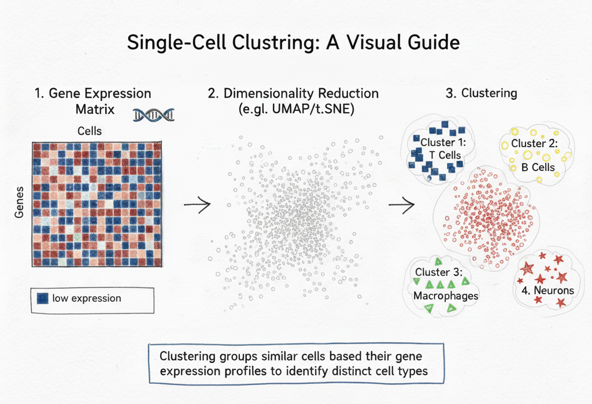
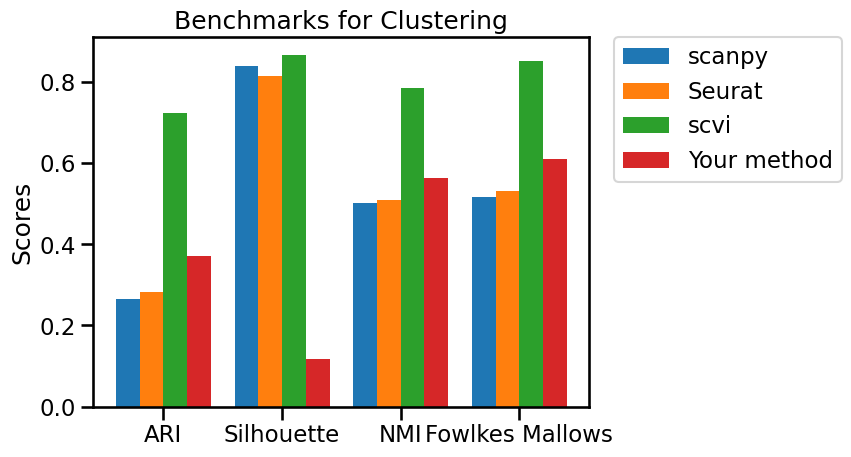
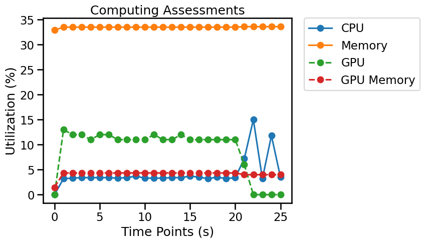

# Clustering

## Overview

Clustering groups cells with similar expression profiles to identify populations and putative cell states. Most workflows construct a neighborhood graph from a reduced representation (for example, PCA) and apply a clustering algorithm such as Leiden. UMAP and t-SNE are primarily **visualization** methods; their two-dimensional layouts should not, by themselves, be treated as reliable clustering input.



*In single-cell analysis, Clustering is a critical step to identify distinct cell types or states within a heterogeneous sample. The process begins with a gene expression matrix (**step 1**), detailing expression levels for thousands of genes across individual cells. To manage this high-dimensional data, dimensionality reduction techniques like PCA, UMAP or t-SNE (**step 2**) are applied, projecting cells into a 2D or 3D space while preserving transcriptional similarities. Finally, Clustering algorithms (**step 3**) group these projected cells into distinct clusters, where each cluster represents a population of cells with similar gene expression profiles, allowing for the identification and annotation of unique cell types (e.g., T Cells, B Cells, Macrophages, Neurons) from the original sample.*

## Evaluation metrics

We use cell-type as Clustering ground truth, and compare it with the predicted Clustering.

- **ARI:** Agreement between clusters and reference labels, adjusted for chance; 1 is perfect and values can be negative. [^1]
- **FMI:** Fowlkes–Mallows index: geometric mean of pairwise precision and recall; 1 indicates perfect pairwise agreement. [^2]
- **Silhouette:** Measures within-cluster cohesion relative to between-cluster separation in the chosen feature space; ranges from −1 to 1. It does not require ground-truth labels. [^3]
- **NMI:** Normalized mutual information quantifies shared information between predicted clusters and reference labels, from 0 to 1. [^4]

> **Interpretation:** Benchmark metrics describe different properties. Read them together, check class imbalance and dataset design, and verify whether each reported metric is a raw value or a transformed score.

## Python Packages

Install OSCB with `python -m pip install oscb` (see [Installation](doc/?doc=installation)). All examples use the OSCB [`DataLoader`](doc/?doc=data_loader) and [`eval`](doc/?doc=evaluators) interfaces described in this documentation. **These examples assume you have already generated predictions with your own method.**

### 1. Load a benchmark dataset

```python
from oscb.data import DataLoader

benchmark_id = "CL-m-FACS_Bladder-1268-Tabula-2018"
adata = DataLoader(benchmark_id, data_folder="./datasets/")
```

An example identifier is supplied above. You can use a different ID from the platform's [Benchmarks](doc/?doc=benchmarks) page. Dataset storage locations and matrix layers depend on the downloaded dataset; check the object before analysis rather than assuming `X` always contains raw counts.

### 2. Evaluate predictions on an OSCB benchmark

**Required method output:** A clustering result in `adata.obs["leiden"]` and an embedding in `adata.obsm["X_umap"]` (adjust the keys to match your output).

```python
from oscb.evaluator import eval

# Replace the method-specific keys/objects with the outputs of your algorithm.
results_dict = eval(adata, benchmarks_id=benchmark_id, cluster_key="leiden", embedding_key="X_umap", method="Your method")
```

When a benchmark ID is provided, the evaluator can compare your method with the existing benchmark results. Availability of plots or supported comparisons may depend on the benchmark.



### 3. Evaluate your own labeled data

For custom data, cell-type labels and predicted cluster assignments must refer to the same cells in the same order. The embedding should have one row per cell. A high clustering score is not evidence that every cluster is a unique biological cell type. Replace the illustrated observation keys and species with values from your data.

```python
from oscb.evaluator import eval

# Replace the method-specific keys/objects with the outputs of your algorithm.
results_dict = eval(task="Clustering", labels=adata.obs["cell_type"], labels_pred=adata.obs["leiden"], embedding=adata.obsm["X_umap"], method="Your method")
```

### 4. Save results

```python
from oscb.evaluator import write_json

write_json(results_dict, file_path="./output.json")
```

### 5. Monitor resource utilization (optional)

OSCB's `Monitor` can record CPU/memory use and, when supported, GPU utilization. Start it before your algorithm runs and stop it when processing completes.

```python
from oscb.utilization import Monitor

monitor = Monitor(1)  # Sampling interval in seconds
try:
    # Run your analysis here; the evaluator does not execute your method.
    pass
finally:
    monitor.stop()
```



## References
[^1]: Hubert, L., & Arabie, P. (1985). Comparing partitions. Journal of Classification, 2(1), 193–218. https://doi.org/10.1007/bf01908075
[^2]: E. B. Fowkles and C. L. Mallows, 1983. “A method for comparing two hierarchical clusterings”. Journal of the American Statistical Association
[^3]: Peter J. Rousseeuw (1987). “Silhouettes: a Graphical Aid to the Interpretation and Validation of Cluster Analysis”. Computational and Applied Mathematics 20: 53-65.
[^4]: Luecken, M. D., Büttner, M., Chaichoompu, K., Danese, A., Interlandi, M., Mueller, M. F., Strobl, D. C., Zappia, L., Dugas, M., Colomé-Tatché, M., & Theis, F. J. (2021). Benchmarking atlas-level data integration in single-cell genomics. Nature Methods, 19(1), 41–50. https://doi.org/10.1038/s41592-021-01336-8
