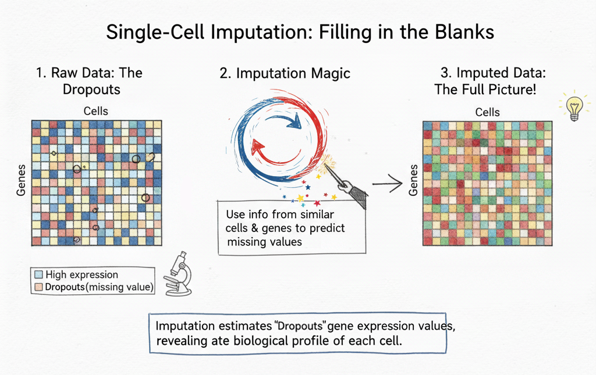
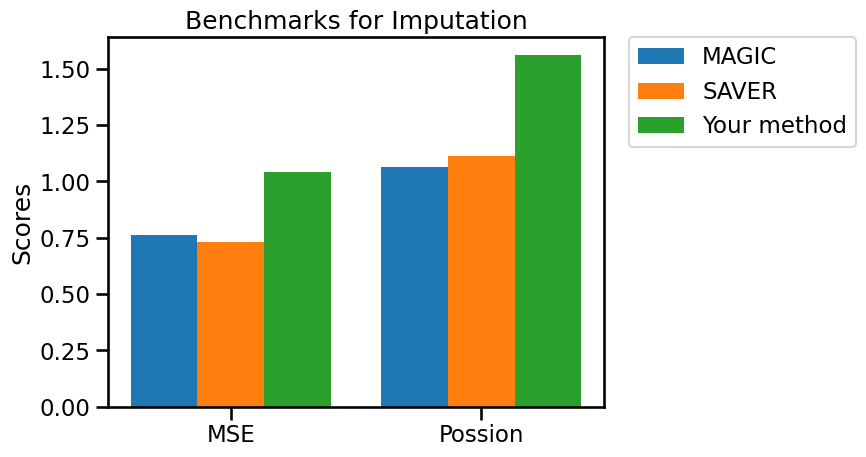
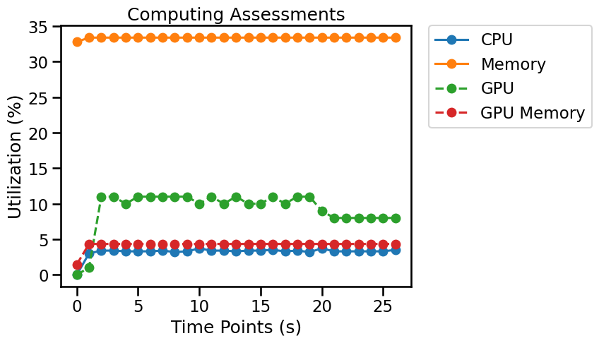

## Overview

Imputation methods estimate expression values obscured by sampling noise in sparse single-cell data. Estimates may improve selected visualizations or analyses, but can also oversmooth real heterogeneity or introduce false gene–gene relationships. Preserve the original counts and validate imputed output against appropriate held-out measurements.



*Single-cell RNA sequencing (scRNA-seq) offers unprecedented insights into individual cells, but its data is often marked by "dropouts"—missing gene expression values due to technical limitations, which can obscure true biological signals. Single-cell Imputation addresses this by computationally estimating these missing values, effectively "filling in the blanks" in the raw data. By inferring likely gene expression based on similar cells and genes, Imputation transforms sparse and noisy datasets into more complete and accurate representations, thereby enhancing the reliability of downstream analyses like clustering and differential expression and allowing for a fuller understanding of cellular biology.*

## Evaluation metrics

Evaluating single-cell RNA sequencing Imputation is challenging due to the lack of ground truth, as existing benchmark methods have limitations that prevent a unified accuracy measure. To address this, molecular cross-validation (MCV) is utilized, a method specifically designed to quantify Imputation accuracy by comparing a denoised training set against a partitioned test set, with demonstrated reliability in representing ground truth accuracy [^1].

A workflow for creating Imputation benchmarks is available on [single-cell.ai](https://www.single-cell.ai/), where training data is stored in `adata.obsm["train"]` and test data in `adata.obsm["test"]`.

- **MSE:** Mean squared prediction error against held-out counts, with the reweighting defined by the benchmark protocol. [^1]
- **Poisson loss:** Agreement between observed held-out counts and the Poisson model implied by denoised predictions; lower loss means better fit when the benchmark reports a loss. [^1]

> **Interpretation:** Benchmark metrics describe different properties. Read them together, check class imbalance and dataset design, and verify whether each reported metric is a raw value or a transformed score.


## Python Packages

Install OSCB with `python -m pip install oscb` (see [Installation](doc/?doc=installation)). All examples use the OSCB [`DataLoader`](doc/?doc=data_loader) and [`eval`](doc/?doc=evaluators) interfaces described in this documentation. **These examples assume you have already generated predictions with your own method.**

### 1. Load a benchmark dataset

```python
from oscb.data import DataLoader

benchmark_id = "IM-h-10x_PBMC-1087-10x-2017"
adata = DataLoader(benchmark_id, data_folder="./datasets/")
```

An example identifier is supplied above. You can use a different ID from the platform's [Benchmarks](doc/?doc=benchmarks) page. Dataset storage locations and matrix layers depend on the downloaded dataset; check the object before analysis rather than assuming `X` always contains raw counts.

### 2. Evaluate predictions on an OSCB benchmark

**Required method output:** An imputed matrix, `adata.layers["denoised"]`, containing cells by genes in the same order as the benchmark input.

```python
from oscb.evaluator import eval

# Replace the method-specific keys/objects with the outputs of your algorithm.
results_dict = eval(adata, benchmarks_id=benchmark_id, denoised=adata.layers["denoised"], method="Your method")
```

When a benchmark ID is provided, the evaluator can compare your method with the existing benchmark results. Availability of plots or supported comparisons may depend on the benchmark.



### 3. Evaluate your own labeled data

A custom imputation benchmark needs the corresponding evaluation setup, including the appropriate training/test split or truth data. A denoised matrix alone does not establish accuracy. Keep input and output gene/cell ordering consistent. Replace the illustrated observation keys and species with values from your data.

```python
from oscb.evaluator import eval

# Replace the method-specific keys/objects with the outputs of your algorithm.
results_dict = eval(adata, task="Imputation", denoised=adata.layers["denoised"], method="Your method")
```

### 4. Save results

```python
from oscb.evaluator import write_json

write_json(results_dict, file_path="./output.json")
```

### 5. Monitor resource utilization (optional)

OSCB's `Monitor` can record CPU/memory use and, when supported, GPU utilization. Start it before your algorithm runs and stop it when processing completes.

```python
from oscb.utilization import Monitor

monitor = Monitor(1)  # Sampling interval in seconds
try:
    # Run your analysis here; the evaluator does not execute your method.
    pass
finally:
    monitor.stop()
```



## References
[^1]: Batson, Joshua, and Loic Royer. "Noise2self: Blind denoising by self-supervision." International conference on machine learning. PMLR, 2019.
