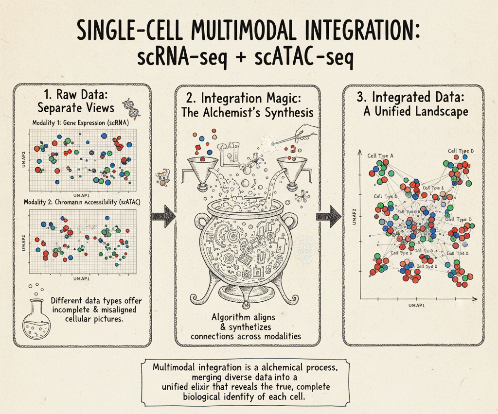
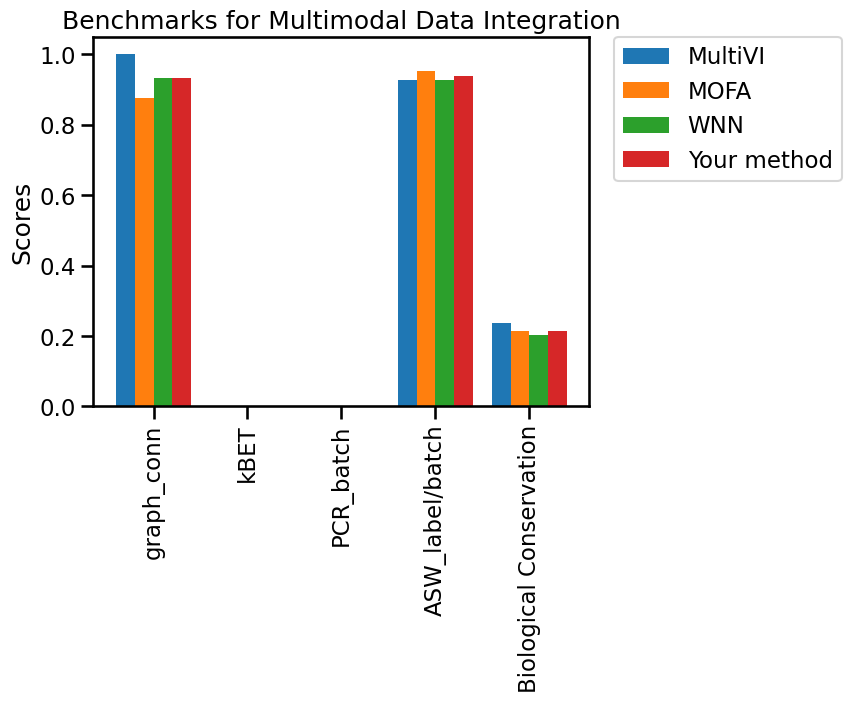
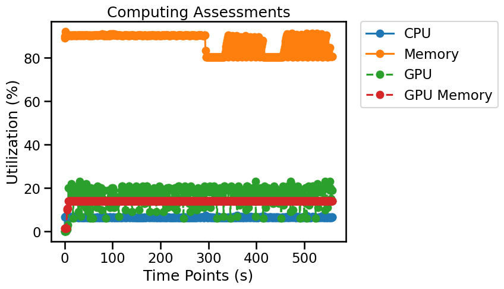

# Multimodal Data Integration

## Overview

Multimodal integration links complementary measurements such as scRNA-seq and scATAC-seq to obtain a joint representation of cellular identity and state. Benchmarking examines biological preservation, technical mixing, and the reliability of alignment across modalities. The requirements differ for paired and unpaired assays.



*Single-Cell Multimodal Data Integration, illustrated by combining scRNA-seq and scATAC-seq data, is a vital bioinformatics process that addresses the limitations of single-assay views. While individual assays provide partial insights—like gene expression (scRNA-seq) or chromatin accessibility (scATAC-seq)—they often present as disconnected datasets ("Raw Data: Separate Views"). Through "Integration Magic: The Alchemist's Synthesis" advanced algorithms align and connect these disparate modalities, identifying shared biological patterns to create a "Unified Landscape" of "Integrated Data." This comprehensive map reveals a more complete biological identity for each cell, enabling holistic downstream analysis by linking gene expression to its underlying regulatory chromatin state.*

## Evaluation metrics

Evaluating the success of Multimodal Data Integration relies on various metrics that assess three key aspects: how effectively batch effects are removed (quantifying the mixing of cells from different technical batches), how well biological signals (including ARI, ASW batch/label, Cell Cycle Conservation, cLISI, HVG overlap, Isolated label ASW, Isolated label F1 score, and NMI) are preserved (ensuring distinct cell types remain separated), and the quality of alignment between corresponding features across modalities. Together, these metrics provide a quantitative framework to compare and optimize different integration algorithms, ensuring the generated "unified landscape" is both technically clean and biologically meaningful.

A workflow for creating Multimodal Data Integration benchmarks is available on [single-cell.ai](https://www.single-cell.ai/), where cell type label and batch key are stored in `mdata.obs`.

- **ARI:** Adjusted Rand index between derived clusters and reference cell-type labels; higher values indicate better agreement. ARI can be negative. [^1]
- **ASW batch/label:** Batch-mixing or biological-label silhouette scores computed from the integrated representation. Interpret the batch and label versions separately. [^1]
- **Cell Cycle Conservation:** Extent to which cell-cycle-associated signal is preserved after integration. [^1]
- **cLISI:** Cell-type local inverse Simpson index; neighborhoods dominated by one type have low cLISI (near 1), supporting cell-type separation. [^1]
- **Graph Connectivity:** Connectivity of same-label cells in the neighborhood graph; higher values indicate better preservation of biological populations. [^1]
- **HVG overlap:** Overlap of highly variable genes before and after integration, where applicable to the method and data representation. [^1]
- **Isolated label ASW:** Separation of labels that appear in few batches; higher values generally indicate better preservation. [^1]
- **Isolated label F1 score:** F1 score for recovering isolated cell populations after integration. [^1]
- **kBET:** Tests local batch mixing. A lower rejection rate generally indicates less detectable batch structure; transformed benchmark scores may reverse the direction. [^2]
- **NMI:** Normalized mutual information between clusters and reference labels; 0–1, with higher agreement being better. [^1]
- **PC Regression:** Proportion of variance in the integrated representation attributable to batch effects; lower raw R² generally suggests better correction. [^1]

> **Interpretation:** Benchmark metrics describe different properties. Read them together, check class imbalance and dataset design, and verify whether each reported metric is a raw value or a transformed score.

## Python Packages

Install OSCB with `python -m pip install oscb` (see [Installation](doc/?doc=installation)). All examples use the OSCB [`DataLoader`](doc/?doc=data_loader) and [`eval`](doc/?doc=evaluators) interfaces described in this documentation. **These examples assume you have already generated predictions with your own method.**

### 1. Load a benchmark dataset

```python
from oscb.data import DataLoader

benchmark_id = "MI-h-sci_CAR_Cell_Line-4739-Cao-2018"
mdata = DataLoader(benchmark_id, data_folder="./datasets/")
```

An example identifier is supplied above. You can use a different ID from the platform's [Benchmarks](doc/?doc=benchmarks) page. Dataset storage locations and matrix layers depend on the downloaded dataset; check the object before analysis rather than assuming `X` always contains raw counts.

### 2. Evaluate predictions on an OSCB benchmark

**Required method output:** A `MuData` object named `mdata` with an integrated embedding at `mdata.obsm["X_multivi"]`.
> **Prerequisite:** Run your integration method first to produce the `mdata` object or embedding used below. These are not created by the evaluator.


```python
from oscb.evaluator import eval

# Replace the method-specific keys/objects with the outputs of your algorithm.
results_dict = eval(mdata=mdata, embedding_key="X_multivi", benchmarks_id=benchmark_id, method="Your method")
```

When a benchmark ID is provided, the evaluator can compare your method with the existing benchmark results. Availability of plots or supported comparisons may depend on the benchmark.



### 3. Evaluate your own labeled data

Confirm that `mdata.mod["rna"]`, the embedding, and any batch or label metadata exist, and that cells are aligned where required. Interpret the results in light of assay pairing and missing modalities. Replace the illustrated observation keys and species with values from your data.

```python
from oscb.evaluator import eval

# Replace the method-specific keys/objects with the outputs of your algorithm.
results_dict = eval(mdata=mdata, task="Multimodal Data Integration", embedding_key="X_multivi", mod1_key="rna", batch_key="batch", label_key="cell_type", species="human", method="Your method")
```

### 4. Save results

```python
from oscb.evaluator import write_json

write_json(results_dict, file_path="./output.json")
```

### 5. Monitor resource utilization (optional)

OSCB's `Monitor` can record CPU/memory use and, when supported, GPU utilization. Start it before your algorithm runs and stop it when processing completes.

```python
from oscb.utilization import Monitor

monitor = Monitor(1)  # Sampling interval in seconds
try:
    # Run your analysis here; the evaluator does not execute your method.
    pass
finally:
    monitor.stop()
```



## References
[^1]: Luecken, M. D., Büttner, M., Chaichoompu, K., Danese, A., Interlandi, M., Mueller, M. F., Strobl, D. C., Zappia, L., Dugas, M., Colomé-Tatché, M., & Theis, F. J. (2021). Benchmarking atlas-level data integration in single-cell genomics. Nature Methods, 19(1), 41–50. https://doi.org/10.1038/s41592-021-01336-8
[^2]: Büttner, M., Miao, Z., Wolf, F. A., Teichmann, S. A., & Theis, F. J. (2018). A test metric for assessing single-cell RNA-seq batch correction. Nature Methods, 16(1), 43–49. https://doi.org/10.1038/s41592-018-0254-1
