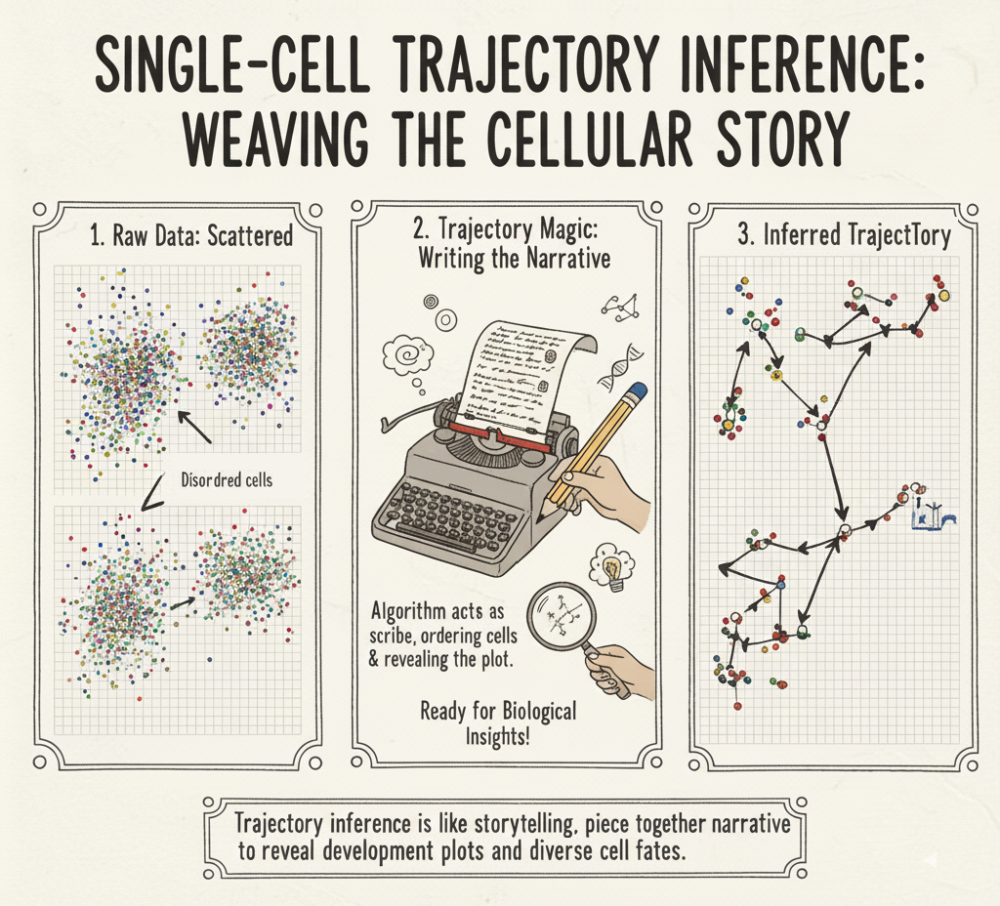
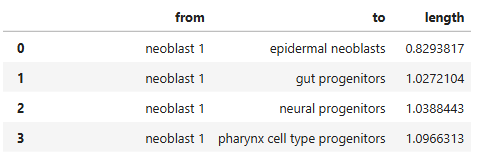
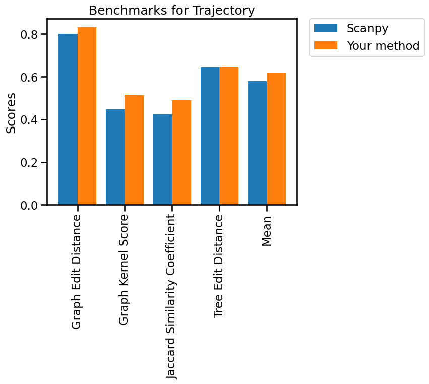
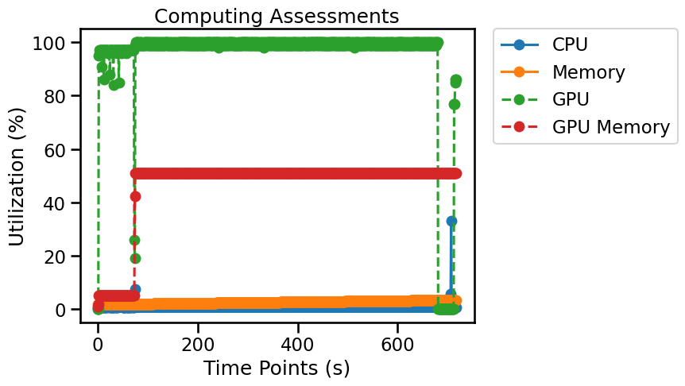

# Trajectory

## Overview

Trajectory inference estimates relationships among cell states across a process such as differentiation. It can suggest branching structure and pseudotime, but a trajectory reconstructed from a single-timepoint sample is not direct observation of lineage direction or cell fate.



*Single-cell trajectory inference is a powerful computational approach used in bioinformatics to reconstruct the continuous biological processes undergone by individual cells, such as differentiation, development, or response to stimuli. Beginning with seemingly scattered individual cell data points, as depicted in the "Raw Data: Scattered Chapters" where cells appear as disordered snapshots, algorithms act as a "scribe," weaving together a coherent narrative by ordering cells along their latent biological progression. This "Trajectory Magic" transforms a static collection of cells into a dynamic "Inferred Trajectory," a roadmap that reveals developmental paths, transient cell states, and the underlying biological storyline, providing crucial insights into cellular differentiation and disease mechanisms.*

## Evaluation metrics

In single-cell trajectory inference, assessing the quality and biological interpretability of the inferred paths is crucial, and this often relies on a variety of metrics. These metrics can be broadly categorized into those that evaluate the topological accuracy of the trajectory (how well it reflects known branching events or temporal ordering), the robustness of the inference to noise or parameter choices, and the biological relevance of the inferred cell states and transitions.

A workflow for creating Trajectory benchmarks is available on [single-cell.ai](https://www.single-cell.ai/), where Cell Type Label is stored in `adata.obs`, Trajectory Label, and Origin Group are in `adata.uns`.

- **Graph Edit Distance:** Cost of transforming an inferred graph into a reference graph using edits; smaller values mean more similar topology. [^1]
- **Graph Kernel Score:** Graph-similarity score derived from graph substructures; interpret direction and normalization according to the evaluator. [^2]
- **Jaccard Similarity Coefficient:** Intersection-over-union similarity of the compared sets of trajectory features. [^3]
- **Tree Edit Distance:** Minimum edit cost between branching trees; smaller values mean more similar topology. [^4]

> **Interpretation:** Benchmark metrics describe different properties. Read them together, check class imbalance and dataset design, and verify whether each reported metric is a raw value or a transformed score.

**Trajectory edge-table format**



## Python Packages

Install OSCB with `python -m pip install oscb` (see [Installation](doc/?doc=installation)). All examples use the OSCB [`DataLoader`](doc/?doc=data_loader) and [`eval`](doc/?doc=evaluators) interfaces described in this documentation. **These examples assume you have already generated predictions with your own method.**

### 1. Load a benchmark dataset

```python
from oscb.data import DataLoader

benchmark_id = "TJ-Planaria-Droplet_Planarian-18837-Mireya-2018"
adata = DataLoader(benchmark_id, data_folder="./datasets/")
```

An example identifier is supplied above. You can use a different ID from the platform's [Benchmarks](doc/?doc=benchmarks) page. Dataset storage locations and matrix layers depend on the downloaded dataset; check the object before analysis rather than assuming `X` always contains raw counts.

### 2. Evaluate predictions on an OSCB benchmark

**Required method output:** An inferred edge table at `adata.uns["trajectory"]` with `from`, `to`, and `length` columns; for custom evaluation, an annotated ground-truth edge table at `adata.uns["benchmark_traj"]`.

```python
from oscb.evaluator import eval

# Replace the method-specific keys/objects with the outputs of your algorithm.
results_dict = eval(adata, benchmarks_id=benchmark_id, traj=adata.uns["trajectory"], method="Your method")
```

When a benchmark ID is provided, the evaluator can compare your method with the existing benchmark results. Availability of plots or supported comparisons may depend on the benchmark.



### 3. Evaluate your own labeled data

Predicted and reference graphs must use matching node identifiers and edge conventions. Select a biologically justified root; topology comparisons do not independently establish the direction of a developmental process. Replace the illustrated observation keys and species with values from your data.

```python
from oscb.evaluator import eval

# Replace the method-specific keys/objects with the outputs of your algorithm.
results_dict = eval(adata, task="Trajectory", traj=adata.uns["trajectory"], bm_traj=adata.uns["benchmark_traj"], root_node="neoblast 1", method="Your method")
```

### 4. Save results

```python
from oscb.evaluator import write_json

write_json(results_dict, file_path="./output.json")
```

### 5. Monitor resource utilization (optional)

OSCB's `Monitor` can record CPU/memory use and, when supported, GPU utilization. Start it before your algorithm runs and stop it when processing completes.

```python
from oscb.utilization import Monitor

monitor = Monitor(1)  # Sampling interval in seconds
try:
    # Run your analysis here; the evaluator does not execute your method.
    pass
finally:
    monitor.stop()
```



## References
[^1]: Sanfeliu, Alberto; Fu, King-Sun (1983). "A distance measure between attributed relational graphs for pattern recognition". IEEE Transactions on Systems, Man, and Cybernetics. 13 (3): 353–363. doi:10.1109/TSMC.1983.6313167. S2CID 1087693.
[^2]: S.V. N. Vishwanathan; Nicol N. Schraudolph; Risi Kondor; Karsten M. Borgwardt (2010). "Graph kernels". Journal of Machine Learning Research. 11: 1201–1242.
[^3]: [Wikipedia entry for the Jaccard index](https://en.wikipedia.org/wiki/Jaccard_index#Jaccard_index_in_binary_classification_confusion_matrices).
[^4]: T. Hütter, M. Pawlik, R. Löschinger, N. Augsten. Effective Filters and Linear Time Verification for Tree Similarity Joins. ICDE, 2019.
