# Annotate mouse bone marrow scRNA-seq data

**Tutorial · Annotation workflow · Mouse bone marrow**

This tutorial walks through a complete cell-type annotation workflow in **single-cell.ai**: selecting a query dataset and an annotated reference, performing quality control (QC), comparing batch-integration and annotation methods, examining interactive visualizations, and refining predicted labels. The example uses mouse bone marrow single-cell RNA-seq data from wild-type (WT) and *Sphk2*−/− mice studied under uninfected and lymphocytic choriomeningitis virus (LCMV) Clone 13–infected conditions.[^1]

**What you will learn**

1. Prepare query and reference datasets for annotation.
2. Configure QC, integration, cell-type annotation, and visualization.
3. Submit and monitor a workflow job.
4. Inspect outputs, compare methods, and manually review cell-type assignments.
5. Use the AI Assistant as an aid—not a substitute—for biological validation.

> **Important: cross-species model compatibility.** The `Immune_All_Low.pkl` model of CellTypist is trained on **human** immune cells and converted with validated human–mouse ortholog mapping before interpreting its predictions.[^12]

## Before you begin

You should have access to the **Annotation** workflow in single-cell.ai and the following data:

| Dataset | Example selection | Requirements |
| --- | --- | --- |
| Query | **Marrow**, approximately **19,448 cells** | Mouse bone marrow scRNA-seq data; a raw-count matrix is preferred for workflows that perform their own preprocessing. |
| Reference | **droplet_Marrow**, approximately **3,360 cells**[^2] | Mouse bone marrow data with curated cell-type labels and compatible gene identifiers. |
| Batch metadata | `Batch` | A populated observation column that identifies the experimental batch or sample group. |
| Reference label field | `cell_ontology_class` | A reference observation column containing meaningful cell-type labels. |

**Before submitting:** confirm that the query and reference use the same species, that gene identifiers are compatible, and that the selected batch and label columns actually exist. Metadata field names and available datasets can differ between installations.

## Workflow at a glance

Navigate to **Analyses → Workflows → Annotation**. The workflow has four main configuration sections: **Quality Control**, **Integration**, **Annotation**, and **Visualization**.

| Stage | Settings used in this example | What to check |
| --- | --- | --- |
| Input | `Marrow` (mouse) | Choose the intended expression matrix, preferably unnormalized counts. |
| Reference | `droplet_Marrow` (mouse) | Check that the reference is annotated and biologically relevant. |
| QC | `Scanpy`; initial/default settings | Inspect QC distributions before accepting thresholds. |
| Integration | `Seurat`, `Harmony`, `LIGER`, `scVI`; batch key `Batch` | Compare embeddings; do not remove biologically meaningful variation. |
| Pseudo-replicates | `3` in the illustrated pooled-sample example | Use only as supported by the workflow; pseudo-replicates are **not** independent animals. |
| Annotation | `CellTypist`, `scANVI`, `SingleR` | Choose a species-compatible CellTypist model and a labeled reference for scANVI. |
| SingleR reference | `mouse_rnaseq` | Suitable as an initial, typically lower-resolution mouse reference.[^13] |
| User reference labels | `cell_ontology_class` | The label column must be present in the reference metadata. |
| Visualization | Leiden resolution `1`; heatmap HVGs `50` | Review both cluster structure and gene expression. |

The settings shown are **illustrative**, not universally optimal. Dataset quality, cell composition, tissue, sequencing depth, and experimental design should guide parameter selection.

---

## Step 1. Select the input dataset

1. Open the **Datasets** selector in the annotation job form.
2. Use **Species**, **Organ Part**, the search field, or sortable table headers to find **Marrow**.
3. Confirm that the selected row is the **mouse** dataset with an estimated **19,448 cells**, then tick its checkbox.
4. If the dataset contains multiple processing stages, expand the row using **+** and select the appropriate data layer. Prefer raw, unnormalized counts when the workflow will perform QC, normalization, or count-based modeling.
5. Click **Select** to confirm.

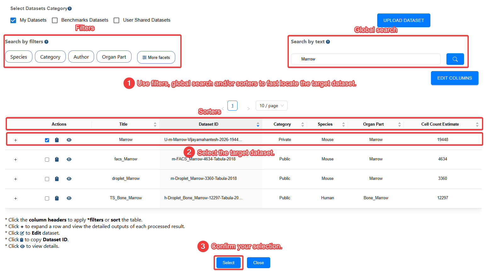

*Figure 1. Find and confirm the query dataset.*

> **Tip:** To upload your own data, see [Data Management](doc/?doc=data_management). Verify that cell and gene identifiers, species, and metadata were imported correctly before proceeding.

## Step 2. Select an annotated reference dataset

1. Open the **Reference Datasets** selector.
2. Search for **droplet_Marrow**, a mouse marrow reference from the Tabula Muris project.[^2]
3. Confirm **Species: Mouse** and **Organ Part: Marrow**, select the reference, and click **Select**.
4. Check that its reference annotations include `cell_ontology_class` or another suitable label column.

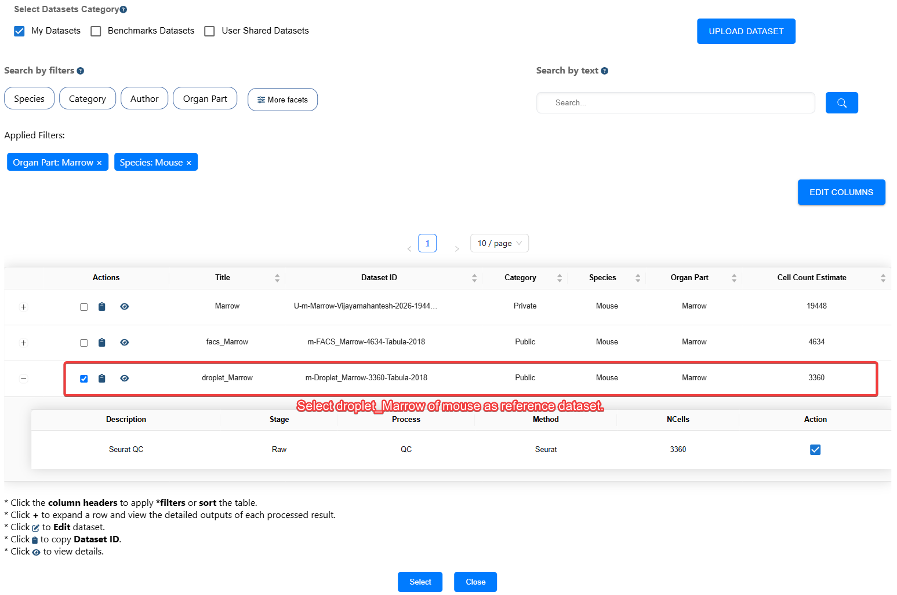

*Figure 2. Select a labeled reference from a biologically related tissue.*

**Why reference choice matters:** Accurate label transfer depends on matching species, tissue, cell populations, gene identifiers, and sufficiently compatible sequencing assays. An unrelated or incomplete reference can produce confident-looking but incorrect labels. Some cell states, particularly those induced by infection, may be absent from the reference.

## Step 3. Configure quality control

In **Quality Control (QC)**, choose **Scanpy** from the available methods (which may also include Bioconductor, Seurat, and Dropkick). The workflow accepts **one QC method at a time**. Start with the displayed defaults, then adjust based on the dataset's actual distributions.[^3][^4][^5][^6]

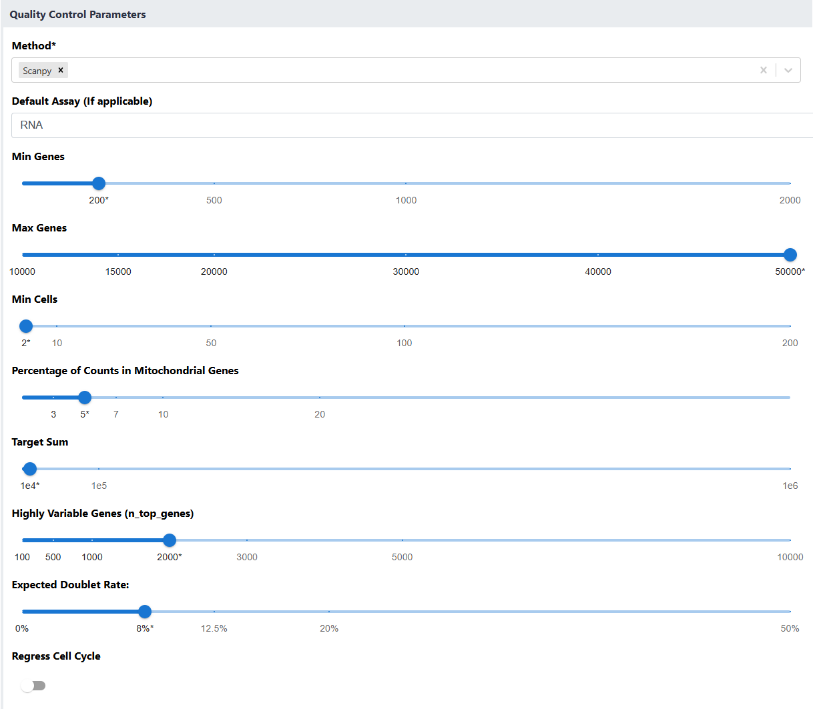

*Figure 3. Configure QC and review the displayed parameter values.*

### How to choose QC parameters

| Parameter | Purpose | Practical guidance |
| --- | --- | --- |
| `min_genes` | Filters cells with very few detected genes. | A threshold around **200–500** is a common starting point for droplet data, not a fixed rule. |
| `max_genes` | Flags cells with unusually many genes, which can be enriched for multiplets. | Set from the distribution for this tissue and chemistry. High-complexity cells can also be biologically genuine. |
| `min_cells` | Removes genes detected in very few cells. | **3–20** expressing cells can be a starting range; avoid discarding rare but informative features without review. |
| Mitochondrial count percentage | Helps identify damaged or stressed cells. | Evaluate the distribution and tissue biology; **5–20%** is often considered, but no universal cutoff is appropriate. |
| Highly variable genes (HVGs) | Selects genes informative for downstream representation learning. | Too few can omit cell states; too many may add noise. |
| Expected doublet rate | Helps doublet-detection methods estimate multiplet frequency. | Base this on capture chemistry, cell loading, and the number of recovered cells; confirm whether the chosen pipeline flags or removes doublets. |
| Regress cell cycle | Optionally reduces cell-cycle-associated signal. | Use only if cell cycle is a nuisance variable. It can also be biologically relevant, especially in marrow. |

**Interpret the QC output before moving on.** Examine distributions of genes per cell, counts per cell, mitochondrial fractions, and flagged doublets/outliers. Too-aggressive filtering can remove important populations, including activated or proliferating cells.

### Get help from the AI Assistant

Open the **AI Assistant** to ask for tissue-aware suggestions—for example, whether a mitochondrial threshold is suitable for bone marrow. Provide relevant context such as species, chemistry, and the observed QC distributions. Treat AI recommendations as hypotheses to evaluate, not automatic thresholds.

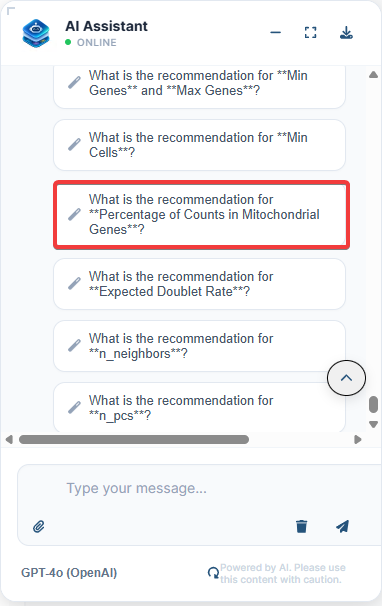

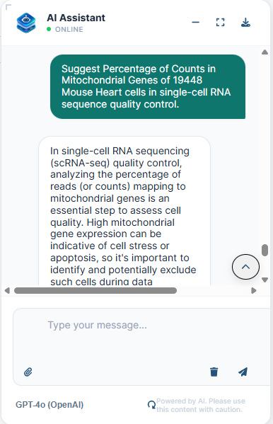

*Figure 4. Example AI-assisted parameter exploration.*

## Step 4. Configure integration

Integration helps compare cells across samples or batches while controlling technical variation. The platform offers **Seurat**, **Harmony**, **LIGER**, and **scVI**.[^5][^7][^8][^9]

1. Select the integration methods to compare. The example selects all four methods; selecting fewer can reduce compute time.
2. Set **Batch Key** to `Batch` (matching the column name in the query's cell metadata).
3. For the illustrated experiment, set **Pseudo Replicates** to `3` only if this matches the intended interpretation of the three pooled mice per batch in your workflow implementation. For non-pooled samples, use the default `0` unless there is a documented reason to change it.
4. Verify that the batch categories reflect the experiment before submitting.

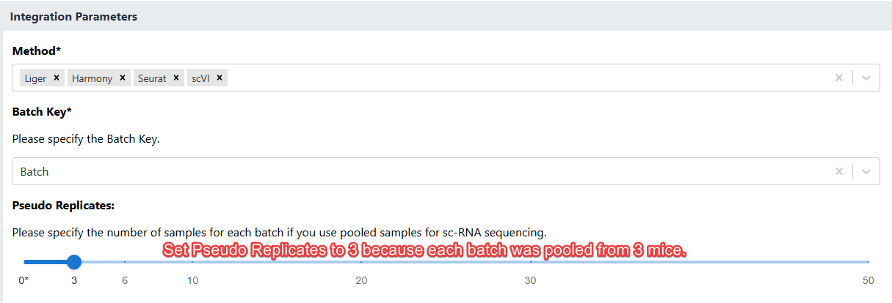

*Figure 5. Select integration methods and the batch variable.*

> **Interpretation warning:** A pseudo-replicate partitions or resamples data; it **does not recreate the identities of individual animals** in a pooled sample, increase the number of independent biological replicates, or support donor-level statistical inference. Do not treat pseudo-replicates as independent mice when reporting variability or p-values. Also examine whether integration inadvertently removes infection-, genotype-, or cell-state-related biological differences.

## Step 5. Configure cell-type annotation

The workflow supports multiple annotation methods. Using several methods can help reveal disagreements, but **agreement is not proof of correctness**.

| Method | Role | Example setting |
| --- | --- | --- |
| **CellTypist**[^10] | Classifies cells using a pretrained or custom model. | The screenshot shows `Immune_All_Low.pkl`; **convert it for mouse orthologs or choose a compatible model** before interpreting mouse labels. |
| **SingleR**[^11] | Transfers labels by comparing expression profiles with a reference. | `mouse_rnaseq` (mouse reference; usually best treated as an initial lower-resolution assessment).[^13] |
| **scANVI**[^14] | Semi-supervised annotation using labeled reference cells. | Select a labeled reference dataset and its label column. |

1. In **Method**, select **CellTypist**, **scANVI**, and **SingleR** as appropriate.
2. In **CellTypist Model**, select a species-compatible model. If you are reproducing the interface shown below, be aware that `Immune_All_Low.pkl` is human-trained; it is converted to mouse model with validated human–mouse ortholog mapping.[^12]
3. In **SingleR Reference**, choose `mouse_rnaseq`.
4. In **User's Reference Labels**, choose `cell_ontology_class`, provided that the selected reference includes this column.
5. Verify that the reference dataset and its labels are supplied for **scANVI**; a labeled reference is required for this use of the method.

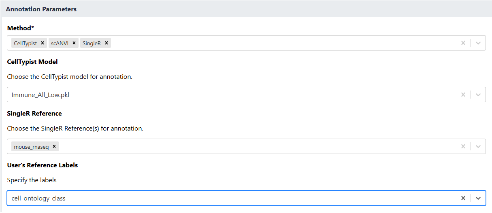

*Figure 6. Annotation controls. The displayed CellTypist model requires a species-compatibility check for this mouse example.*

**Expected labels:** Depending on the methods run and whether a user-provided reference is used, the workflow can add fields such as `celltypist_label`, `celltypist_ref_label`, `SingleR_main`, `SingleR_fine`, `SingleR_user_ref`, and `scANVI_predicted` to `AnnData.obs`. The exact columns depend on completed methods and software versions.

For model and reference details, see the [CellTypist model catalog](https://www.celltypist.org/models) and the [celldex reference guide](https://bioconductor.org/packages/release/data/experiment/vignettes/celldex/inst/doc/userguide.html).

## Step 6. Configure visualizations

Use the **Visualization** section to control neighborhood graphs, clustering, and gene-expression views.

1. Adjust **`n_neighbors`** to control the neighborhood scale used in graph construction and, depending on the pipeline, UMAP.
2. Adjust **`n_pcs`** to choose how many principal components are retained for downstream analysis.
3. Set **Resolution** to `1` for the illustrated Leiden-clustering example.
4. Set **Number of Highly Variable Genes for Heatmap** to `50`.
5. Optionally select **Cluster Column Name** if you want the annotation panel to use an existing cluster assignment instead of the default Leiden clusters.

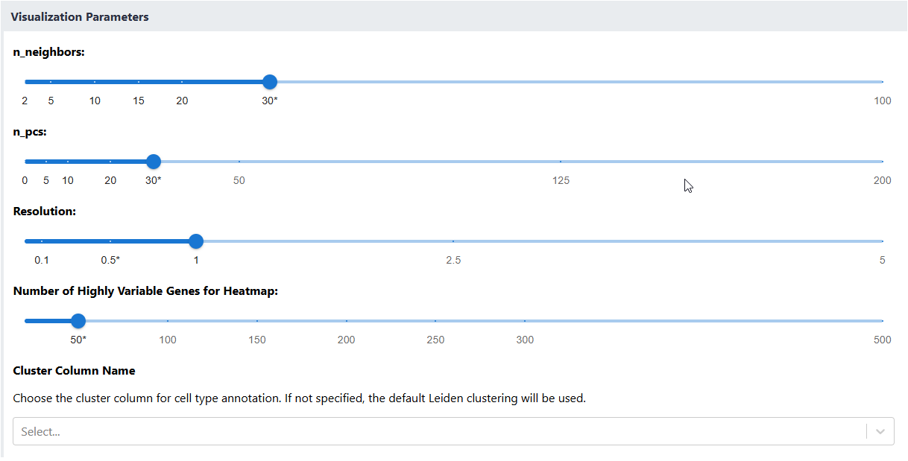

*Figure 7. Configure dimensionality reduction, clustering, and heatmap settings.*

| Setting | Effect of lower values | Effect of higher values |
| --- | --- | --- |
| `n_neighbors` | More local structure; possibly fragmented neighborhoods | Broader neighborhoods; possibly smoother global structure |
| `n_pcs` | May miss biological variation | May preserve additional signal **and** noise |
| `Resolution` | Usually fewer, broader Leiden clusters | Usually more, finer Leiden clusters |

The heatmap setting selects **50 highly variable genes** in this example. HVGs are not necessarily the same as statistically significant, cluster-specific marker genes. Validate candidate markers separately when making biological claims.

---

## Step 7. Submit and monitor the job

After checking all selected datasets, models, and parameters, submit the workflow. Jobs run asynchronously on the backend, so you may navigate away after submission.

1. Open **My Jobs** to locate the annotation task.
2. Use the available search, filters, and sort controls to find your job.
3. Open **Job Details** to review **Dataset Information**, **Execution Details**, and **Live Logs**.
4. If the workflow fails, review the error report and relevant logs. When offered, use the issue-reporting action to create a GitHub issue containing the non-sensitive diagnostic information needed for investigation.

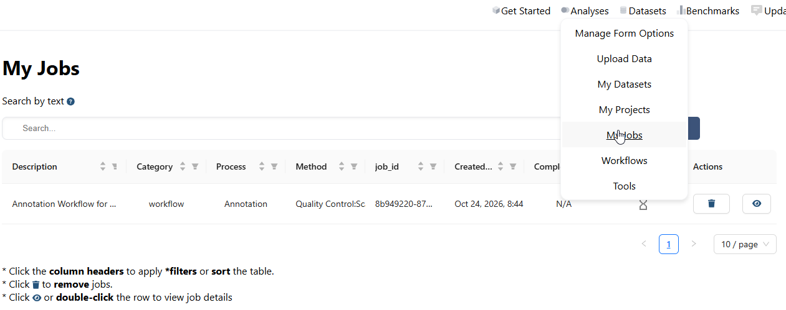

*Figure 8. Find the submitted workflow in My Jobs.*

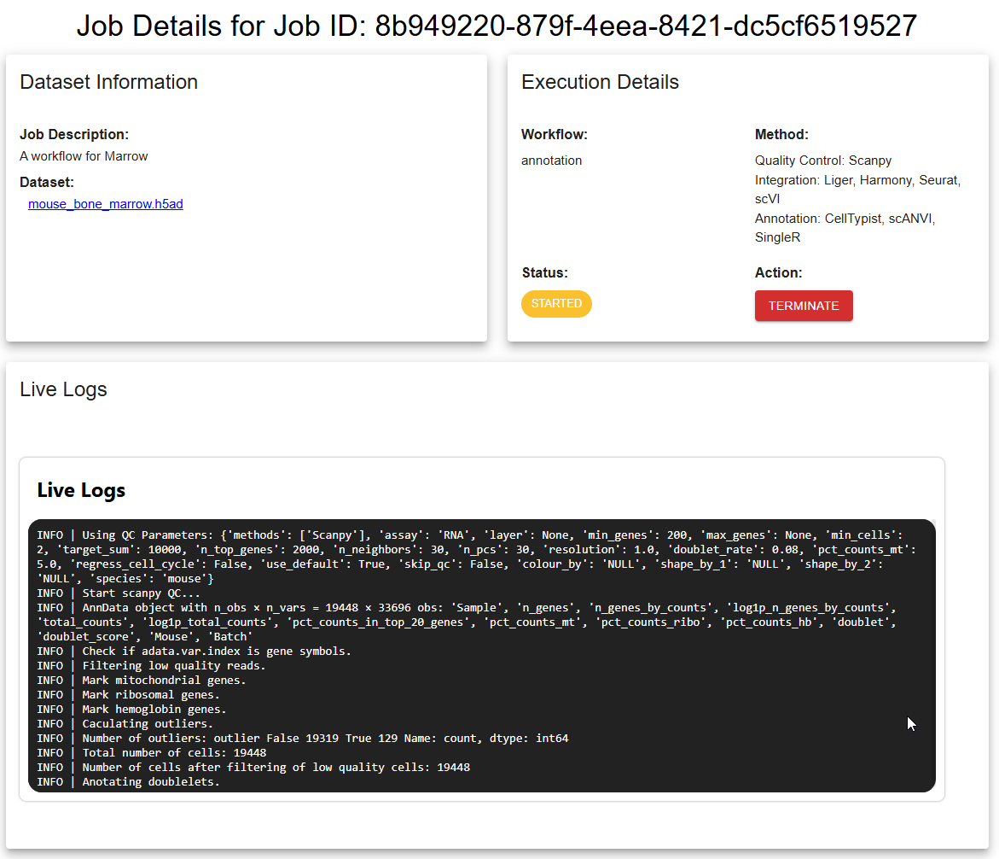

*Figure 9. Review execution progress and diagnostics.*

**Result reuse:** To avoid redundant computation, the platform may reuse previously generated outputs when its content- and parameter-based fingerprint matches an existing result. Cached output reuse is separate from scientific validation: always confirm that the dataset, method, software context, and parameter settings are the ones you intended.

## Step 8. Review and download results

A completed workflow exposes output datasets, static figures, and detailed interactive views for individual processes. The example produces one output for each selected integration method, such as `LIGER_integration_annotation.h5ad`, `HARMONY_integration_annotation.h5ad`, `SEURAT_integration_annotation.h5ad`, and `SCVI_integration_annotation.h5ad`.

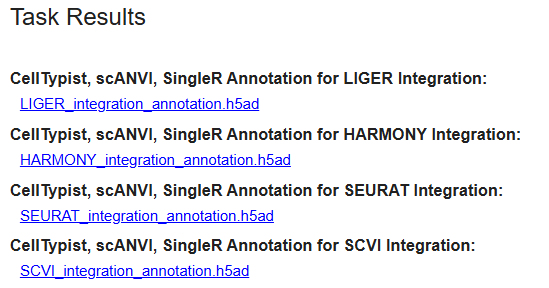

*Figure 10. Download an integration-and-annotation result.*

### Where information is stored

The workflow typically exports **AnnData** (`.h5ad`) or, where applicable, **MuData** (`.h5mu`) objects. Inspect the specific output rather than assuming every field is present.

| Information | AnnData location | Notes |
| --- | --- | --- |
| Cell-level metadata and predicted labels | `adata.obs` | Example label fields include `celltypist_label` and `scANVI_predicted`. |
| Gene-level metadata | `adata.var` | Contains gene information available in the exported object. |
| Raw counts | `adata.layers["raw_counts"]` **if present** | Confirm that raw counts were retained; do not assume `adata.X` is raw counts. |
| Learned embeddings | `adata.obsm` | Harmony/scVI representations, UMAP, t-SNE, or PCA may be stored here. |
| Main expression matrix | `adata.X` | Its contents depend on how the processing method exports its result. |

For example, to inspect a downloaded H5AD file in Python:

```python
import scanpy as sc

adata = sc.read_h5ad("SCVI_integration_annotation.h5ad")
print("Cells × genes:", adata.shape)
print("Cell annotations:", list(adata.obs.columns))
print("Available layers:", list(adata.layers.keys()))
print("Available embeddings:", list(adata.obsm.keys()))
```

You can use **Tools → Formatting → Convert** when you need a different supported data format.

### Compare annotation figures

Open **Figures** to compare the static embedding plots produced by each integration/annotation combination. Look for consistency between cell-type labels, plausible cluster boundaries, and biologically interpretable differences among experimental groups.

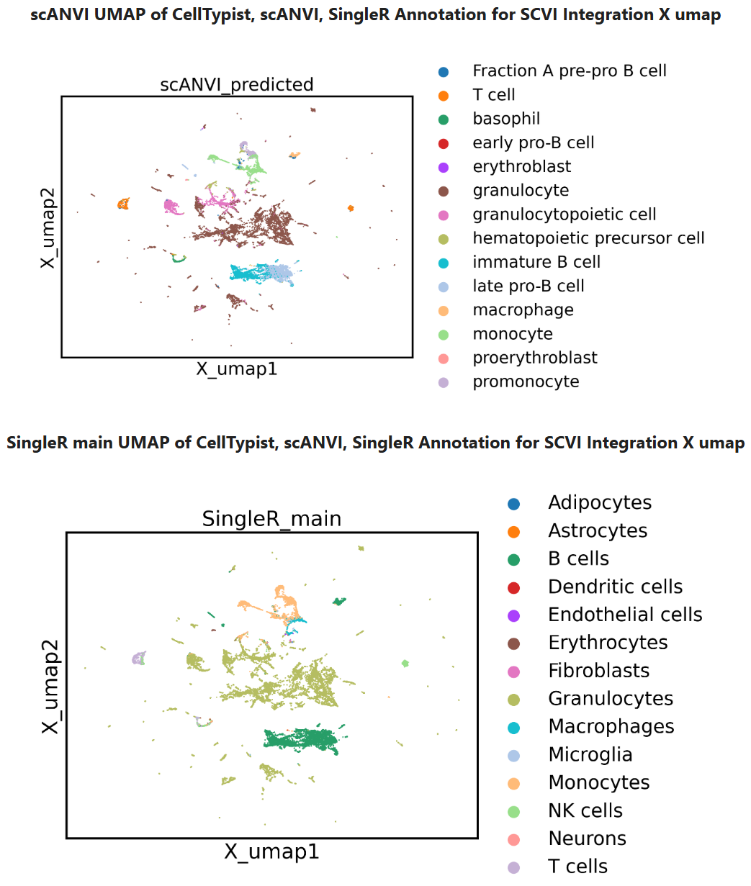

*Figure 11. Compare label assignments across analysis methods.*

### Open a process-level result

Under **Details for Each Method**, open a specific process, such as **CellTypist, scANVI, SingleR Annotation for SCVI Integration**. You can inspect its **Stage**, **Process**, **Method**, **Parameters**, **Tools**, and **Files**. Revisit these details when comparing results, reproducing the analysis, or diagnosing a failed stage.

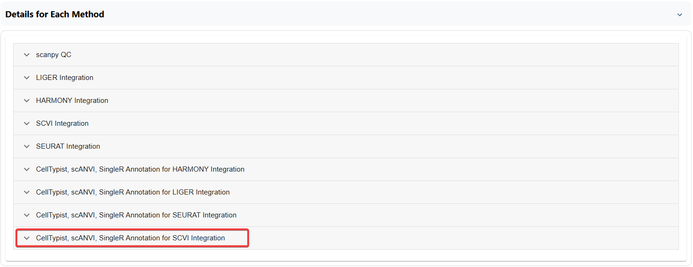

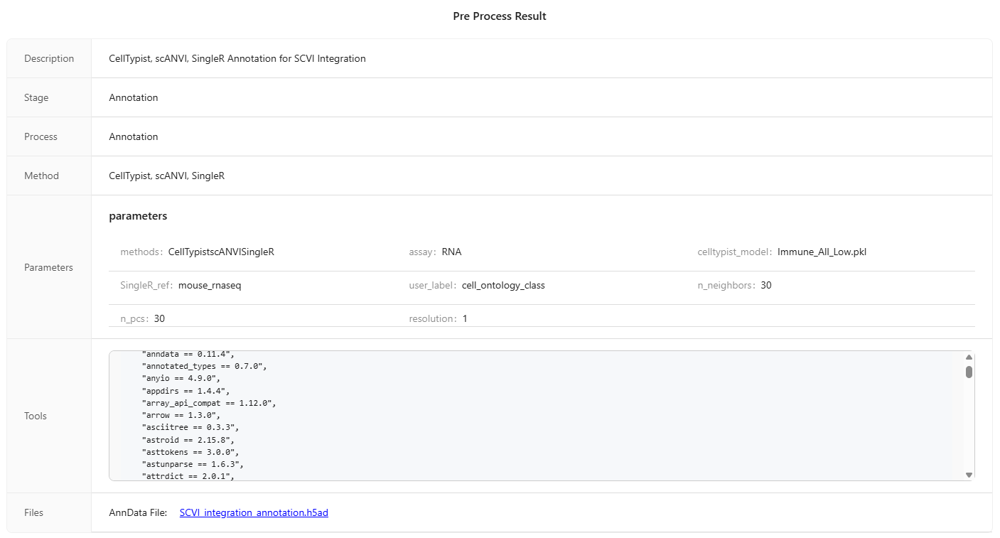

*Figure 12. Inspect the configuration and output of a particular processing stage.*

### Explore interactive UMAP and t-SNE plots

Open the interactive **UMAP** or **t-SNE** views. Use the **Color** dropdown to switch among cluster identifiers, predicted cell types, and available metadata fields. Where supported, change between 2D and 3D views to explore spatial relationships.

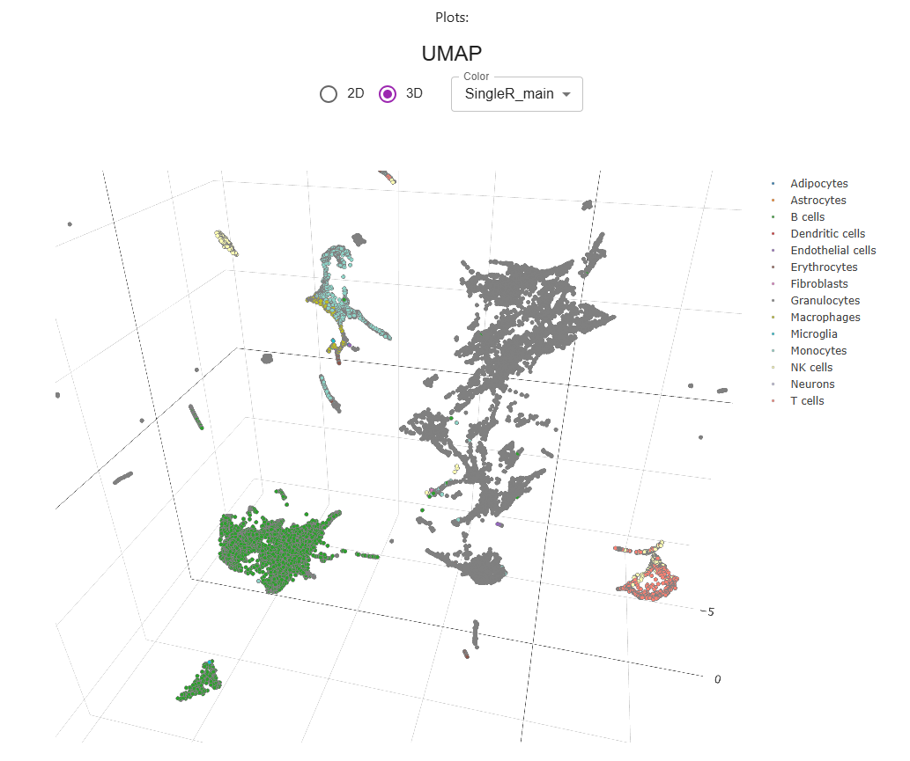

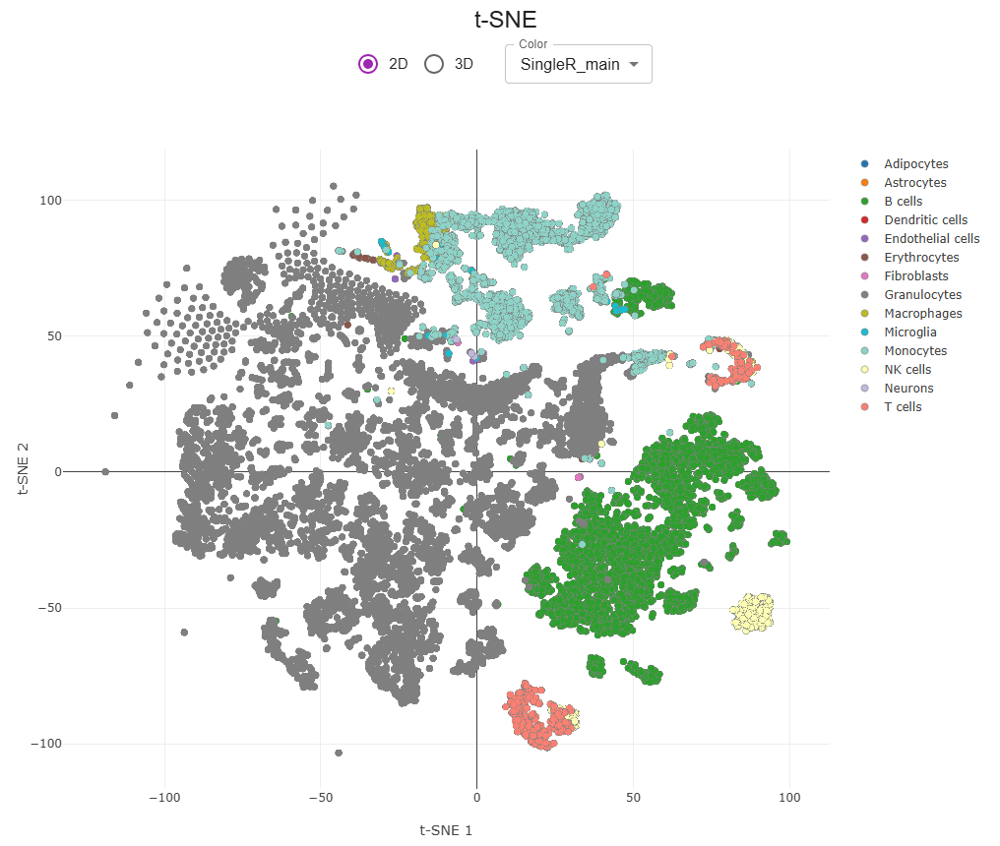

*Figure 13. Explore embeddings while switching between available annotation fields.*

**Interpretation tip:** Proximity in a UMAP or t-SNE plot does not by itself establish biological similarity, lineage, or statistically significant differences. Compare gene expression and sample composition as well.

### Validate annotations with gene expression

The **Gene Expression** panel combines an embedding view, **Cell Sets**, **Cell Set Sizes**, a **Heatmap**, and a **Gene List**. Switch among annotation results and check whether cell-type assignments agree with known marker genes and plausible cell proportions.

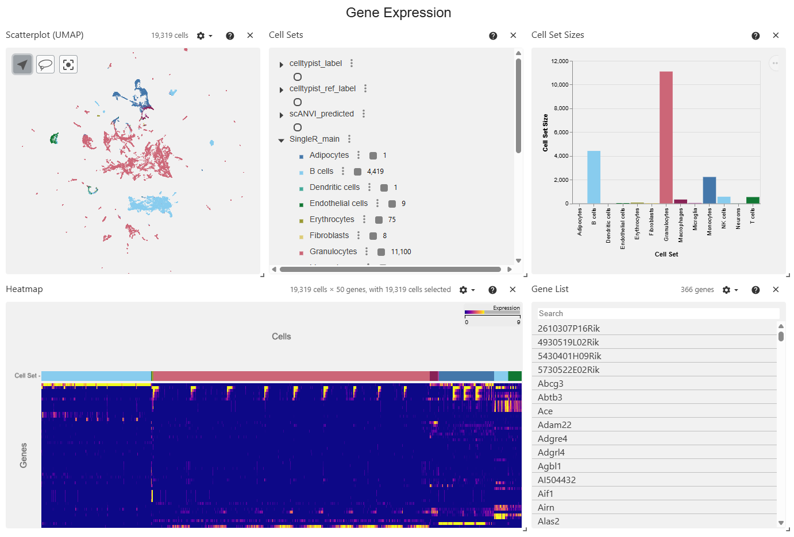

*Figure 14. Evaluate candidate cell types using expression and composition.*

A useful validation pass includes checking:

- Whether the reference contains the expected marrow cell types and infection-associated states.
- Whether known marker genes support the proposed cell identity.
- Whether closely related cell types are consistently distinguished across methods.
- Whether low-confidence or conflicting labels need further investigation.
- Whether apparent differences among WT, infected, and *Sphk2*−/− groups remain plausible after batch integration.

### Review and refine manual annotations

Open **Manual Annotation** to review the cluster-level table. Depending on the workflow output, it includes a proposed consensus or majority-vote `cell_label`, predictions from individual methods, and available confidence-related fields.

1. Sort or filter columns to find uncertain, conflicting, or unusual assignments.
2. Compare the proposed labels with the gene-expression views and known cell markers.
3. Edit a cluster's **cell_type** when the evidence supports a more appropriate assignment. If the option is available, enter a new cell-type name that is missing from the dropdown.
4. Delete an inappropriate row when required, or use **Restore Deleted Rows** to reverse a removal.
5. Use the panel's available save/submit action to apply and preserve supported changes.

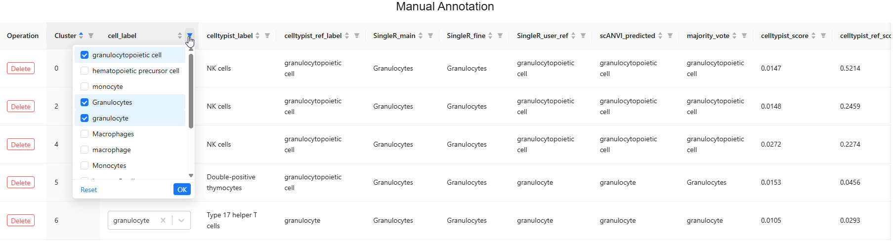

*Figure 15. Manual Annotation table with majority-vote cell labels, method predictions, and edit controls.*

**Do not interpret majority vote as confidence calibration.** Several tools can agree because they share a biased or incomplete reference. Document why labels were revised and keep the original predictions for comparison.

## Step 9. Use the AI Assistant to support interpretation

The **AI Assistant** connects workflow context with a chat interface. In the illustrated annotation workflow, the assistant can receive gene information (including lists of highly variable genes associated with clusters, as supplied by the platform). You can also provide experimental context or upload relevant literature when the interface supports it.

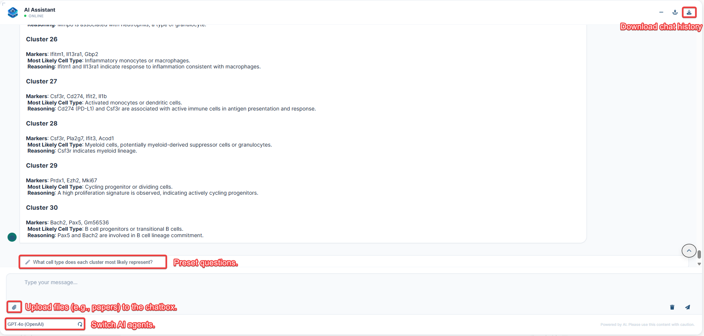

*Figure 16. Ask for interpretations grounded in cluster-level evidence.*

Useful prompts include:

- "Which candidate mouse bone marrow cell types match these genes, and which markers would distinguish them?"
- "Why do CellTypist, SingleR, and scANVI disagree on this cluster?"
- "Could this cluster reflect an activated or infection-associated state rather than a new cell type?"
- "What orthogonal evidence should I examine before changing the annotation?"

**Best practice:** Verify AI-generated suggestions against expression plots, appropriate references, and the original literature. Avoid sharing unpublished or restricted datasets with an external model unless authorized by your project's data-governance rules. Download the conversation history where supported for review and documentation.

## Annotation report

A sample annotation report could be found at [here](doc/doc=sample_report). 

---

## Troubleshooting

| Problem | What to check |
| --- | --- |
| Cannot locate the query dataset | Dataset category, access permissions, species/organ filters, and search term. |
| scANVI cannot start | An annotated reference was selected; the label column exists, has valid values, and matches the intended reference. Check execution logs for environment or resource errors. |
| Many cells have unexpected labels | Reference species and tissue; compatible gene symbols; CellTypist model species; missing cell types; overly aggressive QC. |
| `Batch` cannot be selected | Confirm the query's `obs` has a populated `Batch` column or use the actual batch metadata field. |
| Different integration methods disagree | Compare embeddings and marker expression; check whether important genotype or infection signals were overcorrected. |
| Heatmap does not show expected marker genes | Its setting selects HVGs, which need not correspond to cell-type-specific marker genes. |
| No figure or output appears | Confirm job completion, expand the relevant process, and review its logs and output links. |
| Manual edits cannot be found | Check that the panel's available save/submit action was used and inspect the result version. |

## Completion checklist

- [ ] Query data and reference annotations are species- and gene-compatible.
- [ ] QC thresholds were reviewed against the observed cell distributions.
- [ ] Batch settings reflect technical and biological sample structure.
- [ ] A mouse-compatible CellTypist model or validated ortholog conversion was used.
- [ ] Cell-type assignments were evaluated using markers, expression plots, and reference coverage.
- [ ] Suspected disagreements or uncertain labels were reviewed manually.
- [ ] Job parameters, exported results, and any annotation revisions were retained.

## References

[^1]: Vijayamahantesh V, He Y, Jiang L, et al. (2026). Sphingosine kinase 2 suppresses neutrophil responses to promote viral persistence while attenuating immune pathology. *Frontiers in Immunology* 16:1706967. [doi:10.3389/fimmu.2025.1706967](https://doi.org/10.3389/fimmu.2025.1706967).
[^2]: Tabula Muris Consortium (2020). A single-cell transcriptomic atlas characterizes ageing tissues in the mouse. *Nature* 583:590–595. [doi:10.1038/s41586-020-2496-1](https://doi.org/10.1038/s41586-020-2496-1).
[^3]: Huber W, Carey VJ, Gentleman R, et al. (2015). Orchestrating high-throughput genomic analysis with Bioconductor. *Nature Methods* 12:115–121. [doi:10.1038/nmeth.3252](https://doi.org/10.1038/nmeth.3252).
[^4]: Wolf FA, Angerer P, Theis FJ (2018). SCANPY: large-scale single-cell gene expression data analysis. *Genome Biology* 19:15. [doi:10.1186/s13059-017-1382-0](https://doi.org/10.1186/s13059-017-1382-0).
[^5]: Satija R, Farrell JA, Gennert D, et al. (2015). Spatial reconstruction of single-cell gene expression data. *Nature Biotechnology* 33:495–502. [doi:10.1038/nbt.3192](https://doi.org/10.1038/nbt.3192).
[^6]: Heiser CN, Wang VM, Chen B, et al. (2021). Automated quality control and cell identification of droplet-based single-cell data using dropkick. *Genome Research* 31:1742–1752. [doi:10.1101/gr.271908.120](https://doi.org/10.1101/gr.271908.120).
[^7]: Korsunsky I, Millard N, Fan J, et al. (2019). Fast, sensitive and accurate integration of single-cell data with Harmony. *Nature Methods* 16:1289–1296. [doi:10.1038/s41592-019-0619-0](https://doi.org/10.1038/s41592-019-0619-0).
[^8]: Liu J, Gao C, Sodicoff J, et al. (2020). Jointly defining cell types from multiple single-cell datasets using LIGER. *Nature Protocols* 15:3632–3662. [doi:10.1038/s41596-020-0391-8](https://doi.org/10.1038/s41596-020-0391-8).
[^9]: Gayoso A, Lopez R, Xing G, et al. (2022). A Python library for probabilistic analysis of single-cell omics data. *Nature Biotechnology* 40:163–166. [doi:10.1038/s41587-021-01206-w](https://doi.org/10.1038/s41587-021-01206-w).
[^10]: Domínguez Conde C, Xu C, Jarvis LB, et al. (2022). Cross-tissue immune cell analysis reveals tissue-specific features in humans. *Science* 376:eabl5197. [doi:10.1126/science.abl5197](https://doi.org/10.1126/science.abl5197).
[^11]: Aran D, Looney AP, Liu L, et al. (2019). Reference-based analysis of lung single-cell sequencing reveals a transitional profibrotic macrophage. *Nature Immunology* 20:163–172. [doi:10.1038/s41590-018-0276-y](https://doi.org/10.1038/s41590-018-0276-y).
[^12]: CellTypist development team. [Cross-species model conversion](https://github.com/Teichlab/celltypist#cross-species-model-conversion), official documentation. The human-trained `Immune_All_Low.pkl` model can be converted with an appropriate ortholog mapping.
[^13]: celldex. [Mouse RNA-seq reference](https://bioconductor.org/packages/release/data/experiment/vignettes/celldex/inst/doc/userguide.html#mouse-rna-seq), Bioconductor reference guide.
[^14]: Xu C, Lopez R, Mehlman E, et al. (2021). Probabilistic harmonization and annotation of single-cell transcriptomics data with deep generative models. *Molecular Systems Biology* 17:e9620. [doi:10.15252/msb.20209620](https://doi.org/10.15252/msb.20209620).
