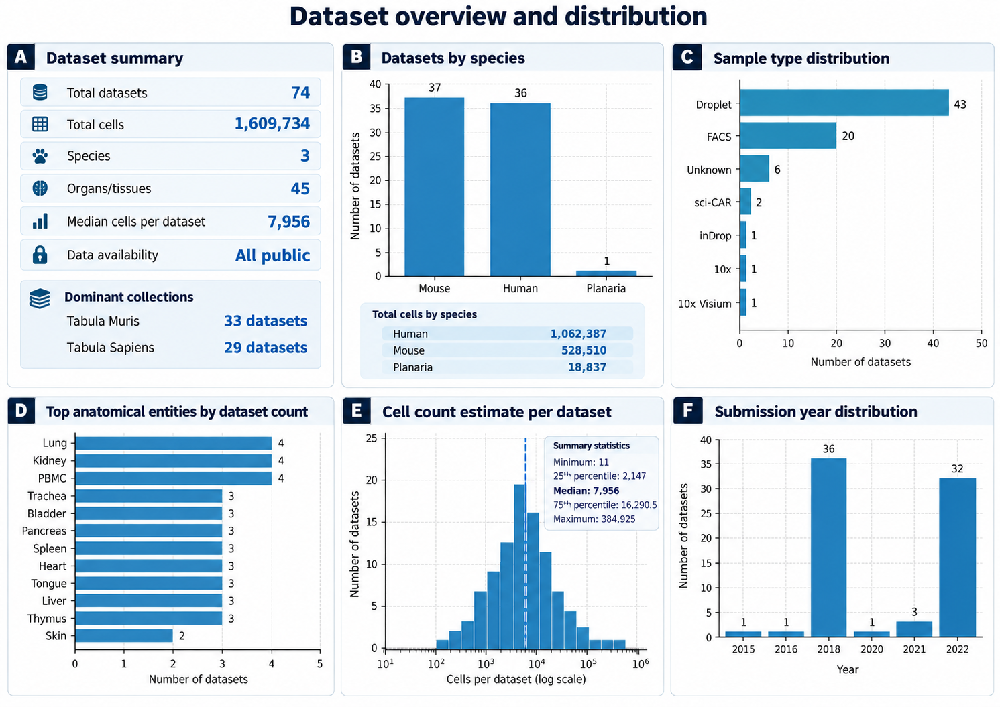
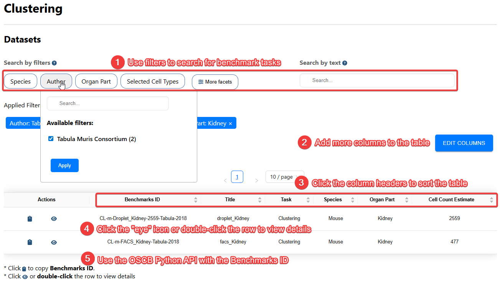
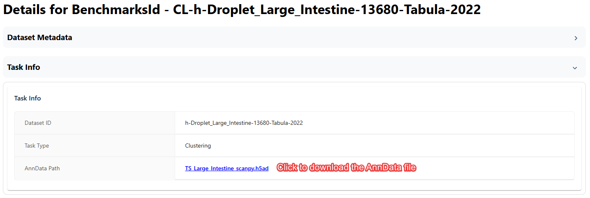
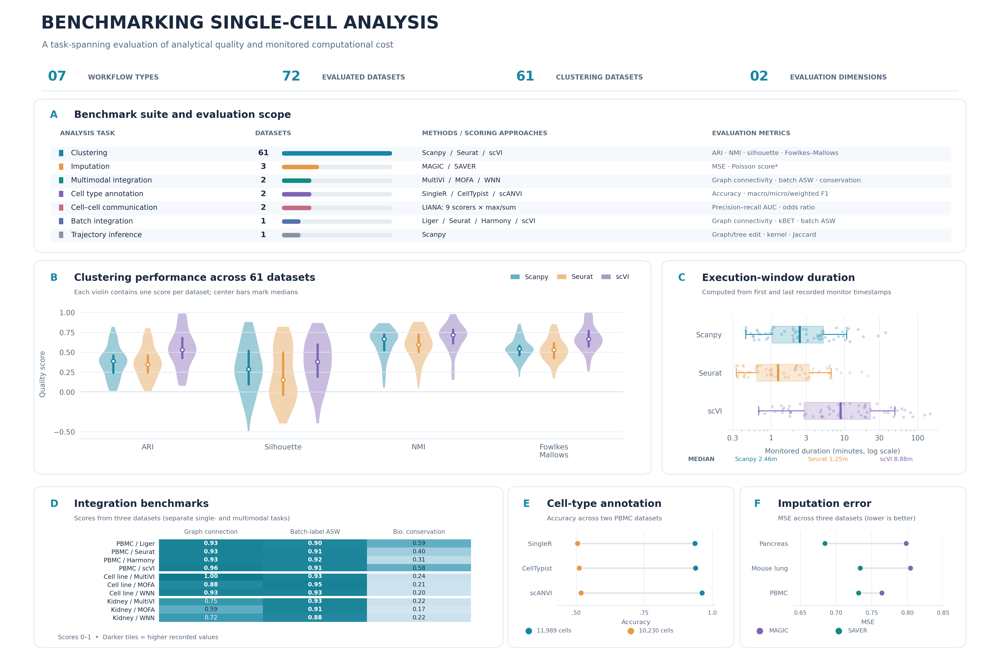

# Explore Benchmarks

The **Benchmarks** browser in **single-cell.ai** provides a central place to discover public single-cell datasets, examine benchmark configurations, compare analytical methods, and download inputs for reproducible evaluation. The benchmark collection brings together **biological quality metrics** and **computational resource measurements** so that researchers can assess both the effectiveness and practical cost of a method.

This guide introduces the available datasets, explains how to navigate benchmark records, and illustrates how to interpret the reported results. 

## Benchmark collection at a glance

| Measure | Value | Scope |
| --- | ---: | --- |
| Public dataset records | **74** |  |
| Estimated cells | **1,609,734** | Sum of the `Cell Count Estimate` values |
| Species | **3** | Mouse, human, and planaria |
| Anatomical categories | **45** | Distinct recorded `Anatomical Entity` labels |
| Median dataset size | **7,956 cells** | Across the 74 dataset records |
| Datasets with benchmark results | **72** |  |
| Benchmark task types | **7** | From clustering to trajectory inference |

## Dataset coverage and distribution

The dataset collection spans multiple organisms, tissues, and experimental techniques. This diversity helps researchers evaluate methods under different biological contexts and dataset sizes rather than relying on a single reference dataset.



**Figure 1. Dataset overview and distribution in the supplied dataset catalog.**

- **A — Dataset summary:** The catalog includes **74 public datasets**, approximately **1.61 million cells**, **3 species**, and **45 distinct recorded anatomical categories**. The median dataset contains **7,956 cells**. Two major sources are **Tabula Muris** (33 datasets) and **Tabula Sapiens** (29 datasets).
- **B — Species:** Mouse (**37 datasets**) and human (**36 datasets**) are nearly equally represented by dataset count, with one planarian dataset. Human datasets account for **1,062,387 estimated cells**, compared with **528,510** mouse cells and **18,837** planarian cells.
- **C — Sample type:** **Droplet-based datasets (43)** are the largest category, followed by **FACS (20)**. Six entries have no sample type specified; smaller categories include sci-CAR, inDrop, 10x, and 10x Visium. These labels reproduce the exported metadata rather than a newly standardized technology taxonomy.
- **D — Anatomical coverage:** Lung, kidney, and peripheral blood mononuclear cells (**PBMC**) appear in **four datasets each**. Several additional tissues, including trachea, bladder, pancreas, heart, spleen, liver, and thymus, appear in three datasets each.
- **E — Dataset size:** Cell counts vary substantially, from **11 to 384,925** estimated cells per dataset. The middle 50% of datasets span approximately **2,147 to 16,291 cells**. The logarithmic cell-count axis makes small and large datasets visible in the same panel; the dashed line marks the median.
- **F — Submission year:** Most catalog entries are dated **2018 (36 datasets)** or **2022 (32 datasets)**, reflecting substantial contributions from the two large atlas collections.

### What the distribution means for benchmarking

Dataset diversity matters because methods may behave differently depending on **cell count, tissue complexity, organism, reference annotations, and assay type**. For example, FACS and droplet-based datasets can differ in capture strategy and expression coverage, while large atlas datasets can impose different memory and runtime requirements from small, tissue-specific collections.

When selecting a comparison set, try to include datasets of different sizes and biological origins. Interpret average performance cautiously: **the catalog is not evenly balanced across studies, technologies, or years**, and many datasets originate from Tabula Muris or Tabula Sapiens. Report per-dataset results when possible, rather than relying on an overall average alone.

> **Metadata note:** Cell totals are sums of the catalog's **estimates**, not a recount of downloaded matrices. Anatomical categories are counted as recorded, without merging synonymous or differently formatted labels. Missing sample types are shown as **Unknown** rather than assigned a presumed technology.

## Find a benchmark

1. Open **Benchmarks** in **single-cell.ai**.
2. Use the available filters to narrow records by **species**, **category**, **author**, **organ part**, **cell type**, or **disease status**.
3. Select a benchmark to review its dataset metadata, task configuration, available methods, and reported performance.
4. Download the dataset or copy the **benchmark ID** for use with the OSCB Python Packages.



**Figure 2. Benchmark browser.** The searchable table helps researchers identify datasets relevant to a biological question or evaluation task. Filtering by biological characteristics is useful for building controlled comparisons, while sorting can highlight datasets with different sizes or metadata properties.

> [!TIP]  
> Select a column header to sort the table. Record the **benchmark ID**, source dataset, input version, preprocessing choices, and task configuration before comparing methods. Two runs should not be treated as directly comparable unless their inputs and evaluation settings are aligned.

## Inspect benchmark details

A benchmark detail page may provide the **dataset provenance**, target labels, applicable methods, evaluation metrics, results visualizations, and **resource utilization**. Together, these elements explain what was evaluated, how performance was measured, and what computational demands were observed.



**Figure 3. Benchmark details and dataset download.** Use the details view to examine the dataset and task-specific configuration before interpreting performance charts. The download option enables further inspection and reproducibility checks in a local environment.

### Understand benchmark performance across tasks

The supplied benchmark results span **seven task types**. Clustering has the broadest coverage and supports a distributional comparison across 61 datasets. The other tasks are represented by smaller groups of datasets, so their panels are best viewed as **illustrative task-specific evaluations**, not as evidence of universal method rankings.



**Figure 4. Benchmark suite and comparative method performance, from the supplied benchmark export.** [Vector PDF](../../images/doc/benchmark_suite_overview.pdf) · [Editable SVG](../../images/doc/benchmark_suite_overview.svg)

- **A — Evaluation coverage:** **72 datasets** have plotted benchmark results across **seven tasks**: clustering (**61**), imputation (**3**), multimodal integration (**2**), cell type annotation (**2**), cell–cell communication (**2**), batch integration (**1**), and trajectory inference (**1**). The panel also identifies representative methods and recorded metric families.
- **B — Clustering quality:** Violin plots show the distributions of **adjusted Rand index (ARI)**, **silhouette score**, **normalized mutual information (NMI)**, and **Fowlkes–Mallows score** across 61 datasets for Scanpy, Seurat, and scVI. For ARI, the recorded median is approximately **0.388 for Scanpy**, **0.345 for Seurat**, and **0.530 for scVI**. The widths and spreads of the violins show that performance varies across datasets, so medians alone do not describe every comparison.
- **C — Computational cost:** The box plots show the **time span between the first and last recorded resource-monitoring timestamps**, not verified end-to-end wall-clock runtime. The median monitoring windows in the clustering records are approximately **2.46 minutes for Scanpy**, **1.25 minutes for Seurat**, and **8.88 minutes for scVI**. Hardware, implementation choices, and execution settings must also be considered when interpreting resource use.
- **D — Batch and multimodal integration:** The heatmap shows recorded **graph connectivity**, **batch-label average silhouette width (ASW)**, and **biological conservation** for selected integration methods. It includes a PBMC batch-integration benchmark and sci-CAR cell-line and kidney multimodal benchmarks. These are **distinct task settings**; the panel should not be read as a single cross-task leaderboard.
- **E — Cell type annotation:** The accuracy panel compares **SingleR**, **CellTypist**, and **scANVI**, where results are available, on two PBMC datasets containing approximately **11,989** and **10,230** cells. Differences between the datasets emphasize the importance of reference labels and dataset-specific performance.
- **F — Imputation:** The panel compares **MAGIC** and **SAVER** using **mean squared error (MSE)** on pancreas, mouse lung, and PBMC datasets. For MSE, **lower values indicate less squared reconstruction error** under the recorded evaluation setup. Other imputation metrics may have different interpretations.

### Interpreting the results responsibly

Benchmark metrics answer different questions. **Clustering agreement** assesses similarity to reference labels, **integration metrics** examine batch mixing and preservation of biological variation, **annotation scores** measure agreement with known cell identities, and **imputation error** quantifies differences from an evaluation target. A score of 0.8 for one metric is therefore not necessarily equivalent to a score of 0.8 for another.

In addition, results for tasks with only one to three datasets should be presented as **examples from the available benchmark collection**, rather than general claims that one method is best. For integration, removal of batch effects can trade off against preservation of biological signal. For computational monitoring, reported durations should not be interpreted as standardized speed benchmarks without checking hardware and measurement boundaries.

## Benchmark tasks and evaluation metrics

| Task | Benchmarked datasets | What is evaluated | Representative methods and metrics |
| --- | ---: | --- | --- |
| **Clustering** | 61 | Whether inferred clusters recover known cellular groupings and exhibit separation. | Scanpy, Seurat, scVI; ARI, NMI, silhouette, Fowlkes–Mallows. [Clustering](benchmarks/clustering) |
| **Cell Type Annotation** | 2 | Agreement between predicted cell identities and reference annotations. | SingleR, CellTypist, scANVI; accuracy and macro/micro/weighted F1. [Cell Type Annotation](benchmarks/cell-cell-communication) |
| **Cell–Cell Communication** | 2 | How well inferred signaling interactions recover the available reference signal. | LIANA-based scoring; precision–recall AUC and odds ratio. [Cell–Cell Communication](benchmarks/cell-cell-communication) |
| **Imputation** | 3 | Agreement between reconstructed expression values and evaluation targets. | MAGIC, SAVER; MSE and a Poisson-related score. [Imputation](benchmarks/imputation) |
| **Batch Integration** | 1 | Removal of technical batch variation while retaining biological information. | Liger, Seurat, Harmony, scVI; graph connectivity, kBET, batch ASW, biological conservation. [Batch Integration](benchmarks/batch-integration) |
| **Multimodal Data Integration** | 2 | Joint representation of multiple modalities and preservation of biologically meaningful structure. | MultiVI, MOFA, WNN; graph connectivity, batch ASW, biological conservation. [Multimodal Data Integration](benchmarks/multimodal-data-integration) |
| **Trajectory** | 1 | Agreement of inferred developmental or lineage structure with a reference. | Scanpy; graph edit distance, graph kernel score, Jaccard similarity, tree edit distance. [Trajectory](benchmarks/trajectory) |

**Metric guide:** ARI, NMI, and Fowlkes–Mallows compare inferred groups with reference groupings; silhouette evaluates separation and cohesion; accuracy and F1 evaluate predictions against labels; graph connectivity and batch ASW provide views of integration; and MSE measures reconstruction error. Check each task's documentation for its **normalization, direction, reference definition, and handling of unavailable metrics**. The imputation export names its Poisson-related field `Possion`; retain that exact key when parsing the raw JSON.

## Download and use a benchmark in Python

Use a benchmark ID from the browser to load the associated data with the OSCB Python Packages. For example:

```python
from oscb.data import DataLoader

adata = DataLoader(
    "CL-m-FACS_Bladder-1268-Tabula-2018",
    data_folder="./datasets/"
)
```

The example uses the **benchmark identifier** `CL-m-FACS_Bladder-1268-Tabula-2018` shown in the supplied documentation. Benchmark IDs and source dataset IDs are distinct fields in the JSON exports, so copy the appropriate identifier from the browser rather than constructing one manually.

After loading the dataset, inspect its cell and feature dimensions, available metadata columns, layers, and embeddings before choosing an analysis method. The input representation and preprocessing status can influence benchmark outcomes.

For package behavior, return types, evaluator usage, and task-specific requirements, see the [Data Loader API](doc/?doc=data_loader) and [Evaluator API](doc/?doc=evaluators).

## Reproducible comparisons: recommended checks

For a meaningful comparison, document:

1. **Dataset provenance:** source publication, accession or download location, benchmark ID, and dataset version.
2. **Input preparation:** filtering, normalization, highly variable gene selection, feature representation, and any prior batch correction.
3. **Evaluation design:** task, ground-truth labels, batch keys, held-out data, and metric definitions.
4. **Method configuration:** software versions, parameters, random seeds, and training or stopping criteria.
5. **Computational environment:** CPU, RAM, GPU, and relevant runtime or monitoring configuration.
6. **Reported outcomes:** per-dataset scores, aggregation method, missing values, and uncertainty where available.
