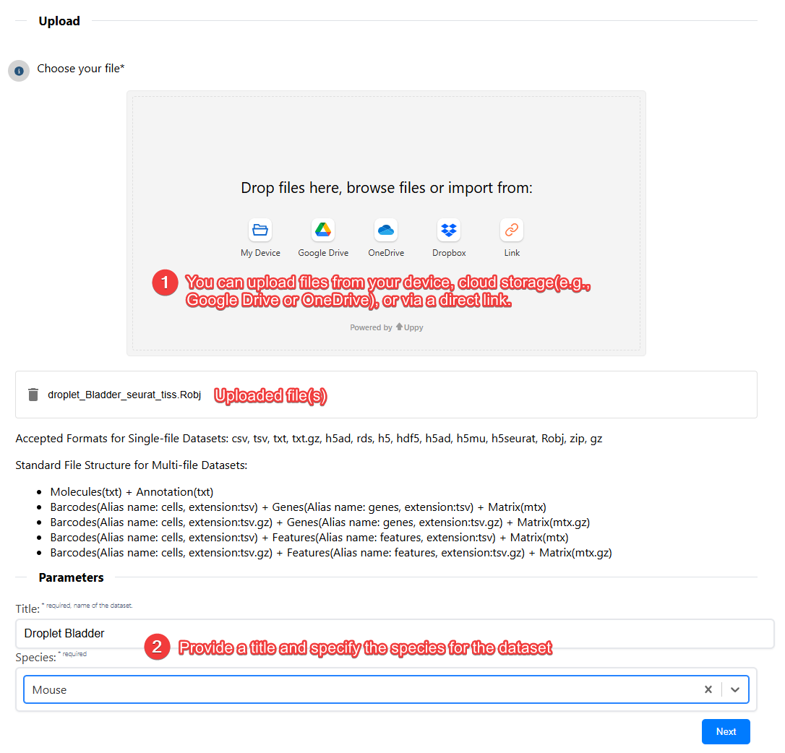
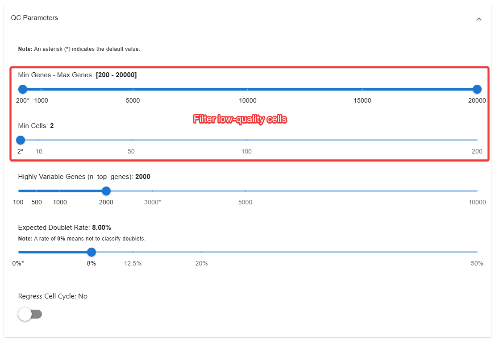
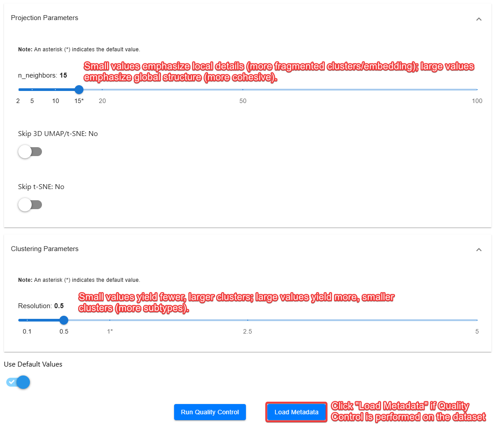
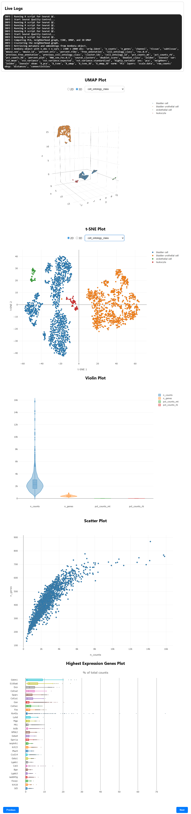
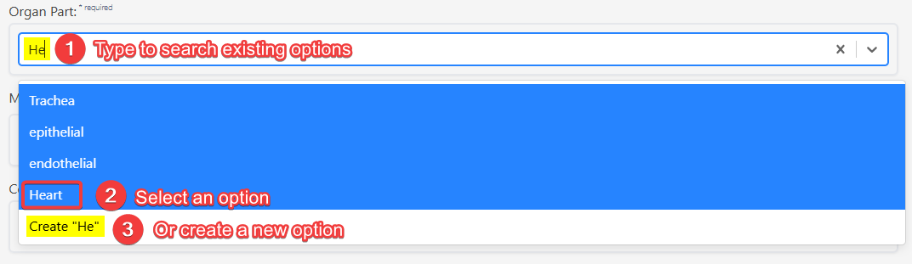
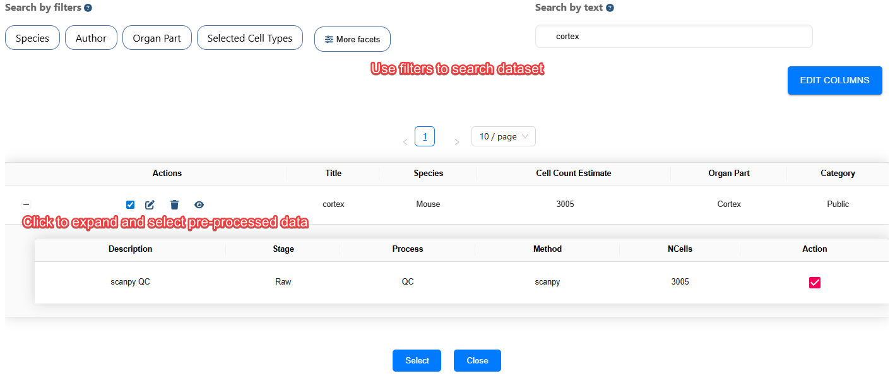
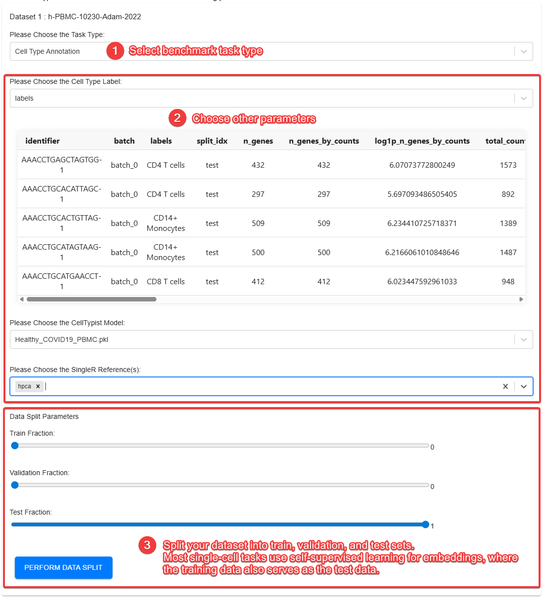
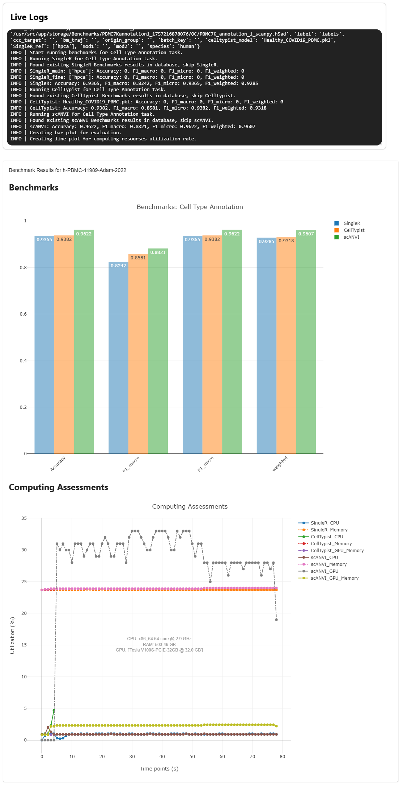

# Create New Benchmarks

> [!IMPORTANT]
> **Administrator permissions are required** to create a new benchmark in the current workflow.

This guide covers dataset preparation, quality control, task configuration, execution, and interpretation in the single-cell.ai benchmark builder.

## 1. Upload and describe a dataset

1. Open the dataset uploader and choose files from your device, supported cloud storage, or a direct link.
2. Provide a descriptive **title** and the **species**.
3. Confirm that count matrices, barcodes, feature names, and any annotations describe the same sample and are correctly aligned.
4. See [Data Management](doc/?doc=data_management.md) for supported file formats, multi-file structures, and visibility settings.

## 2. Configure quality control (QC)

Select the available **Scanpy** or **Seurat** QC route as appropriate for the input format. If the dataset is already processed and contains trustworthy QC metadata, use **Load Metadata** when supported rather than repeating incompatible preprocessing.

| Setting | Purpose | How to choose |
| --- | --- | --- |
| `min_genes` | Remove low-complexity cells. | Start from the observed gene-count distribution; 200–500 can be an initial range for droplet RNA-seq. |
| `max_genes` | Flag unusually complex cells or possible multiplets. | Use the tissue and capture technology; genuine large or active cells may express many genes. |
| `min_cells` | Exclude genes detected in too few cells. | A starting range is 3–20 cells, but retain rare features when they matter biologically. |
| Mitochondrial count percentage | Helps identify damaged or stressed cells. | Evaluate the distribution and tissue biology; **5–20%** is often considered, but no universal cutoff is appropriate. |
| HVGs | Select informative genes for dimensionality reduction. | Tune to heterogeneity, sample size, and downstream analysis. |
| Expected doublet rate | Inform doublet detection. | Estimate from chemistry, loading density, and recovered cells. |
| Regress cell cycle | Suppress cell-cycle-correlated variation, when appropriate. | Avoid if proliferation or cell cycle is part of the biological question. |

Thresholds are not universal. Inspect QC plots before finalizing filters, and retain sufficient cells from rare populations.

For downstream clustering, `n_neighbors` affects neighborhood graph structure and `resolution` controls clustering granularity. Larger resolution values often yield more clusters. Tune parameters with reference to the expected biological populations rather than optimizing only a single benchmark score.

## 3. Inspect preprocessing results

Follow live execution logs, check whether QC completed successfully, and review available plots (for example, UMAP/t-SNE, scatter and violin plots, and feature-expression summaries). A visually separated UMAP alone is not proof of accurate annotation.

## 4. Complete dataset metadata

Enter source, species, tissue/organ part, assay, study conditions, and any publication identifiers. Reuse existing controlled terms where available. Save the dataset, then open **My Data** to confirm that the entry is accessible with the expected permissions.

## 5. Build a benchmark task

1. Open **Benchmark Task Builder**.
2. Select a dataset or expand **+** to choose a processed output generated by a previous task.
3. Choose the benchmark **task type** (for example, Clustering or Cell Type Annotation).
4. Select the **ground-truth or annotation fields** needed for that task.
5. Where applicable, configure independent **training**, **validation**, and **test** partitions.

> [!CAUTION]
> **Prevent data leakage.** When assessing generalization, partition by biological sample, donor, or study where feasible, not merely at random across cells from the same sample. Even in self-supervised workflows, using the same observations for fitting and final evaluation may overestimate generalization. Document any transductive evaluation explicitly.

## 6. Run and interpret benchmarks

Select the methods and start evaluation. After completion, examine available **performance comparison plots** and **computational utilization plots**. Record method versions, input processing, hardware, metrics, and any excluded results so the comparison is reproducible.

For metric definitions and Python examples, see [Benchmarks](doc/?doc=benchmarks) and [Evaluator API](doc/?doc=evaluators).

## References

[^1]: Wolf FA, Angerer P, Theis FJ (2018). SCANPY: large-scale single-cell gene expression data analysis. *Genome Biology* 19:15. https://doi.org/10.1186/s13059-017-1382-0
[^2]: Satija R, Farrell JA, Gennert D, et al. (2015). Spatial reconstruction of single-cell gene expression data. *Nature Biotechnology* 33:495–502. https://doi.org/10.1038/nbt.3192
