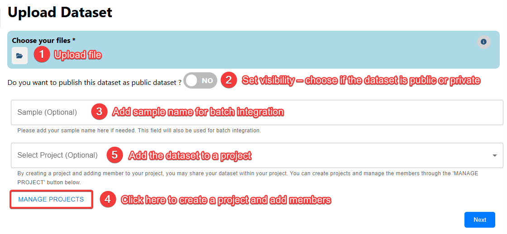
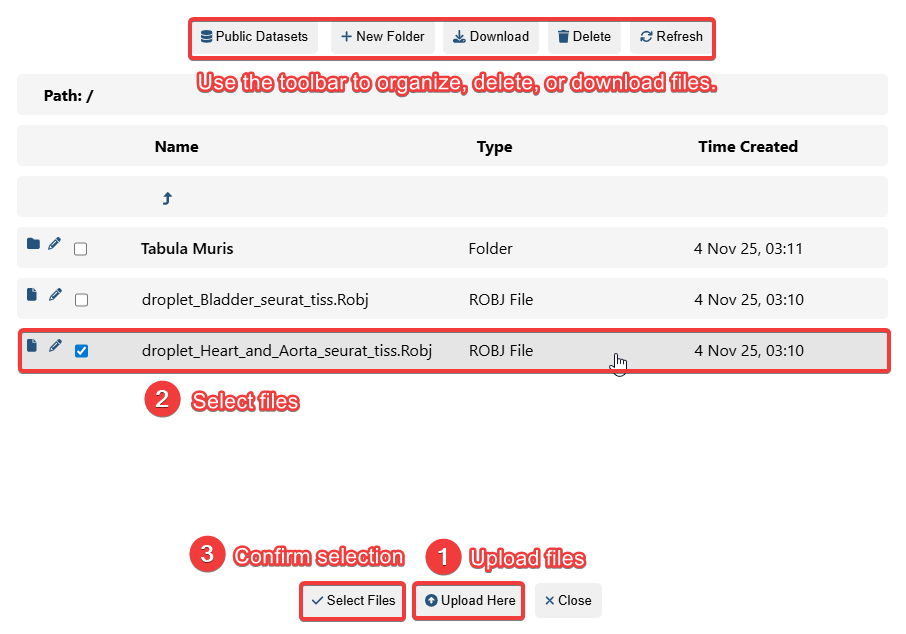
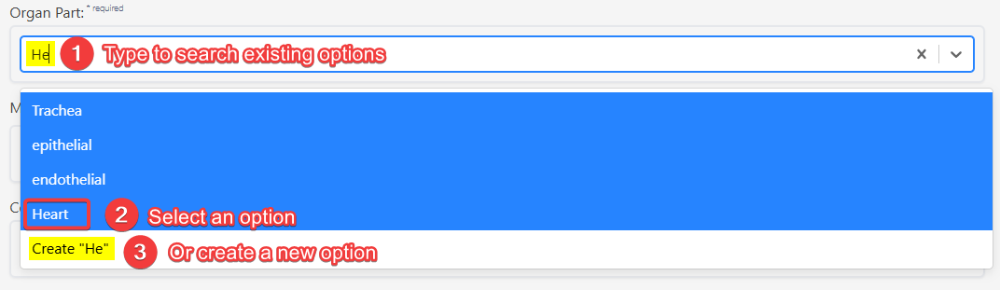
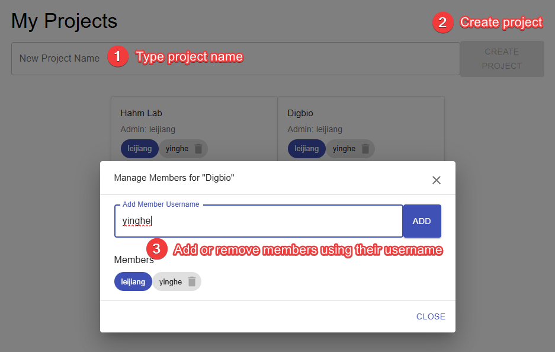
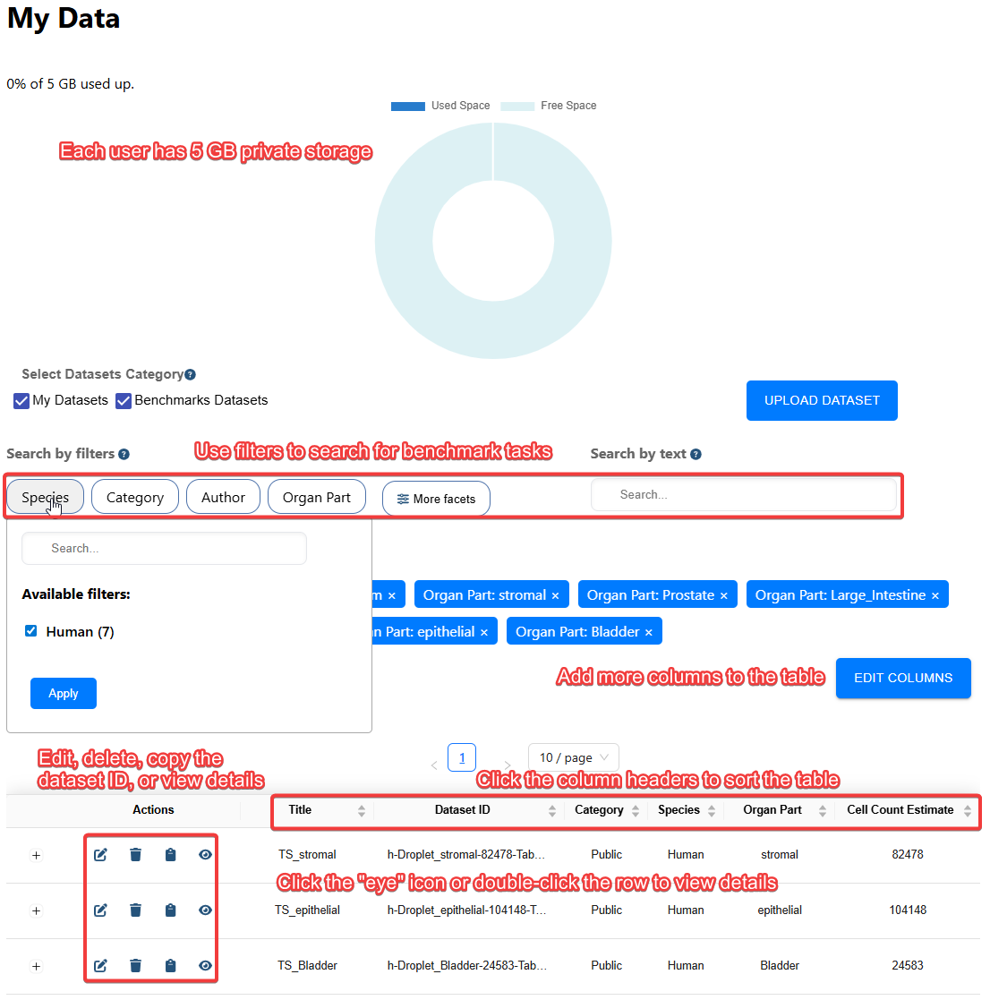
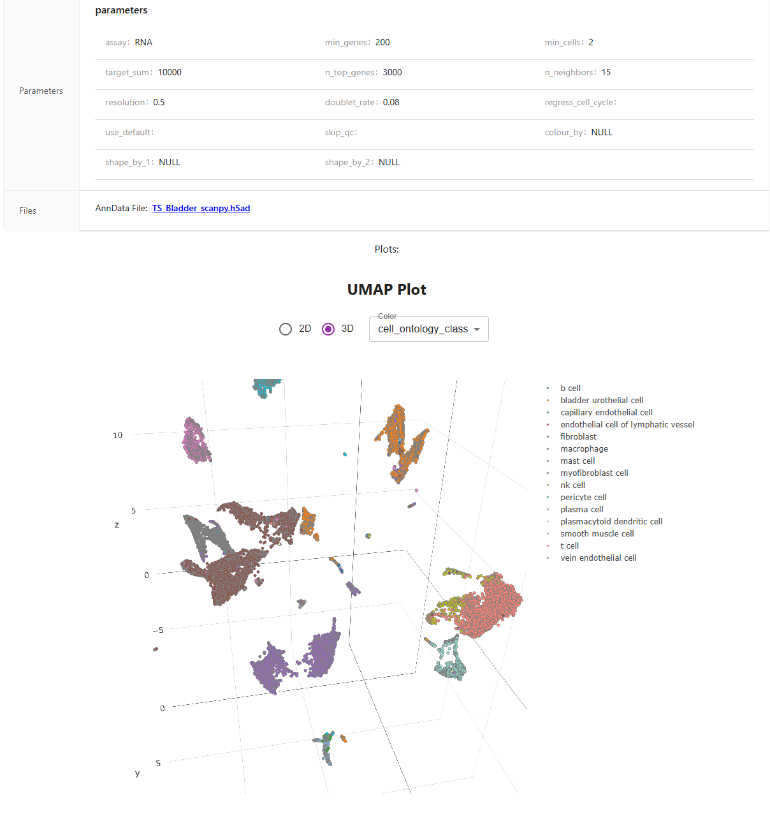
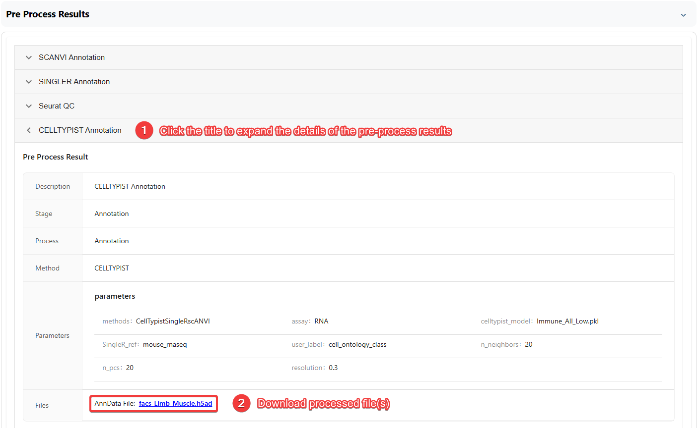

# Data Management

Use **Data Management** to upload datasets, organize shared projects, control access, and inspect processing history. For analysis examples, see [Tools](doc/?doc=tools) and [Workflows](doc/?doc=workflows).

## Upload a dataset

1. Open **Upload Data** and select a file or supported multi-file dataset.
2. Confirm the chosen files and their pairing. You can use the file toolbar to organize, download, or remove uploaded files.
3. Choose the dataset visibility: private, shared with a project, or public if publication is intended.
4. Optionally add a sample/batch name and link the dataset to an existing or new project.
5. Complete the metadata form, including **species**, tissue, and other provenance fields, then submit.
6. Open **My Data** to verify the dataset and any generated processing entries.

### Supported input structures

The uploader documentation lists single-file inputs such as `csv`, `tsv`, `txt`, `txt.gz`, `h5ad`, `rds`, `h5`, `hdf5`, `h5mu`, `h5seurat`, `Robj`, `zip`, and `gz`. Exact support depends on file contents and conversion capabilities; a recognized file extension does not guarantee a valid import.

For multi-file datasets, upload **all matching components from the same sample**. Supported conventions include:

| Structure | Files |
| --- | --- |
| Molecule table | Molecules (`.txt`) + annotation (`.txt`) |
| Matrix Market (genes) | Barcodes (`.tsv` or `.tsv.gz`) + genes (`.tsv` or `.tsv.gz`) + matrix (`.mtx` or `.mtx.gz`) |
| Matrix Market (features) | Barcodes (`.tsv` or `.tsv.gz`) + features (`.tsv` or `.tsv.gz`) + matrix (`.mtx` or `.mtx.gz`) |

The platform converts supported inputs to analysis-ready `AnnData` or `MuData` formats as appropriate. After conversion, confirm that count orientation, gene identifiers, observations, and sample annotations were preserved.

### Visibility, samples, and metadata

- **Private:** Only you, and eligible project collaborators where configured, can view the dataset.
- **Project sharing:** Create or select a project, then manage access for its members.
- **Public:** Choose this only for datasets that you are authorized to share; check for restricted participant metadata first.
- **Sample name:** Supply a stable sample/batch identifier when integrating datasets; it is used to populate cell-level metadata.
- **Metadata:** Prefer consistent species and tissue labels, source description, sequencing platform, and preparation details.

## Projects and collaborators

Open **Manage Project** from the upload page or **My Projects** from **Analyses**. Project owners can create projects, add or remove members, and link datasets. Members may belong to multiple projects.

## Find datasets in My Data

The **My Data** page lists personal datasets and publicly available benchmark data. Use filters for species, category, author, organ part, cell type, and disease status, then select a dataset to inspect or manage it.

The original documentation describes a **5 GB private-storage allowance**; confirm the current allowance and whether public datasets count toward it in your deployment before relying on this limit.

## Inspect dataset details and processing history

The details page displays metadata and available preprocessing outputs. Expand a processed result to inspect the method, settings, figures, and downloadable data. When choosing inputs for a later step, confirm whether the result is counts, normalized expression, an embedding, or another processed representation.

