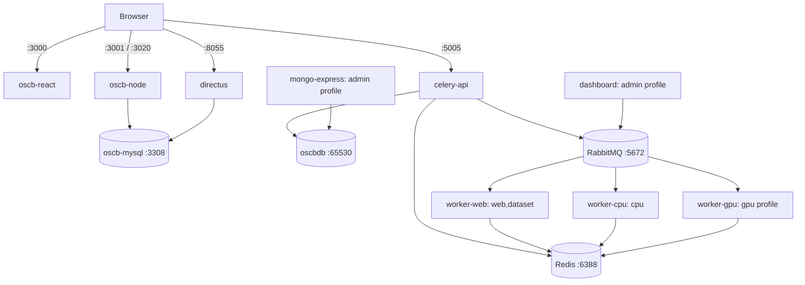

# Docker Compose Deployment

**Audience:** Developers, DevOps engineers, and administrators deploying the single-cell.ai / OSCB application on a Linux Docker host.  
**Scope:** First installation, configuration, CPU/GPU workers, administration, validation, security, maintenance, and troubleshooting.  
**Compatibility:** These tutorials describe the image versions and service definitions in the supplied Compose file.

> [!CAUTION]
> **For fresh install:** `sh scripts/init-secrets.sh` generates *new* internal credentials for missing files.
>
> **For existing installations:** Do not replace existing secret values or database directories with newly generated ones. Retain your persistent volumes, especially MySQL, MongoDB, Redis, RabbitMQ, and Directus data.

---

## Tutorial 1 — Understand the architecture

### 1.1 Clone the repository

```bash
git clone https://github.com/cirisjl/single-cell.ai.git
cd single-cell.ai
```

---

### 1.2 Services defined in the supplied Compose file

The configuration defines **13 services**, a bridge network (`oscb-network`), **19 file-based secrets**, and two optional profiles (`admin`, `gpu`).

| Compose service | Image / build definition | Purpose | Host port | Default startup? |
|---|---|---|---|---|
| `oscbdb` | `mongo:7.0` | Project, job, and other document data | Internal only, MongoDB `65530` | Yes |
| `oscb-redis` | `redis:6-alpine` | Celery result backend / cache | Internal only, Redis `6388` | Yes |
| `oscb-rabbitmq` | `rabbitmq:4.2.8-management` | Celery message broker | `15672`, localhost by default | Yes |
| `oscb-mysql` | `mysql:8.0` | Relational data | Internal only, MySQL `3308` | Yes |
| `celery-api` | Built from `api/Dockerfile` | Python application/API | `5005` | Yes |
| `worker-web` | Built from `api/Dockerfile` | Tasks on `web,dataset` | Internal only | Yes |
| `worker-cpu` | Built from `api/Dockerfile` | Tasks on `cpu` | Internal only | Yes |
| `worker-gpu` | Built from `api/Dockerfile` | Tasks on `gpu`; NVIDIA device reservation | Internal only | **No — `gpu` profile** |
| `dashboard` | Built from `api/Dockerfile` | Celery Flower monitoring | `5555` | **No — `admin` profile** |
| `mongo-express` | `mongo-express:latest` | Web MongoDB administration | `8081` | **No — `admin` profile** |
| `oscb-node` | Built from `oscb-ui/oscb-node/Dockerfile`; image `oscb-node` | Node.js backend and companion server | `3001`, `3020` | Yes |
| `oscb-react` | Built from `oscb-ui/oscb-react/Dockerfile` | React frontend | `3000` | Yes |
| `directus` | `directus/directus:9.24.0` | Data/content administration | `8055` | Yes |

> Port values above are taken from the YAML. A published port is not automatically internet-reachable: its exposure depends on the bind IP, host firewall, and CloudLab/network access rules. RabbitMQ's *management* port `15672` is published; its broker port `5672` is internal. The source uses custom internal ports for MongoDB, Redis, and MySQL.

### 1.3 Data and task flow



### 1.4 Internal hostnames

For service-to-service requests, **use Compose service names**, not `localhost` and not the host's public DNS name:

```text
oscbdb:65530
oscb-redis:6388
oscb-rabbitmq:5672
oscb-mysql:3308
oscb-node:3001
celery-api:5005
```

For browser-to-service requests, the hostnames need to be reachable **from the browser**. `localhost` in a browser means the user's own computer, not the Docker host.

---

## Tutorial 2 — Prepare the host and project directory

### 2.1 Host prerequisites

Use a Linux server with:

- Docker Engine and the modern **Docker Compose v2** plugin (`docker compose`, with a space).
- Enough CPU, RAM, and disk capacity for MongoDB, MySQL, scientific workflows, and any large single-cell datasets.
- Access to the application repository containing the code and Dockerfiles.
- Permission to create and write the host-mounted storage directories.
- Outbound access to retrieve the exact images and packages used by the project.
- **GPU deployment only:** NVIDIA driver, working `nvidia-smi`, and an NVIDIA Container Toolkit configured for Docker.

Verify:

```bash
docker --version
docker compose version
docker info >/dev/null
# GPU hosts only:
nvidia-smi
```

### 2.2 Required project layout

The supplied YAML resolves its build contexts relative to the Compose file's directory. The full project should resemble:

```text
project-root/
├── docker-compose.yml           
├── .env                         
├── example.env                  
├── initMongo.js                 
├── api/
│   └── Dockerfile               
├── oscb-ui/
│   ├── oscb-node/
│   │   └── Dockerfile           
│   ├── oscb-react/
│   │   └── Dockerfile           
│   └── oscb-mysql/
│       └── oscb_schema_latest.sql 
├── scripts/
│   └── celery-entrypoint.py     
└── secrets/
    ├── mysql_password.txt       # 19 secret files required by YAML
    └── ...
```

### 2.3 Persistent host storage

The provided `.env` sets:

```dotenv
OSCB_APP_DATA_DIR=/data/oscb
OSCB_WORKER_DATA_DIR=/data/oscb
```
Create the directories if this is a **new** installation:

```bash
sudo mkdir -p /data/oscb/{results,uploads,logs,user_storage,Directus_uploads}
sudo mkdir -p /data/oscb/db/{oscbdb,redis,rabbitmq/data,rabbitmq/log}
sudo mkdir -p /data/oscb/mysql_db
```

> [!CAUTION]
> **Do not run recursive `chown` or `chmod 777` on an existing deployment.** Inspect the container users and directory owners first, then grant only the write permissions each service needs. Different official images run under different UIDs/GIDs.

---

## Tutorial 3 — Configure environment variables

### 3.1 Choose the correct environment file

An `example.env` is provided and need to be renamed to `.env` after editing with your configuration:

- `example.env` is a generic template and does **not** provide all the `OSCB_*` host overrides. If you choose the template, also set the host bind and storage variables below.

For a new independent installation, make a private working copy and edit it:

```bash
cp example.env .env       # ONLY if you don't need to preserve an existing .env
chmod 600 .env
```

> [!CAUTION]
> **Do not overwrite the current `.env` on an existing installation.** `docker compose` uses root `.env` for variable interpolation; the services declaring `env_file: .env` also receive its contents as runtime environment variables. The distinction matters for React build-time configuration (see below).

### 3.2 Important variables to review

The following are examples, **not instructions to paste over existing values**:

```dotenv
# Host storage and port binding
OSCB_APP_DATA_DIR=/data/oscb
OSCB_WORKER_DATA_DIR=/data/oscb
OSCB_PUBLIC_BIND_IP=0.0.0.0
OSCB_ADMIN_BIND_IP=127.0.0.1

# Application-specific DNS and ports
HOST_URL=your-host.example.org
MONGO_URL=mongodb://oscbdb:65530
MONGO_DB_NAME=oscb
MYSQL_DATABASE=oscb
MYSQL_TCP_PORT=3308
DB_HOST=oscb-mysql
DB_PORT=3308

# Celery routing
CELERY_BROKER_HOST=oscb-rabbitmq
CELERY_BROKER_USER=admin
CELERY_RESULT_BACKEND_HOST=oscb-redis
OSCB_WEB_WORKER_CONCURRENCY=2
OSCB_CPU_WORKER_CONCURRENCY=4
OSCB_CELERY_MAX_MEMORY_KB=100000000

# Browser-facing endpoints: customize for real, browser-reachable origins
REACT_APP_DIRECTUS_URL=https://your-host.example.org/directus
PUBLIC_URL=https://your-host.example.org/directus
```

`DB_HOST`/`DB_PORT` are shown as examples of useful application variables, **not proof the Node source consumes them**. In the supplied `.env`, the Node-specific variables include `DBUSER`, `DATABASE`, `NODE_MYSQL_CONNECTION_LIMIT`, and secret-file paths. Confirm the Node source actually uses any new variable you add.

> [!IMPORTANT] 
> The configured `OSCB_CELERY_MAX_MEMORY_KB=100000000` is around **95.4 GiB per child process** and may not impose a practical limit on moderate servers. Set a realistic value only after considering your dataset size and memory usage. This is Celery's `--max-memory-per-child`, not a Docker container memory cap.

### 3.3 Fix browser-visible URLs

The supplied `.env` uses `REACT_APP_DIRECTUS_URL=http://127.0.0.1:8055` and `PUBLIC_URL=http://localhost:8055`. These work only for a client on the Docker host. If you access the UI from another computer, use your server's reachable hostname, reverse-proxy URL, and correct scheme.

For example, if you are temporarily using direct HTTP ports on a development host:

```dotenv
REACT_APP_DIRECTUS_URL=http://your-host.example.org:8055
PUBLIC_URL=http://your-host.example.org:8055
```

**React build caveat:** The Compose service declares `env_file: .env`, which sets variables *at container runtime*. Create React App-style `REACT_APP_*` variables are normally embedded *at build time*. Depending on your React Dockerfile, changing `.env` alone may not change the built JavaScript bundle. Check how that Dockerfile accepts build arguments or copies configuration; then rebuild React. Do not add build-time **secrets** to a browser bundle.

### 3.4 Redis, RabbitMQ, MySQL, and Node settings

| Area | Variables | Notes |
|---|---|---|
| MongoDB | `MONGO_URL`, `MONGO_DB_NAME`, `MONGO_COLLECTION_*` | Prefer Docker DNS service `oscbdb` for new internal clients; existing alias may resolve but verify |
| Redis | `REDIS_PORT=6388`, `REDIS_PASSWORD_FILE` | Password is stored in `secrets/redis_password.txt` |
| RabbitMQ | `RABBITMQ_DEFAULT_USER=admin`, `RABBITMQ_PORT=5672` | Password is read from a secret file in its startup shell |
| MySQL | `MYSQL_DATABASE=oscb`, `MYSQL_TCP_PORT=3308` | `MYSQL_ROOT_PASSWORD_FILE` is set by the service |
| Node | `EXTERNAL_PORT=3001`, `EMAIL_*`, `STORAGE_*`, `*_FILE` | Node source must implement reading `_FILE` variables |
| Directus | `DB_*`, `ADMIN_*`, `KEY_FILE`, `SECRET_FILE`, `PUBLIC_URL` | **Verify version 9.24.0 honors these file-based settings** |
| Mongo Express | `ME_CONFIG_*` | Check authentication is enforced after startup |
| CORS | `CORS_ENABLED`, `CORS_ORIGIN`, `CORS_*` | Setting Directus CORS is **not** a substitute for Node Express CORS |

The supplied `CORS_ORIGIN=true` and broad `COMPANION_UPLOAD_URLS="/.*/"` are development-oriented and should be narrowed for a public deployment.

---

## Tutorial 4 — Set up Docker secrets

### 4.1 How secrets work here

The Compose file defines **19** `secrets` entries whose host files live under `./secrets/`. For example:

```yaml
secrets:
  mysql_password:
    file: ./secrets/mysql_password.txt
```

Services receiving this secret see its contents at `/run/secrets/mysql_password`. **The file is not automatically created** when you run Compose. Docker Compose mounts secrets; the application or image must explicitly read them. The `_FILE` suffix is a supported convention for certain images, but it is **not a universal Docker feature**.

### 4.2 Required secret files

**Internal/application secrets** (generate securely *only for a new deployment*):

```text
mysql_password.txt
redis_password.txt
rabbitmq_password.txt
mongo_express_password.txt
directus_password.txt
flower_basicauth_password.txt
jwt_token_secret.txt
directus_key.txt
directus_secret.txt
```

**External integration secrets** (obtain actual values from the relevant providers):

```text
github_token.txt
email_password.txt
openai_api_key.txt
gemini_api_key.txt
googledrive_key.txt
googledrive_secret.txt
dropbox_key.txt
dropbox_secret.txt
onedrive_key.txt
onedrive_secret.txt
```

A blank or randomly generated **external API credential** does not enable the integration. Create the relevant file with its real secret only after configuring that provider. Some integrations may require valid credentials at process startup; check the Node/React code before treating them as optional.

### 4.3 Generate new internal secrets safely

For a **new installation only**:

```bash
umask 077
mkdir -p secrets
for name in \
  mysql_password redis_password rabbitmq_password \
  mongo_express_password directus_password flower_basicauth_password \
  jwt_token_secret directus_key directus_secret; do
  path="secrets/${name}.txt"
  if [ ! -e "$path" ]; then
    openssl rand -hex 32 > "$path"
  else
    echo "Preserving existing: $path"
  fi
done
chmod 600 secrets/*.txt
```

The format/handling of `flower_basicauth_password.txt` depends on the missing `scripts/celery-entrypoint.py`. A generated string alone does **not** prove Flower authentication is enabled. Verify it before exposing port `5555`.

For external providers, create and populate each required file through a secure editor or secrets manager. Avoid putting real secret values into command history, version control, screenshots, or support logs.

### 4.4 Preserve existing credentials

For existing MongoDB/MySQL/RabbitMQ/Directus data, **do not rotate secret files as part of deployment**. Changing a MySQL root password secret after the data directory was initialized does not automatically change the password inside MySQL. Likewise, Directus signing/encryption keys should be preserved unless you are following a planned, application-aware rotation procedure.

---

## Tutorial 5 — Deploy the core application

### 5.1 Preflight checks

Run these commands in the repository root (where `docker-compose.yml` lives):

```bash
pwd
ls -l docker-compose.yml .env
ls -l initMongo.js api/Dockerfile \
  oscb-ui/oscb-node/Dockerfile \
  oscb-ui/oscb-react/Dockerfile \
  oscb-ui/oscb-mysql/oscb_schema_latest.sql \
  scripts/celery-entrypoint.py
ls -l secrets/
docker compose -f docker-compose.yml config --quiet
```
> [!CAUTION]
> `docker compose config` **without `--quiet`** may display resolved application environment variables in the terminal. Do not paste its full output publicly when it could contain secrets.

### 5.2 Start infrastructure services first

For a first installation, start databases and brokers first to troubleshoot them separately:

```bash
docker compose -f docker-compose.yml up -d \
  oscbdb oscb-redis oscb-rabbitmq oscb-mysql

docker compose -f docker-compose.yml ps -a
docker compose -f docker-compose.yml logs --tail=100 \
  oscbdb oscb-redis oscb-rabbitmq oscb-mysql
```

The MongoDB initializer (`initMongo.js`) and MySQL schema (`oscb_schema_latest.sql`) are mounted into official images' initialization directories. Such scripts generally run **only when their respective database data directories are first initialized**; restarting an existing database does not re-run schema/bootstrap tasks automatically.

### 5.3 Build and launch the standard stack

```bash
docker compose -f docker-compose.yml up -d --build
```

This starts the **10 unprofiled services**: four infrastructure services, `celery-api`, `worker-web`, `worker-cpu`, Node, React, and Directus.

The default command **does not** start `dashboard`, `mongo-express`, or `worker-gpu`, since they declare profiles.

### 5.4 Check status and application URLs

```bash
docker compose -f docker-compose.yml ps -a
docker compose -f docker-compose.yml logs --tail=100 \
  celery-api worker-web worker-cpu oscb-node oscb-react directus
```

With default public binding and firewall access, the configured web interfaces are:

| Interface | Development URL |
|---|---|
| React | `http://YOUR_SERVER:3000` |
| Node | `http://YOUR_SERVER:3001` |
| Python API | `http://YOUR_SERVER:5005` |
| Directus | `http://YOUR_SERVER:8055` |

Actual routes, login screens, and API health endpoints depend on the application source. The availability of a TCP port alone does not prove end-to-end application readiness.

---

## Tutorial 6 — Enable the admin tools and GPU worker

### 6.1 Start Flower and Mongo Express

Both admin tools have the `admin` profile:

```bash
docker compose -f docker-compose.yml \
  --profile admin up -d --build
```

Or start only the two tools (and their dependencies) without enabling every profile:

```bash
docker compose -f docker-compose.yml up -d dashboard mongo-express
```

Check their status:

```bash
docker compose -f docker-compose.yml --profile admin ps -a
docker compose -f docker-compose.yml logs --tail=100 dashboard mongo-express
```

#### Important: admin ports are currently exposed via the **public** bind variable

The supplied YAML uses:

```yaml
# dashboard
ports:
  - "${OSCB_PUBLIC_BIND_IP:-0.0.0.0}:5555:5555"

# mongo-express
ports:
  - "${OSCB_PUBLIC_BIND_IP:-0.0.0.0}:8081:8081"
```

Even though `.env` defines `OSCB_ADMIN_BIND_IP=127.0.0.1`, these two services **do not use it**. With the supplied `OSCB_PUBLIC_BIND_IP=0.0.0.0`, they bind on all host interfaces.

**Recommended secure adjustment (no image version change):** Change only these two port lines to:

```yaml
# dashboard
ports:
  - "${OSCB_ADMIN_BIND_IP:-127.0.0.1}:5555:5555"

# mongo-express
ports:
  - "${OSCB_ADMIN_BIND_IP:-127.0.0.1}:8081:8081"
```

Recreate those services after updating YAML:

```bash
docker compose -f docker-compose.yml up -d --force-recreate dashboard mongo-express
```

Access them through an SSH tunnel (replace the username and hostname):

```bash
ssh -L 5555:127.0.0.1:5555 \
    -L 8081:127.0.0.1:8081 \
    USER@YOUR_SERVER
```

Then open `http://localhost:5555` (Flower) and `http://localhost:8081` (Mongo Express). **Verify authentication is actually enforced** before providing access to either interface; the presence of a secret file does not prove the application consumed it.

### 6.2 Start the GPU worker

On a host with configured NVIDIA GPU access:

```bash
nvidia-smi
docker compose -f docker-compose.yml --profile gpu up -d worker-gpu
docker compose -f docker-compose.yml logs -f worker-gpu
```

The file reserves all NVIDIA GPUs with `capabilities: [gpu]`. The worker uses `--pool=solo`, `--concurrency=1`, and listens **only** to the `gpu` queue. Its host needs compatible NVIDIA drivers/toolkit, and the Docker image must contain compatible scientific libraries.

For all standard, admin, and GPU services together:

```bash
docker compose -f docker-compose.yml \
  --profile admin --profile gpu up -d --build
```

### 6.3 Check Celery queue routing

| Worker | Queues | Configuration |
|---|---|---|
| `worker-web` | `web,dataset` | Configurable concurrency, default `2` |
| `worker-cpu` | `cpu` | Configurable concurrency, default `4` |
| `worker-gpu` | `gpu` | Solo pool and concurrency `1` |

If tasks stay pending, confirm the task routes in Python actually send tasks to these queue names. A `gpu` task won't run on `worker-cpu` merely because the CPU worker is healthy.

---

## Tutorial 7 — Verify services and API connectivity

### 7.1 Health and log inspection

```bash
docker compose -f docker-compose.yml ps -a
docker compose -f docker-compose.yml logs --tail=200 oscb-node
docker compose -f docker-compose.yml logs --tail=200 celery-api
```

The YAML declares health checks for MongoDB, Redis, RabbitMQ, and MySQL. **It does not declare health checks for React, Node, Directus, or the Celery workers**, so `Up` for those containers is not the same as application-level health.

### 7.2 Test the databases and brokers

```bash
# MongoDB
docker compose -f docker-compose.yml exec oscbdb \
  mongosh --quiet --port 65530 --eval 'db.adminCommand({ping: 1})'

# Redis (uses the mounted password file)
docker compose -f docker-compose.yml exec oscb-redis sh -ec \
  'REDISCLI_AUTH="$(cat /run/secrets/redis_password)" redis-cli -p 6388 ping'

# RabbitMQ
docker compose -f docker-compose.yml exec oscb-rabbitmq \
  rabbitmq-diagnostics -q ping

# MySQL (uses the mounted password file)
docker compose -f docker-compose.yml exec oscb-mysql sh -ec \
  'MYSQL_PWD="$(cat /run/secrets/mysql_password)" mysql --protocol=TCP -h 127.0.0.1 -P 3308 -uroot -Nse "SELECT 1"'
```

### 7.3 Test published ports from the Docker host

```bash
curl -I --max-time 10 http://127.0.0.1:3000/
curl -i --max-time 10 http://127.0.0.1:3001/node/signup
curl -I --max-time 10 http://127.0.0.1:8055/
ss -lntp | grep -E ':(3000|3001|3020|5005|8055|5555|8081|15672)\b'
```

`GET /node/signup` may legitimately return `404` or `405` if the backend only defines a `POST` route. A non-network HTTP response still proves something is listening; it does not prove signup succeeds.

### 7.4 Explicitly test signup CORS preflight

The frontend (`:3000`) and Node server (`:3001`) are different browser origins. For cross-origin signup requests, the **Node** server must handle the `OPTIONS` request and return an appropriate `Access-Control-Allow-Origin` header:

```bash
curl -i -X OPTIONS \
  http://127.0.0.1:3001/node/signup \
  -H 'Origin: http://YOUR_SERVER:3000' \
  -H 'Access-Control-Request-Method: POST' \
  -H 'Access-Control-Request-Headers: content-type'
```

Replace `YOUR_SERVER` with the exact hostname and scheme the browser uses. A correct response should allow **that origin**, `POST`, and `content-type`. Editing Directus `CORS_ORIGIN` does **not** configure CORS for your custom Node backend. Fix Express middleware or proxy frontend/API through the same origin.

### 7.5 Check the browser-facing Directus URL

If the React UI attempts to fetch `http://127.0.0.1:8055` in a remote user's browser, that request targets the user's device. Set the URL to an external address (or a reverse-proxy path), ensure the React build embeds it appropriately, rebuild, and re-test.

---

## Tutorial 8 — Operate, scale, and back up the stack

### 8.1 Day-to-day commands

```bash
# List containers and status
docker compose -f docker-compose.yml ps -a

# Follow worker logs
docker compose -f docker-compose.yml logs -f --tail=100 worker-cpu

# Rebuild only the Node image and recreate its service
docker compose -f docker-compose.yml up -d --build oscb-node

# Restart selected services
docker compose -f docker-compose.yml restart worker-web worker-cpu

# Stop without deleting persistent data
docker compose -f docker-compose.yml stop

# Restart configured standard services
docker compose -f docker-compose.yml up -d
```

Avoid routinely using `docker compose down -v`, which can remove Docker-managed volumes. The supplied configuration uses host bind mounts for its important data, but destructive cleanup is still inappropriate without verified backups.

### 8.2 Scale workers

The `worker-web` and `worker-cpu` service definitions do not fix a `container_name`, so you can scale them using Compose:

```bash
docker compose -f docker-compose.yml up -d --scale worker-web=3
docker compose -f docker-compose.yml up -d --scale worker-cpu=2
```

Before scaling, ensure the host has enough RAM/CPU and all replicas can use the same storage. `worker-web` has a configured 1-CPU limit per container and `worker-cpu` a 6-CPU limit per container. Celery task concurrency **within** each container is controlled separately by `.env`.

### 8.3 Configure log retention

The YAML applies Docker's `json-file` logging driver to its services, with:

```yaml
logging:
  driver: json-file
  options:
    max-size: "10m"
    max-file: "3"
```

This rotates **Docker stdout/stderr logs**, not arbitrary application log files written under `/data/logs` or data stored in database volumes.

### 8.4 Back up relational and document databases

Choose a quiet period or maintenance window and use database-consistent tools. Example commands (adapt before using in production):

```bash
mkdir -p backups

# MySQL logical backup (the resulting file contains potentially sensitive data)
docker compose -f docker-compose.yml exec -T oscb-mysql sh -ec \
  'MYSQL_PWD="$(cat /run/secrets/mysql_password)" exec mysqldump -uroot -h 127.0.0.1 -P 3308 --single-transaction --routines --triggers --events oscb' \
  > backups/oscb-mysql.sql

# Check whether MongoDB Database Tools are available inside the image
docker compose -f docker-compose.yml exec -T oscbdb \
  sh -c 'command -v mongodump'

# If mongodump exists:
docker compose -f docker-compose.yml exec -T oscbdb \
  mongodump --port 65530 --archive --gzip \
  > backups/oscb-mongodb.archive.gz
```

If `mongodump` is absent, use a **compatible MongoDB Database Tools** installation rather than pretending a backup succeeded. Test restoring to an isolated environment before trusting any backup policy.

Back up host storage such as `/data/oscb/results`, `uploads`, `user_storage`, and `Directus_uploads`, plus the Compose configuration and privately held secrets, using secure backups and appropriate file permissions. Do not assume `down`/`up` constitutes backup or restore.

### 8.5 Update safely

1. Back up database data, uploaded files, and secret values.
2. Review application code and Dockerfiles for compatibility.
3. Check the resulting Compose configuration using `docker compose config --quiet`.
4. Rebuild or recreate **only** the changed service where possible.
5. Verify logs, basic health, signup, datasets, and a representative Celery job.
6. Keep a tested rollback plan; a prior Compose file alone may not roll back a migrated database schema.

**Image version policy:** The documentation preserves `mongo:7.0`, `redis:6-alpine`, `rabbitmq:4.2.8-management`, `mysql:8.0`, `mongo-express:latest`, and `directus/directus:9.24.0` exactly as supplied. Note that `mongo-express:latest` is a moving tag, so repeat pulls may receive a different build even though the YAML text is unchanged.

---

## Tutorial 9 — Harden the deployment for production

The provided Compose file is a useful development/CloudLab configuration; it is **not automatically a secure production setup**.

### 9.1 Limit publicly exposed services

`OSCB_PUBLIC_BIND_IP=0.0.0.0` publishes React, Node, Python API, Directus, and (currently) the optional admin interfaces on all host interfaces. Prefer a TLS-enabled reverse proxy exposing only necessary application routes. Keep MySQL, MongoDB, Redis, and RabbitMQ broker ports internal (as configured). Bind administrative ports to `127.0.0.1` or private management interfaces and use SSH tunneling/VPN.

Example *target* routing with a reverse proxy (requires a separately configured proxy and application-aware path handling):

```text
https://your-host.example.org/          -> oscb-react:3000
https://your-host.example.org/node/      -> oscb-node:3001
https://your-host.example.org/api/       -> celery-api:5005 (if compatible)
https://your-host.example.org/directus/  -> directus:8055 (if compatible)
```

Don't assume applications tolerate arbitrary path prefixes; verify or adapt route rewriting, websocket support, cookie paths, and URL settings.

### 9.2 Review authentication and secrets

- Verify that Flower requires authentication. A declared `flower_basicauth_password` secret is not evidence the missing Celery entrypoint actually passes Flower an auth setting.
- Verify Mongo Express really reads `ME_CONFIG_BASICAUTH_PASSWORD_FILE` under the image version you run.
- Verify `directus/directus:9.24.0` supports `KEY_FILE`, `SECRET_FILE`, `DB_PASSWORD_FILE`, and `ADMIN_PASSWORD_FILE` as configured. Only certain images/processes honor `_FILE`; if unsupported, provide the values through a secure app-aware entrypoint (do not put plaintext secrets in Git).
- Preserve Directus `KEY` and `SECRET` when migrating an existing instance.
- Avoid sending secrets to the React browser bundle. Client-side credentials are not private.
- Check whether you really need to run Node/Directus with MySQL `root`; prefer least-privileged application accounts for a future hardening change.

### 9.3 Restrict cross-origin and external upload access

- Restrict React→Node CORS to the exact allowed frontend origins (including scheme and port).
- Replace overly permissive `CORS_ORIGIN=true` where possible.
- Review `COMPANION_UPLOAD_URLS="/.*/"`; an unrestricted URL matcher can be dangerous for a server-side URL-fetching/upload companion.
- Configure production cookies, allowed origins, and reverse-proxy trusted headers in the actual application code.

### 9.4 Monitor resource usage and data growth

```bash
docker stats
docker system df
df -h /data/oscb
```

Watch large worker jobs, Mongo/MySQL storage, uploads, application logs, and memory pressure. The YAML sets CPU limits on `worker-web`, `worker-cpu`, and `worker-gpu` but does **not** define memory limits for the stack. `OSCB_CELERY_MAX_MEMORY_KB` affects only Celery child recycling and is not a host-wide out-of-memory safeguard.

---

## Tutorial 10 — Troubleshooting playbook

### Problem A — `docker compose up --build` fails on a missing file

**Likely cause:** The uploaded archive lacks `api/Dockerfile`, `oscb-ui/.../Dockerfile`, `initMongo.js`, `oscb_schema_latest.sql`, `scripts/celery-entrypoint.py`, and secret files. Compose uses `build.context: .`, so running from a folder with only three config files is insufficient.

**Action:** Restore the complete repository layout in Tutorial 2; verify the paths exist before attempting a build. Avoid creating empty placeholder Dockerfiles or SQL scripts merely to suppress the error.

### Problem B — `dashboard` or `mongo-express` does not start

**Cause:** Both have `profiles: [admin]`.

```bash
docker compose -f docker-compose.yml --profile admin up -d
docker compose -f docker-compose.yml logs --tail=100 dashboard mongo-express
```

If they start but are unreachable, check whether the ports use `OSCB_PUBLIC_BIND_IP`, firewall rules, SSH tunnels, and whether authentication was configured.

### Problem C — `worker-gpu` is absent or exits immediately

**Causes:** `gpu` profile not enabled, no NVIDIA GPU, Docker runtime/toolkit not configured, or incompatible GPU libraries.

```bash
nvidia-smi
docker compose -f docker-compose.yml --profile gpu up -d worker-gpu
docker compose -f docker-compose.yml logs --tail=200 worker-gpu
```

The CPU-only stack is designed to run without the `gpu` profile, but tasks routed to `gpu` will remain pending until a GPU worker exists.

### Problem D — Node signup says `ERR_CONNECTION_REFUSED`

**Meaning:** No reachable TCP listener at the Node public endpoint. Check:

```bash
docker compose -f docker-compose.yml ps -a
docker compose -f docker-compose.yml logs --tail=150 oscb-node oscb-mysql
curl -v --max-time 5 http://127.0.0.1:3001/node/signup
docker compose -f docker-compose.yml port oscb-node 3001
```

If localhost succeeds but a remote client fails, investigate bind IP, host firewall, network security rules, and reverse-proxy routing. The YAML has a MySQL health dependency for Node, so MySQL startup can also block its creation.

### Problem E — Node signup fails the browser CORS preflight

**Meaning:** The Node process responds but does not return the expected CORS headers for `OPTIONS /node/signup`. The browser treats `:3000` and `:3001` as different origins.

**Action:** Register appropriate Express CORS middleware **before** signup/auth routes; allow only expected frontend origins, `POST`, and required request headers. Use the preflight test in Tutorial 7. Directus's CORS environment settings do not automatically configure Node's Express server.

### Problem F — React connects to `localhost:8055` on a remote computer

**Cause:** `REACT_APP_DIRECTUS_URL` and/or Directus `PUBLIC_URL` are loopback URLs in the supplied `.env`.

**Action:** Set browser-reachable URLs and rebuild React if those values are compiled into the bundle. Confirm the reverse proxy's correct HTTP scheme and path prefix.

### Problem G — One service cannot see files another service generated

**Cause:** `OSCB_APP_DATA_DIR` and `OSCB_WORKER_DATA_DIR` point to different underlying directories, or their file permissions differ.

```bash
grep -E '^OSCB_(APP|WORKER)_DATA_DIR=' .env
ls -ld /data/oscb /data/oscb/results /data/oscb/uploads
```

The supplied `.env` sets both to `/data/oscb`. If changing this, ensure path equivalence, ownership, and shared storage semantics across containers.

### Problem H — MySQL `unhealthy` or login failure after redeployment

**Causes:** Previous database initialization with a different root password, corrupted/permission-denied bind mount, schema bootstrap failure, or port mismatch.

```bash
docker compose -f docker-compose.yml logs --tail=200 oscb-mysql
docker compose -f docker-compose.yml ps -a oscb-mysql
```

**Do not delete `/data/oscb/mysql_db` or generate a new password in an attempt to "reset" an existing production database.** Recover the actual credentials or use a deliberate database password-rotation procedure.

### Problem I — Celery jobs remain pending

Check the corresponding queues and broker/result backend health:

```bash
docker compose -f docker-compose.yml logs --tail=150 \
  oscb-rabbitmq oscb-redis celery-api worker-web worker-cpu
# Include --profile gpu and worker-gpu if GPU jobs are involved.
```

Verify task route names exactly match `web`, `dataset`, `cpu`, or `gpu`; verify the missing Python entrypoint actually reads the broker and result backend secrets.

### Problem J — Configuration appears changed, but the browser still uses an old value

A running React container may serve a previously built bundle. Confirm the Dockerfile's build-time configuration injection, rebuild `oscb-react`, reload without cached assets, and inspect browser network requests. Updating a Compose runtime `env_file` alone may not update a compiled frontend.

### Problem K — Plotly warning about missing `.js.map`

A warning such as a missing `maplibre-gl-unminified.js.map` inside Plotly usually indicates a source-map packaging issue rather than a Docker network or application API failure. Do not upgrade the pinned application dependencies merely to silence the warning; check for an actual runtime stack trace and, if needed, suppress only that specific warning in your frontend bundler configuration.

---

## Pre-deployment checklist

- [ ] Full application repository, Dockerfiles, Mongo initializer, MySQL schema, and Celery entrypoint are present.
- [ ] `.env` exists and has correct hostname, bind IPs, data paths, URL settings, and Celery concurrency.
- [ ] All 19 host secret files required by the chosen services exist, with valid values and restricted permissions.
- [ ] Existing database passwords, Directus secrets, and data directories were preserved.
- [ ] API and worker directories map to the same underlying shared storage.
- [ ] `docker compose -f docker-compose.yml config --quiet` succeeds.
- [ ] MongoDB, Redis, RabbitMQ, and MySQL report healthy after startup.
- [ ] Node, React, Directus, and Python API respond as expected.
- [ ] Node signup preflight allows the real frontend origin.
- [ ] React's Directus URL is reachable from a remote user's browser.
- [ ] Admin endpoints are not publicly bound unless intentionally protected.
- [ ] Flower, Mongo Express, and Directus authentication have been tested.
- [ ] GPU profile is enabled only on a compatible host; CPU-only deployment avoids GPU tasks.
- [ ] Database and application-file backups have been taken and test-restored.
- [ ] HTTPS, firewall rules, resource alerts, and log retention are configured for production.

---

## References

Official Docker documentation:

- [Docker Compose — Getting started](https://docs.docker.com/compose/gettingstarted/)
- [Using Compose profiles](https://docs.docker.com/compose/how-tos/profiles/)
- [Manage secrets securely in Docker Compose](https://docs.docker.com/compose/how-tos/use-secrets/)
- [Environment variables and interpolation](https://docs.docker.com/compose/how-tos/environment-variables/variable-interpolation/)
- [Run Docker Compose services with GPU access](https://docs.docker.com/compose/how-tos/gpu-support/)
- [docker compose config](https://docs.docker.com/reference/cli/docker/compose/config/)