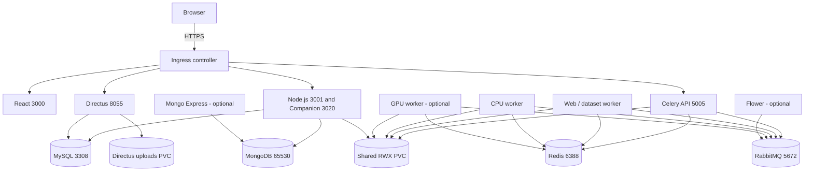

# Helm Deployment and Operations

---

## 1. Clone the repository

```bash
git clone https://github.com/cirisjl/single-cell.ai.git
cd single-cell.ai
```
---

## 2. Architecture and Helm chart layout



| Workload | Kubernetes kind | Default | Original image reference |
|---|---|---|---|
| `oscbdb` | StatefulSet | On | `mongo:7.0` |
| `oscb-redis` | StatefulSet | On | `redis:6-alpine` |
| `oscb-rabbitmq` | StatefulSet | On | `rabbitmq:4.2.8-management` |
| `oscb-mysql` | StatefulSet | On | `mysql:8.0` |
| `celery-api` | Deployment | On | `stormgod/oscb-api:1.0` |
| `worker-web` | Deployment | On | `stormgod/oscb-api:1.0` |
| `worker-cpu` | Deployment | On | `stormgod/oscb-api:1.0` |
| `oscb-node` | Deployment | On | `stormgod/oscb-node:1.0` |
| `oscb-react` | Deployment | On | `stormgod/oscb-react:1.0` |
| `directus` | Deployment | On | `directus/directus:9.24.0` |
| `dashboard` (Flower) | Deployment | Optional | `stormgod/oscb-api:1.0` |
| `mongo-express` | Deployment | Optional | `mongo-express:latest` |
| `worker-gpu` | Deployment | Optional | `stormgod/oscb-api:1.0` |

```text
single-cell-ai-helm/
├── charts/single-cell-ai/
│   ├── Chart.yaml
│   ├── values.yaml
│   ├── values.schema.json
│   └── templates/
│       ├── _helpers.tpl
│       ├── _pod.tpl
│       ├── configmap.yaml
│       ├── storage.yaml
│       ├── services.yaml
│       ├── statefulsets.yaml
│       ├── deployments.yaml
│       ├── ingress.yaml
│       └── NOTES.txt
├── examples/
│   ├── values-admin.yaml
│   ├── values-gpu.yaml
│   ├── values-production.example.yaml
│   └── values-local-dev.yaml
├── scripts/create-kubernetes-secret.sh
└── SOURCE_INVENTORY.json
```

The chart accepts values for image references, pulls, probes, CPU/memory, worker startup commands/arguments, replicas, optional workloads, Service ports, Secrets, PVC storage classes, Ingress, and application environment. It uses an **existing Kubernetes Secret** instead of creating credential values in the Helm release.

## 3. Prerequisites

You need:

- Kubernetes cluster with `kubectl` access and a suitable default StorageClass, or explicit storage classes.
- **Helm 3** (compatible with the chart's `apiVersion: v2`).
- Docker/BuildKit or another build tool, plus a container registry accessible to the cluster.
- Full single-cell.ai project source and Dockerfiles.
- Credential files and database initialization assets from your current deployment.
- A **ReadWriteMany (RWX)** storage provider (NFS CSI, CephFS, EFS, etc.) for `oscb-shared-data`. A typical single-node `ReadWriteOnce` PVC is not a safe substitute when API and workers run on different nodes.
- NVIDIA GPU Kubernetes device plugin (and NVIDIA-compatible node runtime) **only if** enabling `worker-gpu`.
- Ingress controller and TLS secret/cert-manager **only if** enabling Ingress.

Verify access:

```bash
helm version
kubectl cluster-info
kubectl get nodes -o wide
kubectl get storageclass
kubectl auth can-i create deployments -n oscb
```

The `kubectl auth` check requires that the namespace exists. Create it first if needed:

```bash
kubectl create namespace oscb --dry-run=client -o yaml | kubectl apply -f -
```

## 4. Configure values and Kubernetes storage

Start in the extracted `single-cell-ai-helm/` directory:

```bash
cp examples/values-production.example.yaml my-values.yaml
```

Edit `my-values.yaml` to set your actual image registry, domain names, and StorageClasses. The example contains fake registry hosts and storage class names; **do not install it unchanged**. Make sure every workload that uses the API image gets the same reachable repository/tag (API, both CPU/web workers, and optional Flower/GPU workers).

The most important options are:

| Helm value | Default | Reason |
|---|---|---|
| `workloads.celery-api.image` | `stormgod/oscb-api:1.0` | Built app image |
| `workloads.oscb-node.image` | `stormgod/oscb-node:1.0` | Custom Node backend image |
| `workloads.oscb-react.image` | `stormgod/oscb-react:1.0` | Custom React image |
| `storage.shared.size` | `100Gi` | Shared data, inputs, outputs |
| `storage.shared.storageClassName` | `null` | Choose RWX-capable class |
| `storage.directus.size` | `10Gi` | Directus uploads |
| `secrets.existingSecret` | `oscb-secrets` | Existing 19-key Secret |
| `workloads.dashboard.enabled` | `false` | Admin Flower |
| `workloads.mongo-express.enabled` | `false` | Admin Mongo Express |
| `workloads.worker-gpu.enabled` | `false` | NVIDIA worker |
| `ingress.enabled` | `false` | HTTPS routes |
| `config.data.*` | Source app.env values | Application settings |

The four StatefulSets have separate per-pod PVCs (`workloads.oscbdb.persistence`, `workloads.oscb-redis.persistence`, `workloads.oscb-rabbitmq.persistence`, `workloads.oscb-mysql.persistence`). Use storage classes compatible with your database and broker requirements. The default settings use `ReadWriteOnce` claims for each.

**Persistence lifecycle:** Shared and Directus PVCs carry `helm.sh/resource-policy: keep` by default to reduce risk of data loss on uninstall. StatefulSet `volumeClaimTemplates` are retained under the normal StatefulSet PVC retention behavior. Never assume `helm uninstall` is an adequate backup strategy. Treat claim names, storage classes and StatefulSet selectors as migration-sensitive and do not change them casually after installation.

### Application settings

The chart carries **89 non-secret environment variables** migrated from the earlier Kubernetes ConfigMap. They live at `config.data`, not in a `.env` file read by Helm. Override only what you need in `my-values.yaml`:

```yaml
config:
  data:
    HOST_URL: app.example.org
    CORS_ORIGIN: https://app.example.org
    NODE_ENV: production
    APP_ENV: Production
    REACT_APP_DIRECTUS_URL: https://directus.example.org
    PUBLIC_URL: https://directus.example.org
```

The React frontend may compile `REACT_APP_*` settings at **image build time**. Runtime ConfigMap changes do not necessarily replace those compiled settings; rebuild the React image with appropriate build arguments/environment if your Dockerfile expects them.

## 5. Create the Kubernetes Secret

The chart deliberately **does not** place passwords or API keys into values files. Create your credentials before installing Helm. Keep the secret directory outside source control. The helper expects **19 nonempty files**, each named `<key>.txt`:

```text
mongo_express_password.txt
redis_password.txt
rabbitmq_password.txt
mysql_password.txt
github_token.txt
email_password.txt
openai_api_key.txt
gemini_api_key.txt
jwt_token_secret.txt
directus_password.txt
flower_basicauth_password.txt
googledrive_key.txt
googledrive_secret.txt
dropbox_key.txt
dropbox_secret.txt
onedrive_key.txt
onedrive_secret.txt
directus_key.txt
directus_secret.txt
```

Run:

```bash
kubectl create namespace oscb --dry-run=client -o yaml | kubectl apply -f -
NAMESPACE=oscb SECRET_NAME=oscb-secrets \
  ./scripts/create-kubernetes-secret.sh /secure/path/to/secrets

kubectl -n oscb get secret oscb-secrets
```

The last command checks existence without printing the values. The script requires all 19 keys even when admin workloads are disabled, matching the source Kubernetes secret inventory.

**Existing deployment:** Preserve the exact MySQL/RabbitMQ/Redis passwords and Directus `KEY` and `SECRET` from the existing installation. Changing them during migration can break connections, persistent login state, or encryption-backed features. MongoDB's earlier source manifest does not configure authentication; don't interpret Mongo Express basic auth as database authentication.

For private registries, configure a Kubernetes image-pull Secret and set `global.imagePullSecrets`, rather than storing registry credentials in Helm values.

## 6. Validate and render the chart

Install Helm 3 on your workstation if it is not already available. From the package root:

```bash
helm lint ./charts/single-cell-ai
helm lint ./charts/single-cell-ai \
  -f my-values.yaml -f examples/values-admin.yaml

helm template oscb ./charts/single-cell-ai \
  --namespace oscb -f my-values.yaml > rendered.yaml

kubectl apply --dry-run=client -f rendered.yaml
```

Optional additional validation on a configured cluster:

```bash
kubectl apply --dry-run=server -n oscb -f rendered.yaml
```

Be aware: dry-run `apply` against an existing namespace can conflict with objects managed by another Helm release. A dry-run does not replace a complete real-world test, especially for PV provisioning, database initialization, image contents, GPU placement or ingress routing. Do not apply `rendered.yaml` for a normal Helm-managed installation; use Helm itself.

Check that images are the ones intended:

```bash
grep -n 'image:' rendered.yaml
```

## 7. Install the core platform

```bash
helm upgrade --install oscb ./charts/single-cell-ai \
  --namespace oscb --create-namespace \
  -f my-values.yaml \
  --wait --timeout 15m

helm status oscb -n oscb
kubectl -n oscb get pods,deploy,statefulset,svc,pvc
kubectl -n oscb get events --sort-by=.lastTimestamp | tail -30
```

`--wait` checks workload readiness but does not validate the complete signup/analysis process. StatefulSet PVCs and database initialization can need extra time. Kubernetes **does not implement Compose's `depends_on` semantics**; the app images need connection retry logic, and startup/readiness probes need to be appropriate for their services.

To access the UI without Ingress:

```bash
kubectl -n oscb port-forward svc/oscb-react 3000:3000
```

Then visit `http://localhost:3000`. Other HTTP endpoints can be forwarded similarly, e.g. `kubectl -n oscb port-forward svc/oscb-node 3001:3001`. Keep in mind that requests made by browser JavaScript must use an endpoint reachable by **the browser**; cluster-internal DNS names work only inside the cluster, not directly in the browser.

## 8. Enable administrative tools

The former Compose `admin` profile maps to Helm overlays:

```bash
helm upgrade --install oscb ./charts/single-cell-ai \
  -n oscb -f my-values.yaml -f examples/values-admin.yaml \
  --wait --timeout 15m
```

This enables both `dashboard` (Celery Flower) and `mongo-express`. The chart creates only **ClusterIP Services**, which are not directly public. Access them with port-forwarding:

```bash
kubectl -n oscb port-forward svc/dashboard 5555:5555
# Another terminal:
kubectl -n oscb port-forward svc/mongo-express 8081:8081
```

Visit `http://localhost:5555` and `http://localhost:8081`. The basic-auth passwords come from the existing Kubernetes Secret. Avoid adding admin paths to the public Ingress unless you have appropriate access controls in place.

**IMPORTANT Helm upgrade behavior:** Pass the same cumulative `-f` values files each time. Omitting `examples/values-admin.yaml` in a later upgrade will turn these admin workloads off under Helm's default values-merging behavior.

## 9. Enable GPU workers

Your Kubernetes cluster must expose GPUs to workloads, typically via the NVIDIA device plugin:

```bash
kubectl describe node <gpu-node-name> | grep -A8 -B4 'nvidia.com/gpu'
```

Replace `<gpu-node-name>` with a real node name. `worker-gpu` requests one GPU via `resources.limits.nvidia.com/gpu: 1`, using the existing `oscb-api` image that contains your GPU dependencies. Customize its `nodeSelector` and/or `tolerations` in the values file if your cluster isolates GPU nodes.

```bash
helm upgrade --install oscb ./charts/single-cell-ai \
  -n oscb -f my-values.yaml -f examples/values-gpu.yaml \
  --wait --timeout 15m

kubectl -n oscb get deployment worker-gpu
kubectl -n oscb describe pod -l app.kubernetes.io/component=worker-gpu
kubectl -n oscb logs deployment/worker-gpu --tail=100
```

To enable both optional groups, use:

```bash
helm upgrade --install oscb ./charts/single-cell-ai \
  -n oscb -f my-values.yaml \
  -f examples/values-admin.yaml -f examples/values-gpu.yaml \
  --wait --timeout 15m
```

For CPU-only nodes, omit the GPU overlay. The default worker queues remain separated: `web,dataset`, `cpu` and `gpu`. Adding a GPU worker does not cause the CPU worker to consume GPU-only tasks.

## 10. Configure HTTPS and API routing

The optional Ingress mirrors the previous Kubernetes example:

| Host/path | Service | Port |
|---|---|---|
| `app.example.org/` | `oscb-react` | 3000 |
| `app.example.org/node` | `oscb-node` | 3001 |
| `api.example.org/` | `celery-api` | 5005 |
| `directus.example.org/` | `directus` | 8055 |
| `companion.example.org/` | `oscb-node` | 3020 |

Enable `ingress.enabled: true` in `my-values.yaml`, then set `ingress.hosts`, `ingress.tls`, the ingress controller class, DNS, and TLS Secret (`oscb-tls` by default). The chart **does not install an ingress controller** or automatically provision TLS certificates.

For browser signup, configure the frontend to call a same-origin relative URL (e.g. `/node/signup`) through your Ingress whenever possible. If browser requests must cross origins, configure CORS in **the actual Node Express backend**, not just Directus's CORS settings. Avoid mixing `http` and `https` across browser requests.

If your Ingress controller changes or strips path prefixes, verify the routes; this chart does not use a rewrite rule by default.

## 11. Customize resources, workers and configuration

Each workload has its own editable values under `workloads.<name>`. Example tuning:

```yaml
workloads:
  worker-web:
    replicas: 1
    resources:
      requests:
        cpu: 500m
        memory: 1Gi
      limits:
        cpu: "2"
        memory: 4Gi
    args:  # replace the COMPLETE args list
      - celery
      - -A
      - main.celery
      - worker
      - --loglevel=info
      - -Q
      - web,dataset
      - --concurrency=2
      - --prefetch-multiplier=1
  worker-cpu:
    replicas: 2
```

> [!IMPORTANT]
> Scaling CPU/web workers requires sufficient RabbitMQ capacity, accessible storage and memory. **Do not scale MongoDB, MySQL, Redis or RabbitMQ to multiple replicas simply by changing `replicas`**; their default configurations are single-instance and not configured for clustered replication or HA.

For private registries:

```yaml
global:
  imagePullSecrets:
    - name: private-registry-credentials
```

For database-level storage-class changes, set `workloads.<database>.persistence.storageClassName` before first installation. On a running StatefulSet, storage-class and volume-claim-template changes often require a controlled migration rather than an in-place Helm upgrade.

## 12. Deploy changes, roll back and uninstall

See the exact desired configuration first:

```bash
helm diff upgrade oscb ./charts/single-cell-ai -n oscb -f my-values.yaml
```

The `helm diff` command **requires the optional helm-diff plugin**. Without it, compare two `helm template` outputs using your usual diff tool.

Upgrade:

```bash
helm upgrade oscb ./charts/single-cell-ai \
  -n oscb -f my-values.yaml \
  --wait --timeout 15m

helm history oscb -n oscb
```

Roll back chart changes, **not database data**:

```bash
helm rollback oscb <REVISION> -n oscb --wait --timeout 15m
```

To uninstall:

```bash
helm uninstall oscb -n oscb
```

The shared-data and Directus claims are normally kept due to chart annotations; database/broker PVC behavior depends on the StatefulSet policy and cluster defaults. Verify after uninstall and back up first. Helm rollback is not a transaction that reverts data migrations, MySQL schema changes, or the data written by older Pods.

## 13. Migrate data from Docker Compose

Start with a maintenance window and verified backups. Major stateful sources include:

- MongoDB: export using `mongodump`/restore using `mongorestore` with matching database options.
- MySQL: consistent logical backup (`mysqldump` or an approved backup method), then import to the initialized StatefulSet.
- Redis/RabbitMQ: decide whether you need transient task state and queued work or can drain queues and start clean; export definitions/metadata when relevant.
- Shared API/worker filesystem: copy uploads, results, logs, and project assets to `oscb-shared-data` with permissions and expected `subPath` directories.
- Directus uploads: copy to `directus-uploads` and preserve database records.

> [!IMPORTANT]
> Do not mount or reuse the exact same database data directory concurrently from Docker Compose and Kubernetes. Ensure the old environment is stopped or appropriately quiesced before the final cutover. Preserve the Directus encryption keys and login credentials. Test with a copy of nonproduction data before a production migration.

## 14. Troubleshooting

### Pods pending because of storage

```bash
kubectl -n oscb get pvc
kubectl -n oscb describe pvc oscb-shared-data
kubectl -n oscb describe pod <pod-name>
```

`oscb-shared-data` needs an RWX-capable class. If database PVCs are pending, inspect their automatically generated names, e.g. `data-oscbdb-0`.

### ImagePullBackOff or ErrImagePull

```bash
kubectl -n oscb describe pod <pod-name>
helm get values oscb -n oscb
```

### CreateContainerConfigError for missing Secret keys

```bash
kubectl -n oscb get secret oscb-secrets
kubectl -n oscb describe pod <pod-name>
```

Check the Secret name and required keys; the chart does not create secret values. Do not paste credential contents into logs or support requests.

### Node signup CORS problem

Check Node readiness (`kubectl logs deployment/oscb-node -n oscb`). From a browser, use a valid reachable URL; `oscbdb` and other cluster DNS names are not resolvable in a user's browser. If the preflight request fails, enable CORS in the Node application's middleware or use same-origin `/node` routing through Ingress.

### Worker not processing a task

```bash
kubectl -n oscb logs deploy/worker-web --tail=100
kubectl -n oscb logs deploy/worker-cpu --tail=100
kubectl -n oscb get deployment worker-gpu
```

Confirm the submitted task's Celery queue (`web,dataset`, `cpu`, or `gpu`), broker credentials, and image dependencies. The GPU-only queue has no consumer unless enabled.

### MySQL or MongoDB startup failure

```bash
kubectl -n oscb logs statefulset/oscb-mysql --tail=100
kubectl -n oscb logs statefulset/oscbdb --tail=100
kubectl -n oscb get pvc
```

For existing database volumes, do not rotate passwords or wipe PVCs as a first fix. Verify the stored credentials, database files and image expectations first.

### Dashboard or Mongo Express is missing

These remain disabled by default. Re-run `helm upgrade` with `-f examples/values-admin.yaml` and inspect Pods/Services. Both Services are internal ClusterIP by design; use `kubectl port-forward` for access.

## 15. Security and production checklist

- [ ] Replace example registry names, domains and storage-class names before install.
- [ ] Use private registry pull credentials where required. Consider immutable digests after verifying deployments; do not silently change the original image tags during conversion.
- [ ] Supply all 19 secrets through Kubernetes; never commit actual secret values or put them in Helm values.
- [ ] Preserve Directus `KEY`/`SECRET` and existing database credentials.
- [ ] Use a dedicated non-root MySQL application account instead of root where the application supports it. This needs an application configuration migration; the source manifest still uses `root`.
- [ ] Add MongoDB authentication and network isolation before production; the source MongoDB configuration does not enforce authentication.
- [ ] Do **not** expose Flower, Mongo Express, RabbitMQ management, databases or Redis publicly. Use RBAC, NetworkPolicy and internal-only access.
- [ ] Review whether mounting `/run/secrets` into the React container is genuinely required; frontend code must never expose backend API keys to browsers.
- [ ] Configure a correct TLS Ingress and browser URLs; use same-origin `/node` where possible.
- [ ] Confirm the RWX PVC works across nodes and each application's filesystem permissions are correct.
- [ ] Back up MongoDB, MySQL, Directus uploads and shared user data and test restores.
- [ ] Set appropriate resource quotas, monitoring, runtime security settings, probes and disruption/maintenance plans for your cluster.
- [ ] Verify application startup, account signup, dataset uploads, Celery task execution and GPU tasks (if enabled).
