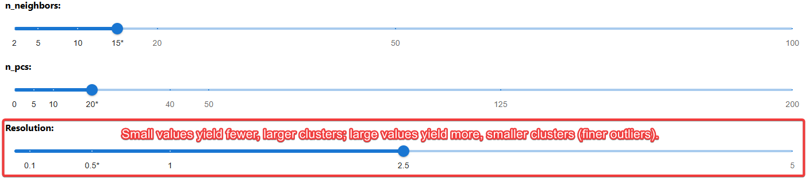
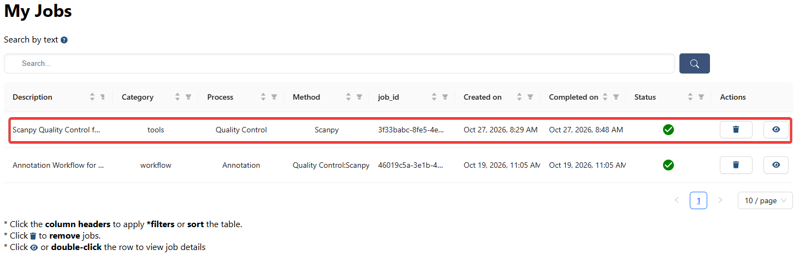
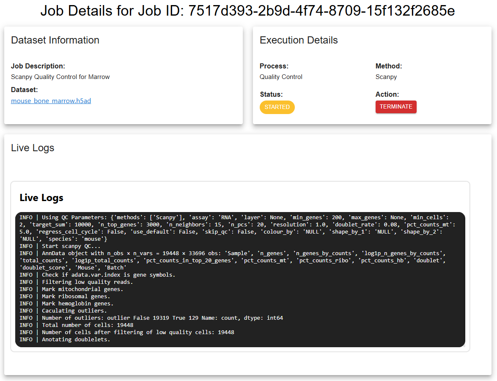
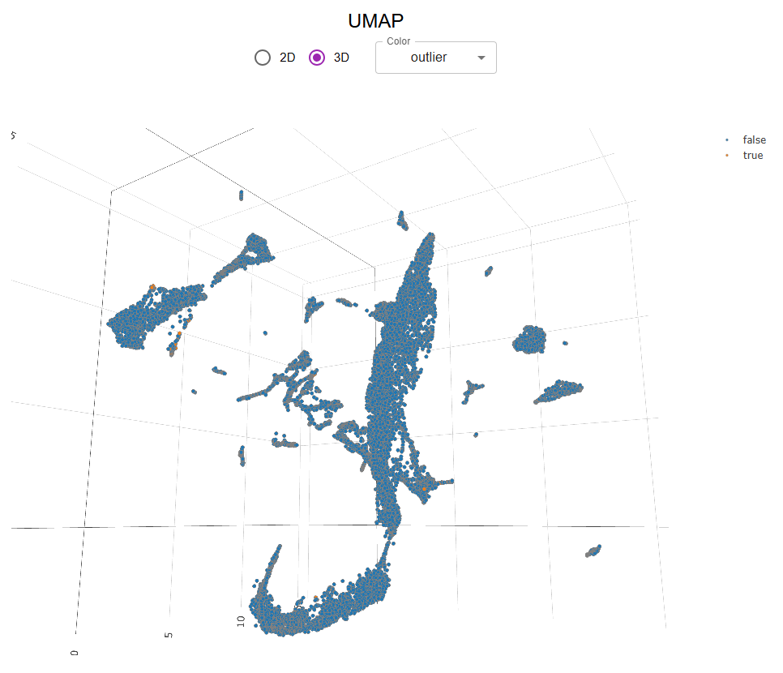
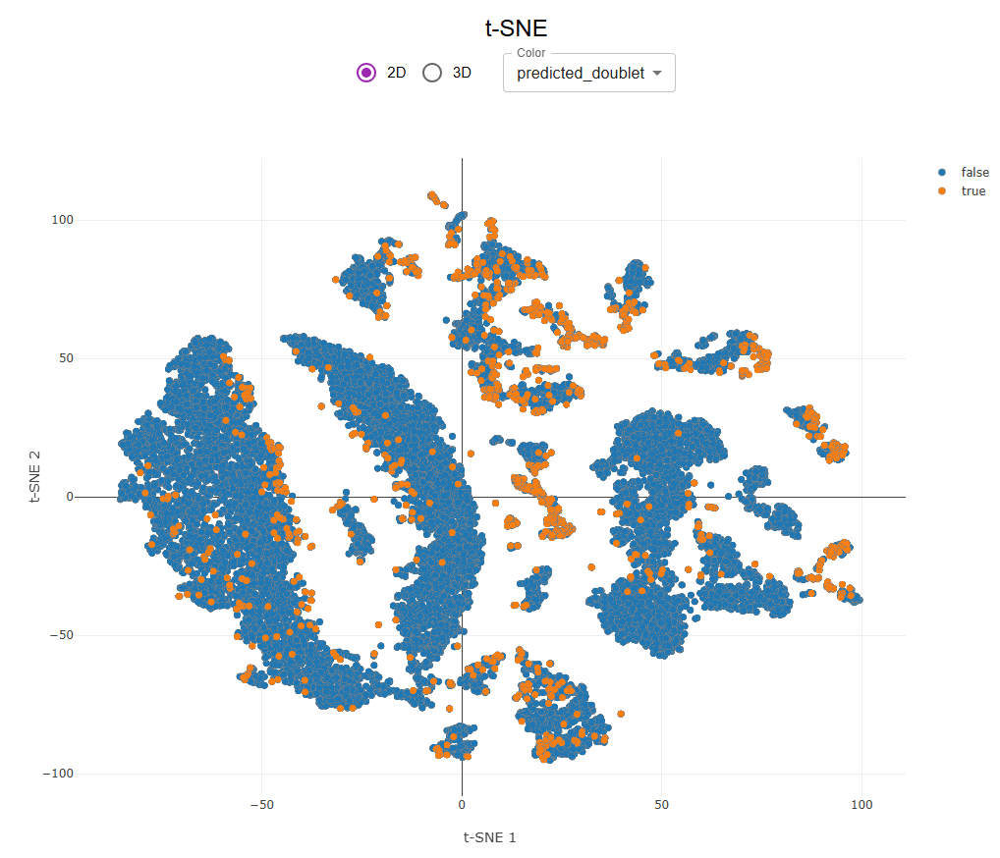
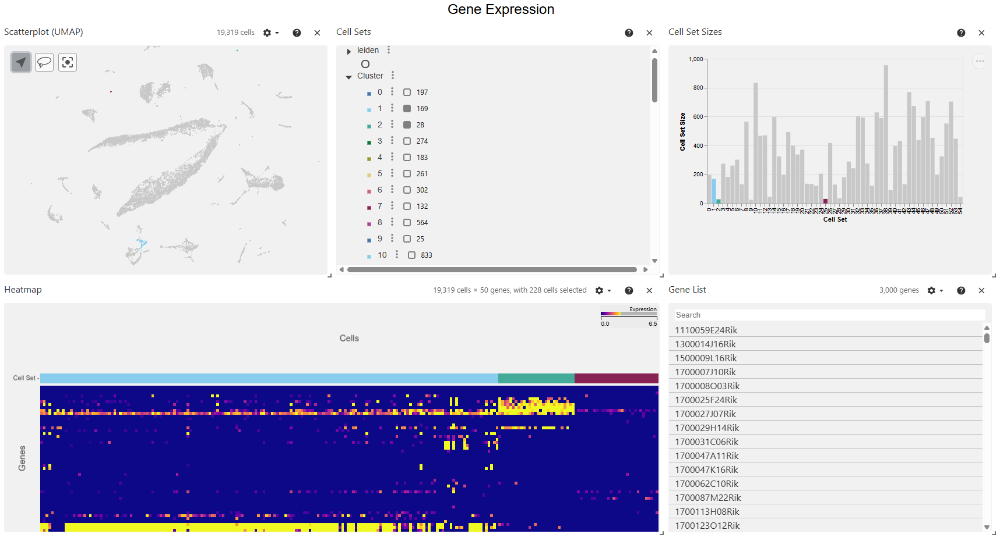
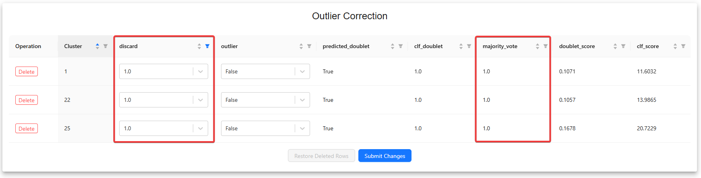

# Identify Outliers in Mouse Bone Marrow Using Quality Control

## Overview

This tutorial demonstrates how to identify and review potential outlier cell populations in a mouse bone marrow single-cell RNA-sequencing (scRNA-seq) dataset using the **Quality Control (QC)** tool in **single-cell.ai**. You will run QC, inspect clustering and gene-expression results, compare outlier and doublet predictions, and curate clusters before continuing downstream analysis.

The example uses the **Mouse Marrow** dataset (**19,448 cells**) derived from a study of uninfected wild-type (WT), lymphocytic choriomeningitis virus clone 13 (LCMV Cl 13)-infected WT, and infected *Sphk2*−/− mice. Bone marrow samples were profiled using 10x Genomics single-cell 3′ RNA-seq.[^1]

**In this tutorial, you will:**

1. Select the Mouse Marrow dataset and configure a QC job.
2. Run **Scanpy** with a clustering **resolution of 2.5**.
3. Monitor execution and open the results.
4. Examine UMAP/t-SNE plots, cluster composition, and gene expression.
5. Review doublet and outlier predictions, correct cluster flags, and submit the curated results.

> [!NOTE]
> This is a worked example, not a universal QC prescription. Filtering thresholds, expected doublet rates, and clustering settings should be evaluated for each tissue, sequencing protocol, and study design. A computationally predicted outlier may represent a genuine, rare cell population.

---

## 1. Create a Quality Control Job

Navigate to **Analyses → Tools → Quality Control** and start a new QC job.

### 1.1 Select the input dataset

1. Open the **Datasets** selector.
2. Search for **Mouse Marrow**; use the available filters or column sorting to narrow the results.
3. Select the dataset containing **19,448 cells**.
4. If the dataset contains multiple processing stages, expand its entries using the **+** control and select the **raw, unnormalized counts** when available.

> [!TIP]
> To analyze your own dataset, follow [Data Management](doc/?doc=data_management) before creating a QC job. Raw count data are generally preferable at the start of QC because many QC metrics and filtering methods depend on count distributions.

### 1.2 Choose a QC method

The tool supports QC methods based on **Bioconductor**,[^2] **Scanpy**,[^3] **Seurat**,[^4] and **dropkick**.[^5]

For this example:

- **QC method:** `Scanpy`
- **QC/filtering parameters:** Keep the defaults for the example run; review their suitability for your own data.
- **Method selection:** Choose **one QC method per job**.

Depending on the selected method, the interface may offer gene/cell filtering, mitochondrial-count filtering, highly variable gene (HVG) selection, doublet detection, or cell-cycle regression. Some settings are method-specific; only enable them when they are appropriate for your experiment.

### 1.3 Configure visualization and clustering

Set the following options:

| Parameter | Example setting | Purpose |
| --- | --- | --- |
| `n_neighbors` | Default | Controls the size of local neighborhoods in the cell-neighbor graph. |
| `n_pcs` | Default | Sets how many principal components are used for downstream analysis. |
| `Resolution` | **2.5** | Produces finer clusters to help inspect possible outlier populations. |
| `Number of Highly Variable Genes for Heatmap` | **50** | Controls how many selected genes are displayed in the heatmap. |

> [!TIP]
> - **`n_neighbors`:** Smaller values emphasize local relationships and may produce more fragmented neighborhoods; larger values capture broader structure. Their effect depends on the dataset and embedding method.
> - **`n_pcs`:** Too few components may exclude biological information; too many may retain unwanted variation.
> - **`Resolution`:** Higher values generally split the graph into more, smaller clusters; lower values favor fewer, larger clusters. Resolution does **not** independently establish biological cell types.

### 1.4 Review QC thresholds

The following guidelines help interpret common parameters. They are **starting points**, not fixed cutoffs for the Mouse Marrow dataset.

| Parameter | What it controls | Common starting point / consideration |
| --- | --- | --- |
| `min_genes` | Minimum number of genes detected in a cell. | Often **200–500**; very low values can indicate poor-quality cells or empty droplets. |
| `max_genes` | Maximum number of genes detected in a cell. | Dataset-dependent; unusually high values may indicate multiplets, although large or highly active cells can also express many genes. |
| `min_cells` | Minimum number of cells in which a gene must be detected. | Often **3–20**; filters very sparsely detected genes. |
| Mitochondrial-count percentage | Fraction of each cell's counts assigned to mitochondrial genes. | Often evaluated around **5–20%**, with tissue- and protocol-specific adjustment. |
| Highly variable genes (HVGs) | Genes selected for downstream feature-space construction. | Choose a sufficient number to represent biological variation without overwhelming the analysis with noise. |
| Expected doublet rate | Prior estimate of droplets containing multiple cells. | Use an estimate appropriate to the platform, chemistry, and cell loading; do not assume a universal rate. |
| Cell-cycle regression | Optional adjustment for cell-cycle-associated variation. | Use only if cell-cycle effects obscure the biological question; regression can also remove genuine biology. |

> [!IMPORTANT]
> A high mitochondrial fraction is not automatically evidence of a damaged cell. Baseline mitochondrial expression differs across cell types and physiological states. Likewise, highly expressed genes and high gene counts can reflect real biology. Inspect QC metric distributions and marker expression before choosing thresholds or excluding clusters.

### 1.5 Submit the job

Review the dataset, method, and parameter settings, then submit the QC job. The application queues the analysis for execution. You do not need to keep the submission page open while the job runs.

---

## 2. Monitor Job Execution

Open **My Jobs** to track submitted analyses. Use search, sorting, or filters to find the QC job, and open its details from the job row.

The **Job Details** page provides:

- **Dataset Information:** Input dataset and job description.
- **Execution Details:** Selected process, method, job status, and available actions.
- **Live Logs:** Progress messages, warnings, and diagnostic output.

If execution fails, review the logs and any displayed error report. Where available, use the error-reporting feature to submit a reproducible issue to the project's GitHub issue tracker. Include the relevant error and configuration, but **do not expose private sample data, credentials, or access tokens**.

> [!NOTE]
> The platform may reuse a previously computed result when the dataset content and analysis configuration match an existing cached job. This can reduce redundant computation; it does not change the need to review the returned results.

---

## 3. Inspect the QC Results

After the job finishes, open its result page. QC outputs are available in **AnnData** or **MuData** format, depending on the analysis and input. The built-in formatting/conversion tool can be used when a different supported format is required.

For an **AnnData** result, common locations include:

| Content | AnnData location |
| --- | --- |
| Cell-level annotations and QC metrics | `adata.obs` |
| Gene-level annotations and statistics | `adata.var` |
| Raw counts, if preserved in that layer | `adata.layers["raw_counts"]` |
| Embeddings (PCA, UMAP, t-SNE, etc.) | `adata.obsm` |

For example, an embedding may be stored as `adata.obsm["X_umap"]`. Exact keys depend on the method and output configuration. Check the actual file instead of assuming that every key or layer exists.

### 3.1 Examine UMAP and t-SNE

1. Open the interactive **UMAP** or **t-SNE** plot.
2. Switch between **2D** and **3D** views, when available.
3. Use the **Color** dropdown to inspect cluster assignments and QC labels.
4. Look for isolated clusters, small satellite groups, and overlap between predicted outliers and doublets.

The example includes predictions from **Scrublet** (`predicted_doublet`) and **DoubletDetection** (`clf_doublet`), along with an `outlier` label. These may be available as columns in `adata.obs`.

Select `predicted_doublet`, `clf_doublet`, or `outlier` in the **Color** control to compare their distributions.

> [!IMPORTANT]
> Visual separation in UMAP or t-SNE does **not** prove that a cluster is an artifact. Embedding geometry and distance can be affected by normalization, neighborhood selection, batch effects, and clustering. Interpret these plots together with QC metrics and gene expression.

### 3.2 Examine clusters and gene expression

Open the **Gene Expression** panel to review the available linked views:

- **UMAP:** Position of the selected cluster or cell population.
- **Cluster Sets:** Cluster membership and available cluster assignments.
- **Cluster Set Sizes:** Number of cells represented by each cluster.
- **Heatmap:** Expression patterns across the selected genes and groups.
- **Gene List:** Genes available for closer inspection.

Before marking a cluster for removal, check whether it:

1. Expresses coherent, biologically plausible cell-type or cell-state markers.
2. Has unusually high/low gene counts, total counts, or mitochondrial fractions.
3. Is enriched for predicted doublets or other QC flags.
4. Appears only in one sample or batch, potentially indicating a technical effect.
5. Could be a legitimate rare cell population rather than low-quality cells.

Cross-check marker genes against the relevant literature and experimental design. Avoid removing a population solely because it is small or distant from other cells in an embedding.

---

## 4. Review and Correct Predicted Outliers

Open **Outlier Correction** to inspect the cluster-level QC decisions. Depending on the output, the table includes:

| Column | Interpretation |
| --- | --- |
| `Cluster` | Cluster identifier. |
| `discard` | Editable indicator used by the correction workflow to flag a cluster for exclusion. |
| `outlier` | Editable outlier classification (`True` / `False`). |
| `predicted_doublet` | Scrublet prediction. |
| `clf_doublet` | DoubletDetection prediction. |
| `majority_vote` | Aggregated prediction from the methods used by the workflow. |
| `doublet_score`, `clf_score` | Method-specific scores that help evaluate predictions. |

### 4.1 Curate the cluster decisions

1. **Sort or filter** the table using its column headers to locate candidate clusters.
2. Compare `majority_vote`, `predicted_doublet`, `clf_doublet`, and scores. Different detection methods may disagree.
3. Return to **Gene Expression** and the embedding plots to validate each candidate cluster.
4. **Edit** the relevant `discard` or `outlier` control based on the evidence. In this workflow, `discard = 1` or `outlier = True` marks a cluster for exclusion.
5. If you remove a table entry using **Delete** by mistake, use **Restore Deleted Rows** before submitting changes, when the control is available.
6. Review the final selections, then click **Submit Changes** to apply the correction.

> [!CAUTION]
> Automated doublet and outlier labels are predictions, not definitive biological classifications. A rare or activated cell type may be incorrectly flagged. Record the rationale for exclusions and review the resulting cell counts and cluster composition before proceeding to downstream analysis.

### 4.2 Verify the curated output

After applying changes, confirm that:

- The intended clusters were excluded and plausible rare populations were retained.
- Remaining cells have acceptable QC metric distributions.
- Major cell populations and expected marker-expression patterns are preserved.
- The updated dataset or result is available for subsequent processing.

If a decision is uncertain, compare results before and after filtering rather than irreversibly discarding the population based only on an automated label.

---

## 5. Use the AI Assistant (Optional)

The **AI Assistant** can help interpret QC settings, candidate outliers, and marker-expression patterns in the context of published research. You can use the chat interface to provide experimental context or relevant papers, and download the conversation history when that option is available.

Useful questions include:

- *What evidence would distinguish a low-quality cluster from a rare bone marrow cell population?*
- *How should mitochondrial-count thresholds be evaluated for this sample?*
- *Which marker genes could help identify this cluster, and what literature supports them?*
- *Why might Scrublet and DoubletDetection disagree on these cells?*

Treat AI-generated suggestions as hypotheses. Verify references, marker-gene assignments, and recommended filtering decisions against the underlying data and literature before applying them.

---

## Summary

You have used the Quality Control tool to run Scanpy on Mouse Marrow, inspect QC results, compare outlier and doublet predictions, and manually review cluster exclusions. The central principle is to **combine computational QC signals with biological evidence** so that technical artifacts are filtered without removing meaningful cell populations.

## References

[^1]: Vijayamahantesh V, He Y, Jiang L, Huerter H, Jung KI, McKenna S, Studstill CJ, Allen L-AH, Nistala R, Xu D, and Hahm B. Sphingosine kinase 2 suppresses neutrophil responses to promote viral persistence while attenuating immune pathology. *Frontiers in Immunology*. 2026;16:1706967. https://doi.org/10.3389/fimmu.2025.1706967
[^2]: Huber W, Carey VJ, Gentleman R, et al. Orchestrating high-throughput genomic analysis with Bioconductor. *Nature Methods*. 2015;12:115–121. https://doi.org/10.1038/nmeth.3252
[^3]: Wolf FA, Angerer P, and Theis FJ. SCANPY: large-scale single-cell gene expression data analysis. *Genome Biology*. 2018;19:15. https://doi.org/10.1186/s13059-017-1382-0
[^4]: Satija R, Farrell JA, Gennert D, et al. Spatial reconstruction of single-cell gene expression data. *Nature Biotechnology*. 2015;33:495–502. https://doi.org/10.1038/nbt.3192
[^5]: Heiser CN, Wang VM, and Chen B, et al. Automated quality control and cell identification of droplet-based single-cell data using dropkick. *Genome Research*. 2021;31:1742–1752. https://doi.org/10.1101/gr.271908.120
