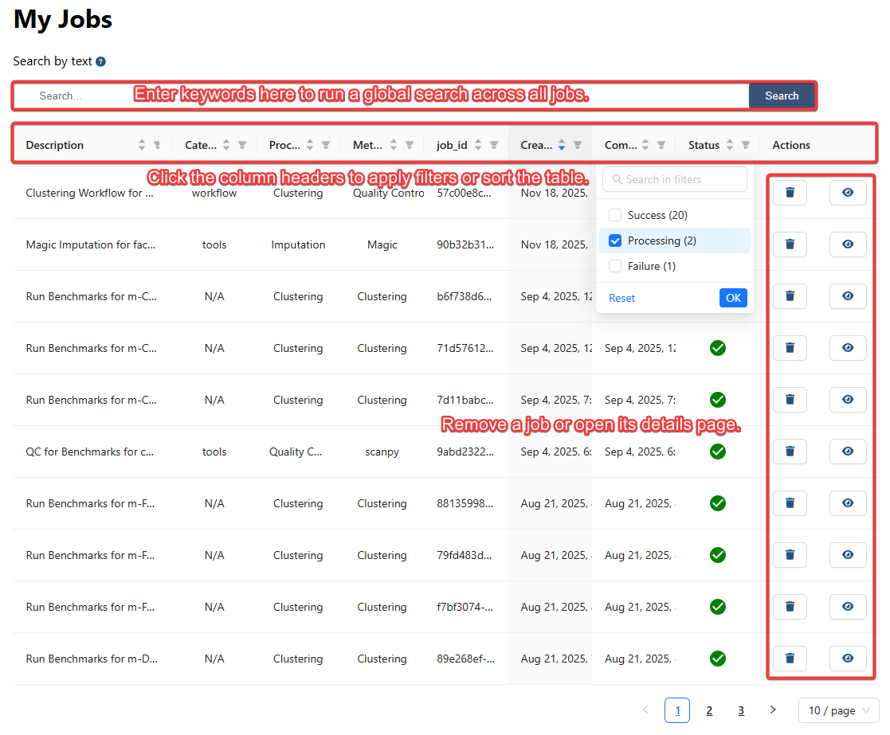
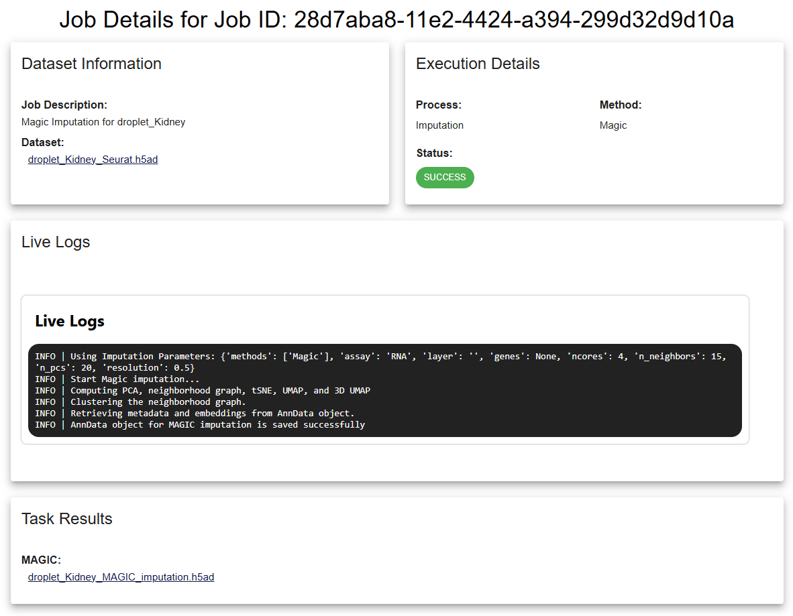
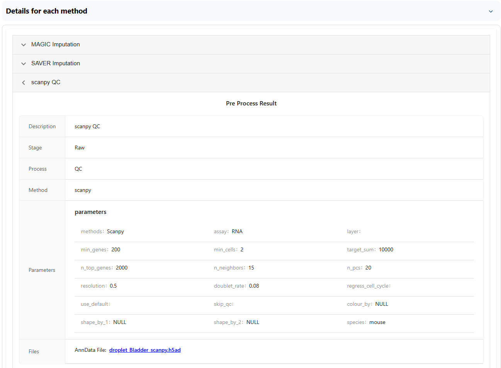

# Job Management

Analyses are submitted as asynchronous jobs. You can navigate away after submission, return to **My Jobs**, and review execution status and outputs.

## Monitor submitted jobs

1. Open **My Jobs** in single-cell.ai. The sidebar also shows a short list of recent jobs.
2. Search or sort the table and identify the intended analysis.
3. Open a job to see its status, selected dataset, parameters, log messages, and outputs.
4. Download outputs you need to retain. Delete a job only after confirming which results are associated with it.

> **Tip:** Check the final status and processing log before interpreting an output. A partially completed workflow may not have results from every stage.

## Investigate failures

The **Job Details** page displays execution logs, task results, interactive plots when generated, and available error reporting controls. Review the traceback or failure message and verify input fields, memory limits, method options, and resource availability. If you submit an issue report, remove confidential information from logs before sharing them.

## Inspect workflow processes

A workflow contains multiple processes. Expand each process in **Workflow Details** to examine its settings, output datasets, figures, and logs. Compare the status of individual steps rather than assuming the overall job status explains every intermediate result.

For a worked example, see the [Annotation workflow tutorial](doc/?doc=workflows_annotation).
