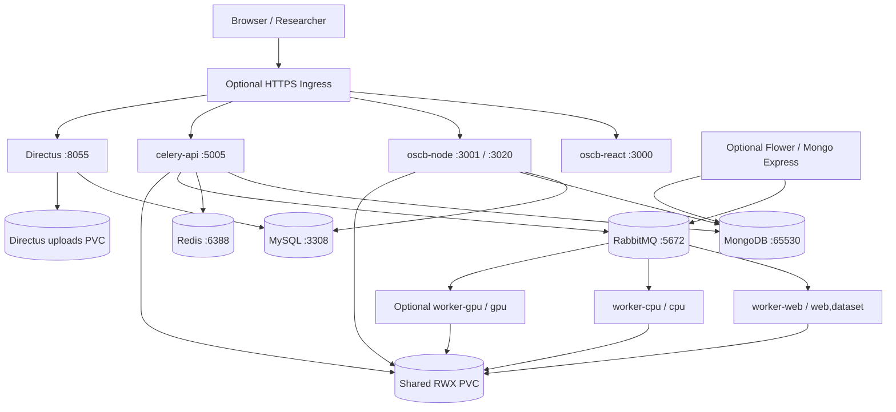

#  Kubernetes Deployment

**Target:** Kubernetes, using standard manifests and Kustomize overlays  
**Services:** 13 workloads; 10 application-facing ClusterIP Services plus four headless StatefulSet Services  
**Credential handling:** 19 file-based Docker Compose secrets translated into one Kubernetes Secret, mounted only with the keys needed by each workload

> [!CAUTION]
> **Do not apply to production unchanged.** Replace the example domains, provision appropriate storage, supply existing credentials, and plan a data migration. Image tags used for third-party images have been preserved exactly as supplied.

---

## 1. Clone the repository

```bash
git clone https://github.com/cirisjl/single-cell.ai.git
cd single-cell.ai
```
---

## 2. Architecture and service mapping



The deployment uses **StatefulSets** for MongoDB, Redis, RabbitMQ, and MySQL; **Deployments** for the API, Celery workers, Node.js, React, Directus, and optional admin services. Each app-facing Service is internal (`ClusterIP`) by default; the Ingress example is deliberately not applied automatically.

| Original Compose service | Kubernetes workload | Image | Kubernetes exposure |
|---|---|---|---|
| `oscbdb` | StatefulSet `oscbdb` | `mongo:7.0` | `oscbdb:65530` |
| `oscb-redis` | StatefulSet `oscb-redis` | `redis:6-alpine` | `oscb-redis:6388` |
| `oscb-rabbitmq` | StatefulSet `oscb-rabbitmq` | `rabbitmq:4.2.8-management` | `oscb-rabbitmq:5672`, management `:15672` |
| `oscb-mysql` | StatefulSet `oscb-mysql` | `mysql:8.0` | `oscb-mysql:3308` |
| `celery-api` | Deployment `celery-api` | `stormgod/oscb-api:1.0` | `celery-api:5005` |
| `worker-web` | Deployment `worker-web` | `stormgod/oscb-api:1.0` | No Service; queue `web,dataset` |
| `worker-cpu` | Deployment `worker-cpu` | `stormgod/oscb-api:1.0` | No Service; queue `cpu` |
| `worker-gpu` | Optional Deployment | `stormgod/oscb-api:1.0` | No Service; queue `gpu` |
| `dashboard` | Optional Deployment `dashboard` | `stormgod/oscb-api:1.0` | `dashboard:5555` |
| `mongo-express` | Optional Deployment | `mongo-express:latest` | `mongo-express:8081` |
| `oscb-node` | Deployment `oscb-node` | `stormgod/oscb-node:1.0` | `oscb-node:3001`, `:3020` |
| `oscb-react` | Deployment `oscb-react` | `stormgod/oscb-react:1.0` placeholder | `oscb-react:3000` |
| `directus` | Deployment `directus` | `directus/directus:9.24.0` | `directus:8055` |

> [!IMPORTANT]
> **Optional profiles:** Compose `profiles: [admin]` maps to `kubernetes/overlays/admin`; `profiles: [gpu]` maps to `kubernetes/overlays/gpu`. The default `base` does not run those services.

---

## 3. Prerequisites and source files

You need:

- A working Kubernetes cluster and access using `kubectl`, plus permissions to create Namespace, Secrets, PVCs, StatefulSets, Deployments, and Services.
- A Docker- or OCI-compatible build engine and a registry accessible from every cluster node.
- **ReadWriteMany (RWX)** storage supported by your cluster (for example, NFS/CSI) for application/worker shared files. This is not generally available from the default local-path provisioner.
- A **ReadWriteOnce (RWO)** storage class for each database/broker and Directus uploads; tailor capacities and backups.
- The original `secrets/*.txt` values. **Reuse existing production passwords and Directus keys** during migration; replacing them without a coordinated rotation can break access to existing data.
- Optional: NVIDIA GPU drivers, Kubernetes NVIDIA device plugin, and schedulable `nvidia.com/gpu` resources for the GPU overlay.
- Optional: Ingress controller, DNS records, and TLS certificate for public access.

Check the cluster:

```bash
kubectl cluster-info
kubectl get nodes -o wide
kubectl get storageclass
kubectl api-resources | grep -E 'deployments|statefulsets|ingresses'
```

---

## 4. Project layout

```text
single-cell-ai-kubernetes/
├── INVENTORY.json
├── scripts/
│   ├── create-kubernetes-secret.sh
│   └── validate-offline.py
└── kubernetes/
    ├── base/
    │   ├── namespace.yaml
    │   ├── storage.yaml
    │   ├── app.env
    │   ├── kustomization.yaml
    │   ├── stateful/
    │   │   ├── mongodb.yaml
    │   │   ├── mysql.yaml
    │   │   ├── rabbitmq.yaml
    │   │   └── redis.yaml
    │   └── apps/
    │       ├── celery-api.yaml
    │       ├── worker-web.yaml
    │       ├── worker-cpu.yaml
    │       ├── oscb-node.yaml
    │       ├── oscb-react.yaml
    │       └── directus.yaml
    ├── optional/
    │   ├── admin/{kustomization.yaml,admin.yaml}
    │   └── gpu/{kustomization.yaml,gpu.yaml}
    ├── overlays/
    │   ├── admin/kustomization.yaml
    │   ├── gpu/kustomization.yaml
    │   └── all/kustomization.yaml
    └── examples/
        └── ingress.example.yaml
```

Render manifests locally (this does not connect to the cluster):

```bash
python3 scripts/validate-offline.py
kubectl kustomize kubernetes/base > /tmp/oscb-base-rendered.yaml
kubectl kustomize kubernetes/overlays/all > /tmp/oscb-all-rendered.yaml
```

`kubectl kustomize` is included with supported kubectl versions. Do not put password values into a tracked Kustomize file.

---

## 5. Configure environment variables and application URLs

The file `kubernetes/base/app.env` contains non-secret values migrated from the supplied `.env` (including the unusual source ports), with example hostnames and email addresses substituted. Kustomize generates the ConfigMap `oscb-app-config` from it.

Important defaults to check:

```dotenv
HOST_URL=app.example.org
MONGO_URL=mongodb://oscbdb:65530
MONGO_DB_NAME=oscb
REDIS_PORT=6388
RABBITMQ_DEFAULT_USER=admin
RABBITMQ_PORT=5672
MYSQL_TCP_PORT=3308
DB_HOST=oscb-mysql
DB_PORT=3308
REACT_APP_DIRECTUS_URL=https://directus.example.org
PUBLIC_URL=https://directus.example.org
CORS_ORIGIN=https://app.example.org
```

Check all `${*_FILE}` settings; the corresponding secret volume mounts retain the Compose `/run/secrets/<name>` path. Do not replace these values with literal passwords in the ConfigMap.

In particular:

- `HOST_URL` may be a hostname rather than a full URL depending on your application. Check the source code.
- `CORS_ORIGIN` should list the actual browser origin(s) in the format required by your Directus/backend versions. Node CORS must be configured **inside the Node app** if it is an independent Express process.
- The API, Node, and React public paths/ports should be checked against the application routing code. The example Ingress assumes `/node` belongs to Node, with `/` going to React.
- `APP_ENV=Development` and `NODE_ENV=development` are inherited from the supplied `.env`. Change only when your built application supports production mode.

After editing `app.env`, run `kubectl apply -k ...` again. Pods may need a rollout restart to pick up environment variable changes, because environment variables are read when a container starts.

---

## 6. Prepare Kubernetes Secrets

Compose declares **19** file-based secrets. The Kubernetes package expects a Secret named `oscb-secrets`, with matching keys. It projects the necessary keys into each container at the original `/run/secrets/` filenames. It does **not** include any real secret values.

Create a secure folder outside the repository, or use the `secrets/` folder from the existing Compose installation, with these filenames:

```text
mongo_express_password.txt
redis_password.txt
rabbitmq_password.txt
mysql_password.txt
github_token.txt
email_password.txt
openai_api_key.txt
gemini_api_key.txt
jwt_token_secret.txt
directus_password.txt
flower_basicauth_password.txt
googledrive_key.txt
googledrive_secret.txt
dropbox_key.txt
dropbox_secret.txt
onedrive_key.txt
onedrive_secret.txt
directus_key.txt
directus_secret.txt
```

On a Linux/macOS shell:

```bash
# Create the namespace before creating secrets.
kubectl apply -f kubernetes/base/namespace.yaml

# Reuse actual, existing credentials; do not paste them into YAML or your Git repository.
chmod 700 /secure/path/to/secrets
./scripts/create-kubernetes-secret.sh /secure/path/to/secrets

# Verify keys are present without printing values.
kubectl -n oscb get secret oscb-secrets -o jsonpath='{.metadata.name}{"\n"}'
```

The helper requires non-empty files for **all** secret keys, including optional-feature credentials, to match the original Compose inventory. For an unused integration, review your application configuration and create a deliberate empty/disabled integration policy rather than inventing production credentials.

Directus reads `KEY`, `SECRET`, `ADMIN_PASSWORD`, and `DB_PASSWORD` via Kubernetes `secretKeyRef` environment variables. This avoids depending on version-specific support for a `_FILE` suffix. These credentials are still sensitive and visible to processes inside the Directus container; use role-based access control and encryption at rest for Secrets in production.

A Secret is not a secure secret vault by itself: review cluster API permissions, audit logging, and secret encryption. Never store real secret YAML in source control.

---

## 7. Provision persistent storage

The deployment creates the following claims:

| Workload | Storage | Default size | Access |
|---|---|---:|---|
| API/Node/all workers | `oscb-shared-data` | 100 GiB | **RWX** |
| Directus uploads | `directus-uploads` | 10 GiB | RWO |
| MongoDB | StatefulSet claim `data-oscbdb-0` | 30 GiB | RWO |
| Redis | StatefulSet claim `data-oscb-redis-0` | 5 GiB | RWO |
| RabbitMQ | StatefulSet claim `data-oscb-rabbitmq-0` | 10 GiB | RWO |
| MySQL | StatefulSet claim `data-oscb-mysql-0` | 30 GiB | RWO |

The shared claim uses `subPath` directories for `/data/results`, `/data/upload`, `/data/logs`, `/data/errors`, and `/usr/src/app/storage`. For network-backed storage, provision the subdirectories and ownership so application users can write them. Mount permission errors can occur with NFS root-squash or restrictive security contexts.

In `kubernetes/base/storage.yaml`, specify your RWX-capable storage class, for example:

```yaml
spec:
  storageClassName: YOUR-RWX-CLASS
  accessModes: [ReadWriteMany]
  resources:
    requests:
      storage: 100Gi
```

For StatefulSets, set suitable `storageClassName` fields in their `volumeClaimTemplates.spec` if your default storage class is not appropriate. For Directus, set the desired RWO class too.

**Data migration is not automatic.** Plan an outage/consistency window to copy Compose's `results/`, `uploads/`, `logs/`, `user_storage/`, and Directus uploads into the matching PVC directories. Databases should generally be migrated using their supported dump/restore tooling with matching image versions; avoid live filesystem copies of open database directories.

If the RWX claim stays `Pending`, do not proceed with the API/worker rollout; select a supported RWX CSI/NFS storage provider first.

---

## 8. Deploy the core platform

From this package's root:

```bash
# 1. Confirm cluster context.
kubectl config current-context

# 2. Edit browser domains, integration settings, registry images, and storage classes.
#    kubernetes/base/app.env
#    kubernetes/base/kustomization.yaml
#    kubernetes/base/storage.yaml

# 3. Create namespace and Secret (see Tutorial 6).
kubectl apply -f kubernetes/base/namespace.yaml
./scripts/create-kubernetes-secret.sh /secure/path/to/secrets

# 4. Preview/render everything before applying.
kubectl kustomize kubernetes/base > /tmp/oscb.yaml

# 5. Create the core Kubernetes objects.
kubectl apply -k kubernetes/base

# 6. Check resources and rollout.
kubectl -n oscb get pods -o wide
kubectl -n oscb get statefulsets,deployments,services,pvc
kubectl -n oscb rollout status statefulset/mongodb --timeout=300s
kubectl -n oscb rollout status statefulset/oscb-mysql --timeout=300s
kubectl -n oscb rollout status deployment/oscb-node --timeout=300s
```

Kubernetes **does not implement Compose `depends_on`** between Deployments and StatefulSets. Probes only signal health/readiness; the application should retry database and broker connections on startup. An occasional initial crash/restart may indicate a service starting later, but persistent restarts require investigation.

The supplied manifests use conservative example resource requests/limits, not measurements from your application. The large single-cell CPU/GPU workflows may need significantly more memory and storage; use real observations to tune these values.

The default base includes 10 workloads: four StatefulSets and six Deployments. It intentionally excludes the optional dashboard, Mongo Express, and GPU worker.

---

## 9. Enable admin tools and NVIDIA GPU processing

The package provides composable Kustomize overlays:

```bash
# Base + Flower dashboard + Mongo Express
kubectl apply -k kubernetes/overlays/admin

# Base + GPU worker (requires a configured NVIDIA GPU node)
kubectl apply -k kubernetes/overlays/gpu

# Base + both admin services + GPU worker
kubectl apply -k kubernetes/overlays/all
```

### Admin services (Flower and Mongo Express)

They are **ClusterIP only**. Use port forwarding instead of exposing administrative web UIs directly to the public internet:

```bash
kubectl -n oscb port-forward svc/dashboard 5555:5555
# In another terminal:
kubectl -n oscb port-forward svc/mongo-express 8081:8081
```

Browse to `http://localhost:5555` and `http://localhost:8081`. Flower's basic authentication is assembled from `FLOWER_BASIC_AUTH_USER` in the ConfigMap and the `flower_basicauth_password` secret file. Test authentication in your deployed Flower version; app code or entrypoint changes could affect it.

### GPU worker

The GPU manifest requests **one** `nvidia.com/gpu`, which is Kubernetes' count-based model; Compose's `count: all` does not map directly to this resource request:

```yaml
resources:
  limits:
    nvidia.com/gpu: 1
```

Before applying:

```bash
kubectl get nodes -o json | grep -A3 'nvidia.com/gpu' || true
```

The cluster needs NVIDIA drivers, a configured container runtime, and an NVIDIA device plugin/operator. Your custom API image must contain GPU-compatible Python/CUDA dependencies. If no suitable GPU is schedulable, `worker-gpu` will remain Pending; inspect `kubectl -n oscb describe pod <gpu-pod>`.

**Overlay removal:** Applying `base` does not automatically delete previously applied optional objects. Explicitly delete the optional resources when they are no longer needed:

```bash
kubectl delete -k kubernetes/optional/admin -n oscb
kubectl delete -k kubernetes/optional/gpu -n oscb
```

Do not delete the StatefulSet PVCs accidentally when disabling optional services.

---

## 10. Expose the frontend and APIs

### Local development and verification

```bash
kubectl -n oscb port-forward svc/oscb-react 3000:3000
# Separate terminal:
kubectl -n oscb port-forward svc/oscb-node 3001:3001
# Separate terminal:
kubectl -n oscb port-forward svc/celery-api 5005:5005
```

A `GET` on a POST-only endpoint such as `/node/signup` may return 404 or 405; that still demonstrates that an HTTP server is responding. Check the real application routes for functional testing.

### HTTPS Ingress example

Edit `kubernetes/examples/ingress.example.yaml` to set real hostnames, your ingress class, and your TLS Secret, then apply it:

```bash
kubectl -n oscb create secret tls oscb-tls \
  --cert=/secure/path/fullchain.pem \
  --key=/secure/path/privkey.pem
kubectl apply -f kubernetes/examples/ingress.example.yaml
```

Example routes (controller-specific rewrite rules may be needed if your application is not served under these paths):

| Host | Path | Backend |
|---|---|---|
| `app.example.org` | `/` | `oscb-react:3000` |
| `app.example.org` | `/node` | `oscb-node:3001` |
| `api.example.org` | `/` | `celery-api:5005` |
| `directus.example.org` | `/` | `directus:8055` |
| `companion.example.org` | `/` | `oscb-node:3020` |

The Ingress manifest is **optional** and should not be applied without replacing the hostnames. If you do not use the NGINX Ingress Controller, review the example's NGINX-specific annotation.

**React/Node CORS and routing:** Calls across origin boundaries (including different hostnames and ports) require proper backend CORS handling, including `OPTIONS` preflight responses. Routing `/node` under the same public origin as React can eliminate CORS for that API route, but confirm its backend expects the `/node` prefix unchanged. WebSockets for the Companion port may need extra Ingress/controller configuration.

---

## 11. Initialize or migrate MongoDB and MySQL

The original Compose file bind-mounted two initialization files that are **not present** in the ZIP:

```text
./initMongo.js
./oscb-ui/oscb-mysql/oscb_schema_latest.sql
```

The Kubernetes manifests deliberately **do not invent replacements** or create empty placeholder schemas.

For a clean install, retrieve the real files from your application repository. Review their contents before execution. You can copy an initialization script to a running Pod and invoke the corresponding native client, for example:

```bash
# Only after verifying the script and confirming it is safe on this database:
kubectl -n oscb cp initMongo.js oscbdb-0:/tmp/initMongo.js
kubectl -n oscb exec oscbdb-0 -- \
  mongosh --port 65530 /tmp/initMongo.js
```

**For MySQL:** use a controlled import from the actual SQL schema file, with your chosen database name and the existing root password stored in the Kubernetes Secret. Prefer piping the SQL from a restricted workstation into `kubectl exec -i` while avoiding putting the password on the command line. Test the import procedure in a disposable environment before touching production data.

For **existing** Compose databases, create backups and restore those into the Kubernetes StatefulSets rather than replaying initialization scripts onto populated production databases. Retain MySQL's `utf8mb4` settings, port `3308`, and the original Directus key/secret. MongoDB remains on port `65530`, matching Compose.

---

## 12. Verify the platform

### Workload and storage status

```bash
kubectl -n oscb get pods -o wide
kubectl -n oscb get deployments,statefulsets,pvc,svc
kubectl -n oscb get events --sort-by=.metadata.creationTimestamp | tail -50
```

Expected steady-state core workloads: `oscbdb-0`, `oscb-redis-0`, `oscb-rabbitmq-0`, `oscb-mysql-0`, plus `celery-api`, `worker-web`, `worker-cpu`, `oscb-node`, `oscb-react`, and `directus` Deployment Pods.

### Logs

```bash
kubectl -n oscb logs deploy/oscb-node --tail=100
kubectl -n oscb logs deploy/celery-api --tail=100
kubectl -n oscb logs deploy/worker-web --tail=100
kubectl -n oscb logs deploy/worker-cpu --tail=100
kubectl -n oscb logs statefulset/oscb-mysql --tail=100
kubectl -n oscb logs statefulset/mongodb --tail=100
```

### Internal networking and secrets

```bash
# Verify the backend receives its ConfigMap-based connection setting.
kubectl -n oscb exec deploy/oscb-node -- printenv MONGO_URL

# Verify secret files are mounted, WITHOUT printing values.
kubectl -n oscb exec deploy/oscb-node -- test -s /run/secrets/mysql_password

# Check the Node HTTP endpoint through the Service.
kubectl -n oscb port-forward svc/oscb-node 3001:3001
```

Then use another terminal:

```bash
curl -i http://127.0.0.1:3001/node/signup

# Browser preflight test (replace with your actual public origin):
curl -i -X OPTIONS http://127.0.0.1:3001/node/signup \
  -H 'Origin: https://app.example.org' \
  -H 'Access-Control-Request-Method: POST' \
  -H 'Access-Control-Request-Headers: content-type'
```

The OPTIONS response must allow the actual browser origin for cross-origin requests. These tests check reachability/CORS, not whether signup successfully writes to the database.

---

## 13. Operate, scale, back up, and recover

### Rollout and restart

```bash
kubectl -n oscb rollout restart deployment/oscb-node
kubectl -n oscb rollout restart deployment/oscb-react
kubectl -n oscb rollout status deployment/oscb-node --timeout=300s
kubectl -n oscb rollout undo deployment/oscb-node
```

For new builds, push a new immutable tag, update the `images:` entries, and apply the chosen overlay. Unlike Compose's `up --build`, Kubernetes Deployments never rebuild Dockerfiles.

### Scaling

```bash
kubectl -n oscb scale deployment/worker-web --replicas=2
kubectl -n oscb scale deployment/worker-cpu --replicas=2
```

Only scale workers after confirming broker queues, shared RWX storage, job idempotency, memory consumption, and task routing. The core database StatefulSets are configured for **one replica each**; increasing replicas alone does **not** create a supported database cluster/replica set.

### Backup planning

Back up data at both application and database layers:

- MongoDB: a consistent `mongodump`/`mongorestore` workflow compatible with `mongo:7.0`.
- MySQL: consistent `mysqldump` or a managed MySQL backup/restore procedure compatible with `mysql:8.0`.
- RabbitMQ: persistent broker data and, if required, exported broker definitions, permissions, and queues (evaluate message-loss risk).
- Redis: current persistence files and/or appropriate application-specific recovery strategy.
- Shared application RWX claim and Directus uploads claim, with consistent backups/snapshots supported by your CSI provider.
- Back up existing secrets and Directus cryptographic keys in an appropriate encrypted vault.

**A PVC is not a backup.** StatefulSet claim retention policies and CSI snapshots do not automatically provide application-consistent backups.

### ConfigMap and Secret rotation

Re-apply the edited ConfigMap/Secret and restart affected workloads to ensure environment-variable changes are loaded. For key rotations, coordinate all consumers (RabbitMQ, Redis, MySQL, Node, Directus, Celery). Avoid rolling every component simultaneously when working with production jobs.

---

## 14. Troubleshooting

| Symptom | Likely cause | What to inspect |
|---|---|---|
| `ImagePullBackOff` | Custom image not pushed, wrong tag, private registry | `kubectl describe pod`; check image names and `imagePullSecrets` |
| Pod `Pending` | No storage class, insufficient CPU/memory, GPU unavailable | `kubectl describe pod`; `kubectl get pvc` |
| Shared PVC `Pending` | No RWX storage provisioner | Check CSI driver and PVC `accessModes` |
| Database container restarts | Password mismatch, permissions, existing volume state | StatefulSet Pod logs and PVC ownership |
| `CreateContainerConfigError` | Missing Secret / ConfigMap / required key | `kubectl describe pod`; verify `oscb-secrets` |
| `ModuleNotFoundError` or missing entrypoint | Wrong/outdated custom API image | Check API Dockerfile and `/usr/local/bin/celery-entrypoint.py` |
| Redis `NOAUTH` | Wrong `redis_password` or client `REDIS_PORT`/URL | Redis logs; application broker config |
| RabbitMQ `ACCESS_REFUSED` | Wrong user/password or stale broker volume | RabbitMQ logs and `RABBITMQ_DEFAULT_USER` |
| Node `/node/signup` connection refused | Node Pod not ready, wrong Service route/port | `kubectl get endpointslice`; Node Pod logs |
| CORS `OPTIONS` failed | Node backend does not return valid preflight headers | Test preflight with `curl -X OPTIONS` |
| React uses old API URL | URL baked into React bundle at build time | Rebuild React with correct `REACT_APP_*` values |
| Worker job cannot find files | RWX claim missing/not shared, wrong `subPath`, permissions | Check API/worker volume mounts; PVC permissions |
| Directus auth or sessions invalid | New/lost KEY/SECRET or wrong DB password | Verify original Directus secrets |
| MongoDB missing schema/collections | Compose init script not carried over | Retrieve and review original `initMongo.js` |
| MySQL missing application tables | SQL initialization script missing | Restore from DB backup or verified schema file |
| Flower/Mongo Express absent | Admin overlay not applied | `kubectl apply -k kubernetes/overlays/admin` |
| GPU worker absent/Pending | GPU overlay not applied or no `nvidia.com/gpu` | Apply overlay; check device plugin/node allocatable |

Check specific Pod events:

```bash
kubectl -n oscb describe pod POD_NAME
kubectl -n oscb logs POD_NAME --previous --tail=150
kubectl -n oscb get endpointslice -l kubernetes.io/service-name=oscb-node
```

---

## 15. Production-hardening checklist

- [ ] All external names/URLs replaced; browser-facing React URLs rebuilt into the frontend image.
- [ ] All three custom images published to a registry with immutable tags; base-image versions preserved.
- [ ] Source-required init scripts, Celery entrypoint, Node launch scripts, and MySQL schema are available and verified.
- [ ] All 19 real credentials provided securely, with Secret encryption at rest, namespace RBAC, and an intentional rotation policy.
- [ ] No real `.env`, `secrets/*.txt`, or generated Secret manifests committed to Git.
- [ ] RWX and RWO storage classes tested, sized, backed up, and permissioned correctly; cross-node read/write tested for API/worker exchange.
- [ ] DNS, TLS, Ingress, login flow, CORS, WebSocket/Companion integration, API routing verified.
- [ ] Admin tools are ClusterIP only, protected by authentication and available through controlled port forwarding/VPN.
- [ ] MongoDB, Redis, RabbitMQ, and MySQL are not publicly exposed.
- [ ] GPU device plugin and workload dependencies verified before enabling the GPU overlay.
- [ ] CPU/memory requests and limits calibrated using actual workloads and OOM/queue metrics.
- [ ] Namespace NetworkPolicies, Pod security contexts, resource quotas, service accounts, and PodDisruptionBudgets reviewed for your cluster and app.
- [ ] Ingress controller, application error logs, metrics, alerts, backups, and restore tests are configured.
- [ ] Stateful database migration has an explicit maintenance window, tested backups, and rollback plan.

### Preserved image references

The generated manifests use the exact existing third-party references:

```text
mongo:7.0
redis:6-alpine
rabbitmq:4.2.8-management
mysql:8.0
mongo-express:latest
directus/directus:9.24.0
```

---

## Official documentation

- [Kustomize with kubectl](https://kubernetes.io/docs/tasks/manage-kubernetes-objects/kustomization/)
- [Managing Kubernetes Secrets](https://kubernetes.io/docs/concepts/configuration/secret/)
- [StatefulSets](https://kubernetes.io/docs/concepts/workloads/controllers/statefulset/)
- [Persistent Volumes](https://kubernetes.io/docs/concepts/storage/persistent-volumes/)
- [NVIDIA GPU scheduling](https://kubernetes.io/docs/tasks/manage-gpus/scheduling-gpus/)
- [Probes](https://kubernetes.io/docs/concepts/configuration/liveness-readiness-startup-probes/)
- [Ingress](https://kubernetes.io/docs/concepts/services-networking/ingress/)
