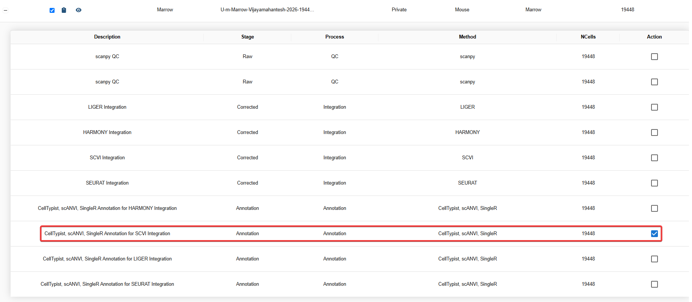
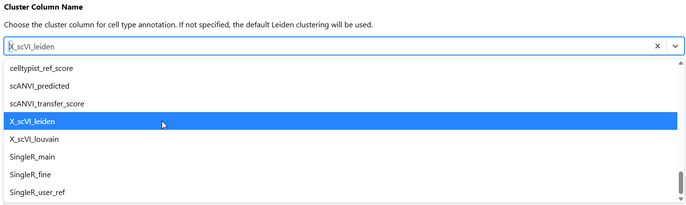
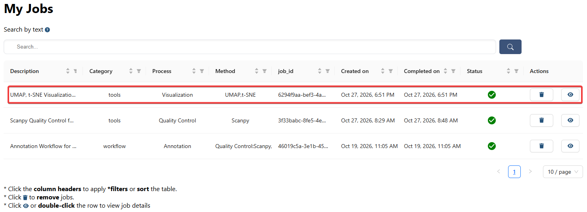
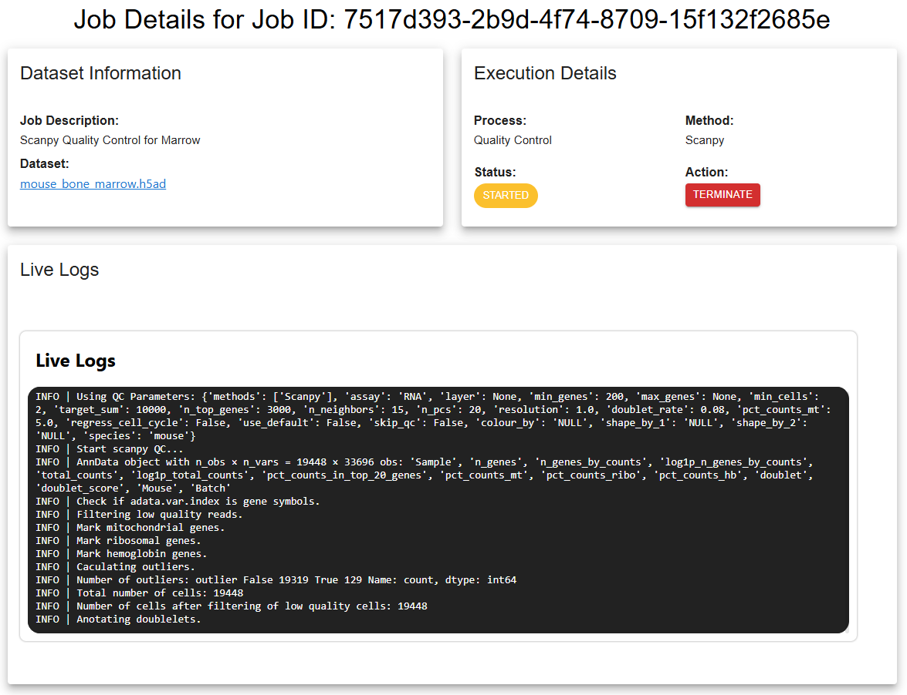
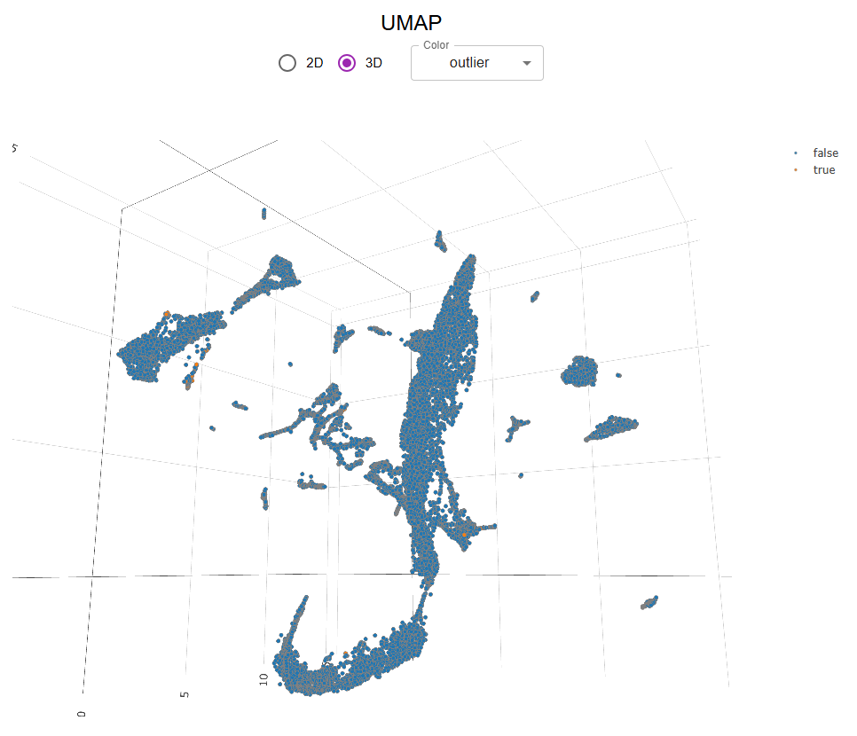
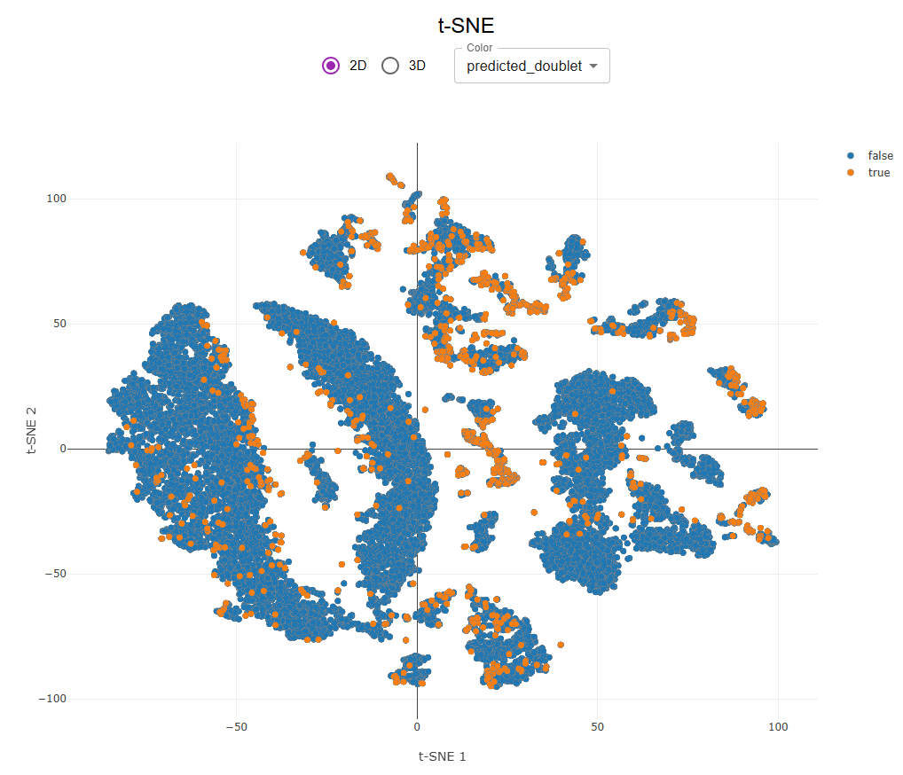
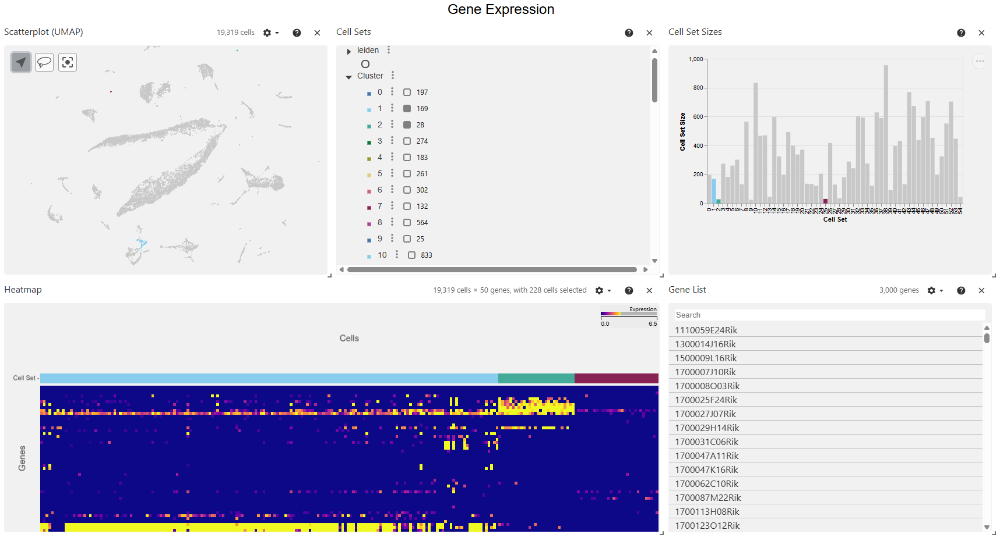
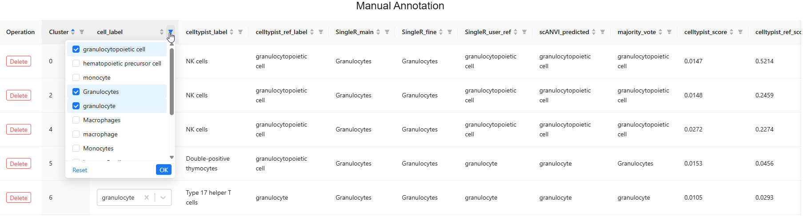
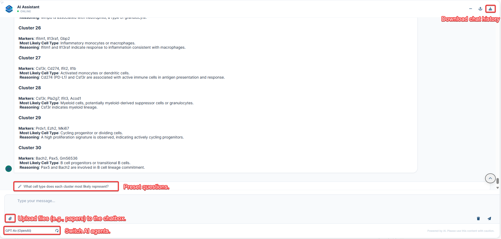

# Refine Cell-Type Annotation in Mouse Bone Marrow with the Visualization Tool[^1]

This tutorial demonstrates how to refine cell-type annotations in **single-cell.ai** using the **Visualization** tool. You will select an annotated mouse bone marrow dataset, configure a visualization job, examine cell clusters and gene expression, manually refine cell-type labels, and use the AI Assistant to support annotation decisions.

The example dataset contains **19,448 cells** from mouse bone marrow collected from uninfected wild-type (WT) mice and lymphocytic choriomeningitis virus clone 13 (LCMV Cl 13)-infected WT and *Sphk2*−/− mice. The data were generated using **10x Genomics single-cell 3′ RNA sequencing**.[^1]

## 1. Create a Visualization Job

Navigate to **Analyses → Tools → Visualization** to create a job for inspecting UMAP/t-SNE embeddings and refining annotations.

### 1.1 Select the Input Dataset

1. Open the **Datasets** file selector.
2. Use the search field, filters, or column sorting to locate **Mouse Marrow** (**19,448 cells**).
3. Click the **+** icon beside a dataset entry to expand its analysis history and view intermediate results.
4. Select **CellTypist, scANVI, SingleR Annotation for SCVI Integration**. This is the annotated dataset used in the following steps.



*Figure 1. Select the existing annotation result from the Mouse Marrow analysis history.*

> [!NOTE]
> To analyze your own data, see [Data Management](doc/?doc=data_management).

### 1.2 Configure Visualization and Clustering Parameters

The Visualization tool provides parameters for dimensionality reduction, clustering, and the gene-expression heatmap.

| Parameter | Purpose | Guidance |
| --- | --- | --- |
| `n_neighbors` | Controls the number of nearby cells used to construct the neighborhood graph. | Lower values emphasize local neighborhoods; higher values can capture broader structure. |
| `n_pcs` | Specifies how many principal components to use when PCA-based processing is performed. | Too few may omit biological variation; too many may introduce noise. |
| `Resolution` | Controls the granularity of graph-based clustering, such as Leiden clustering, when clustering is run. | Lower values generally produce fewer, larger clusters; higher values produce more, smaller clusters. |
| `Number of Highly Variable Genes for Heatmap` | Sets the number of genes included in the heatmap according to the tool's selection procedure. | Use **50** for this tutorial. Highly variable genes are not necessarily cell-type-specific marker genes. |
| `Cluster Column Name` | Selects an existing cluster assignment for the annotation panel. | Use **`X_scVI_leiden`** for this tutorial. |

For this example:

1. Set **`Resolution`** to **`1`**.
2. Set **`Number of Highly Variable Genes for Heatmap`** to **`50`**.
3. Set **`Cluster Column Name`** to **`X_scVI_leiden`**, which contains Leiden clusters derived from scVI embeddings.
4. If you only need to review or refine the existing clusters, turn off unnecessary UMAP/t-SNE recomputation to reduce processing time.

**How the cluster selection works:** When **`Cluster Column Name`** is specified, the annotation panel uses that existing cluster column. Running UMAP/t-SNE again does **not** replace the cluster assignments used by the annotation panel. If no cluster column is specified, the tool uses its default Leiden clustering output instead.



*Figure 2. Configure visualization settings and select the existing scVI-based Leiden clusters.*

> [!TIP]
> **Clustering resolution is not the same as annotation confidence.** Changing `Resolution` affects cluster granularity only when a clustering step is executed. Evaluate the resulting groups against gene expression and known cell biology before assigning cell-type labels.

## 2. Submit and Monitor the Job

1. Submit the configured Visualization job.
2. Open **My Jobs** to check its status. You can leave the current page while the job runs and return later to retrieve the results.
3. Select the job to open its details, including **Dataset Information**, **Execution Details**, and **Live Logs**.
4. If execution fails, review the error-report panel. You can use the available GitHub issue-reporting feature to share the failure for troubleshooting.



*Figure 3. Monitor the submitted job from My Jobs.*



*Figure 4. Inspect the job details and logs.*

> [!NOTE]
> **Result reuse:** single-cell.ai uses an MD5-based identification strategy that incorporates the data content and processing configuration (including methods and parameters). When a matching result is available, the platform may reuse previously computed output rather than repeating the analysis.

## 3. Explore the Visualization Results

Completed jobs produce analysis results in **AnnData** or **MuData** format. To convert results to another supported format, use **Tools → Formatting → Convert**.

### 3.1 Inspect UMAP and t-SNE Plots

The **Plots** panel provides interactive 2D or 3D dimensionality-reduction visualizations, where available. Use the **Color** dropdown to switch between annotation labels or other available cell-level attributes.

Compare the distribution of predicted cell types with the existing Leiden clusters. Look for groups with mixed labels, unexpectedly separated populations, or patterns that warrant further examination.

Dimensionality-reduction coordinates are stored in the AnnData `.obsm` collection under method-specific keys, for example:

```python
adata.obsm["X_umap"]
adata.obsm["sctransform_umap_3d"]
```

The exact keys depend on the methods and outputs used in the analysis.



*Figure 5. Examine the UMAP embedding and change the displayed cell labels.*



*Figure 6. Inspect the complementary t-SNE representation.*

> [!TIP]
> UMAP and t-SNE help reveal patterns, but the distance between groups in a 2D plot is not sufficient evidence of cell identity. Cross-check labels against gene expression and other annotations.

### 3.2 Evaluate Gene Expression and Cell Composition

The **Gene Expression** panel contains several complementary views:

| View | What to examine |
| --- | --- |
| **UMAP** | Where annotated populations appear in the embedding. |
| **Cell Sets** | Which cells belong to each annotated group. |
| **Cell Set Sizes** | The relative abundance of annotated groups. |
| **Heatmap** | Gene-expression patterns across the displayed cell populations. |
| **Gene List** | Genes associated with the displayed expression analysis. |

Switch between available annotation methods and compare their cell-type assignments, population sizes, and expression patterns. Use known biological markers and relevant published evidence to evaluate whether the predicted identities are plausible.



*Figure 7. Compare annotation labels with cell composition and gene-expression evidence.*

## 4. Refine Labels in the Manual Annotation Panel

The **Manual Annotation** panel displays a table that combines automated predictions with cluster-level annotation controls. It includes:

- **`cell_label`**: the majority-vote label derived from the available annotation methods.
- **Method-specific predictions**: cell-type assignments from methods such as CellTypist, scANVI, and SingleR.
- **Confidence scores**: the scores provided by the individual annotation methods, where available.

Use the table to reconcile disagreements between methods and make informed manual adjustments.

1. **Compare predictions.** Review the majority-vote `cell_label`, individual method assignments, and their confidence scores.
2. **Validate the cell identity.** Cross-reference the cluster with UMAP/t-SNE patterns and the **Gene Expression** panel. Avoid changing a label on the basis of a single score or plot.
3. **Edit a cluster.** Use **Edit** to revise its assigned cell type when the evidence supports a different annotation.
4. **Create a new label if needed.** If the desired cell type is not listed in the **`cell_type`** dropdown, type its name and create a new option.
5. **Remove an unwanted entry.** Use **Delete** for a cluster row you intend to exclude from the manual annotation table. To undo a deletion, select **Restore Deleted Rows**.



*Figure 8. Review consensus labels and refine cluster annotations.*

> [!TIP]
> Click a table **header** to use the available sorting or filtering controls. This can help locate clusters with conflicting predictions or low-confidence assignments.

> [!IMPORTANT]
> A majority-vote label is a starting point, not a verified biological identity. Some methods may share biases, and rare populations may be misclassified. Review relevant marker expression and the biological context before finalizing changes.

## 5. Use the AI Assistant to Support Annotation

The **AI Assistant** connects the analysis workflow with AI agents, including services such as ChatGPT and Gemini. For annotation tasks, the workflow can provide the **top 50 highly variable genes (HVGs) for each cluster** as context for the assistant.

You can use the assistant to:

1. **Interpret the gene list.** Ask which cell identities are consistent with the genes supplied for a cluster.
2. **Investigate disagreements.** Compare alternative labels suggested by CellTypist, scANVI, and SingleR, using gene-expression evidence to assess competing explanations.
3. **Add external context.** Enter relevant details in the chatbox or upload a research paper to help contextualize the predictions.
4. **Document the analysis.** Download the chat history for later review.

**Example prompt:**

> The annotation methods disagree on the identity of this mouse bone marrow cluster. Based on the supplied genes, which cell types should I consider, which marker genes would help distinguish them, and what evidence would be needed before updating the label?



*Figure 9. Use the AI Assistant to help interpret clusters and record the reasoning.*

> [!NOTE]
> AI-generated suggestions should be treated as hypotheses. Verify proposed cell-type identities against expression data, established markers, and the experimental context before applying a manual annotation.

## 6. Review the Refined Annotation

Before considering the annotation review complete, confirm that:

- The selected **`X_scVI_leiden`** clusters correspond to the dataset you intended to analyze.
- The chosen cell-type labels are consistent with marker expression and relevant biological knowledge.
- Differences among annotation methods have been examined, rather than resolved solely by majority vote.
- Any edited, deleted, or restored cluster entries reflect your intended interpretation.
- AI-assisted suggestions have been independently checked against the data.

The result is a more carefully reviewed cell-type annotation that can support downstream interpretation of the mouse bone marrow dataset.

## References

[^1]: Vijayamahantesh V, He Y, Jiang L, Huerter H, Jung KI, McKenna S, Studstill CJ, Allen L-AH, Nistala R, Xu D, and Hahm B (2026). Sphingosine kinase 2 suppresses neutrophil responses to promote viral persistence while attenuating immune pathology. *Frontiers in Immunology*, **16**, 1706967. https://doi.org/10.3389/fimmu.2025.1706967
