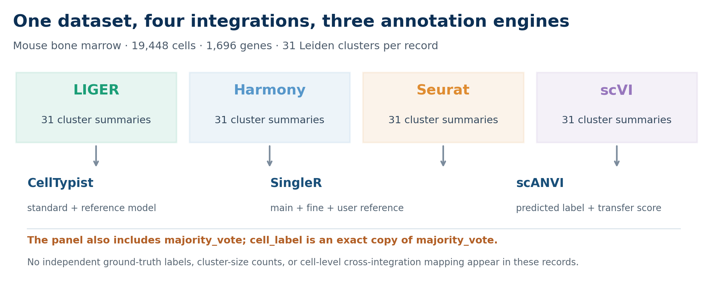
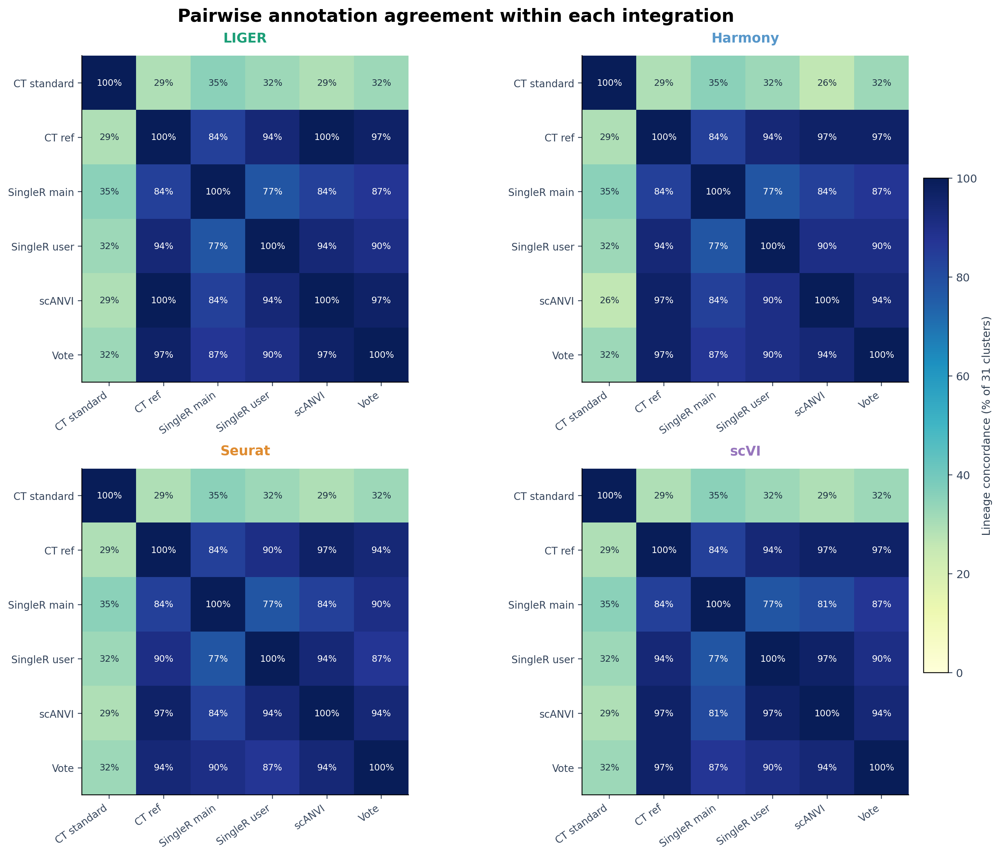
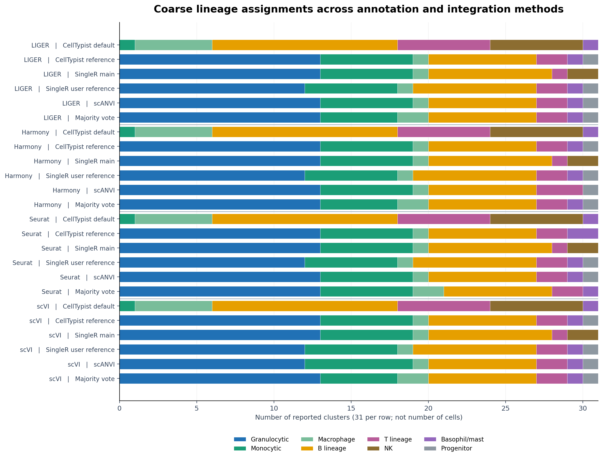
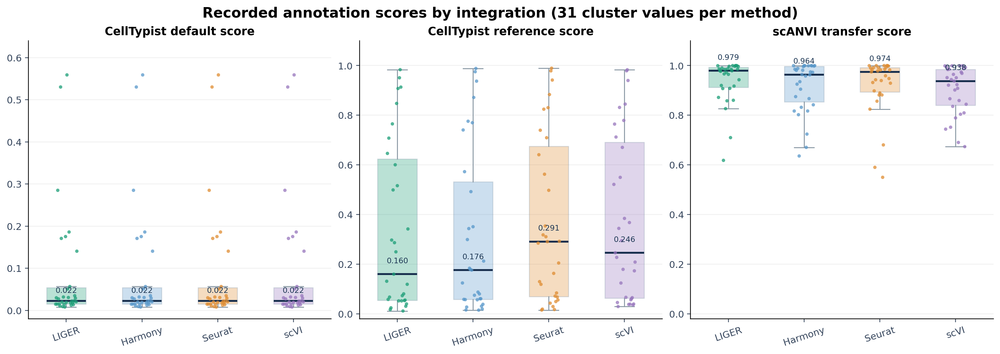
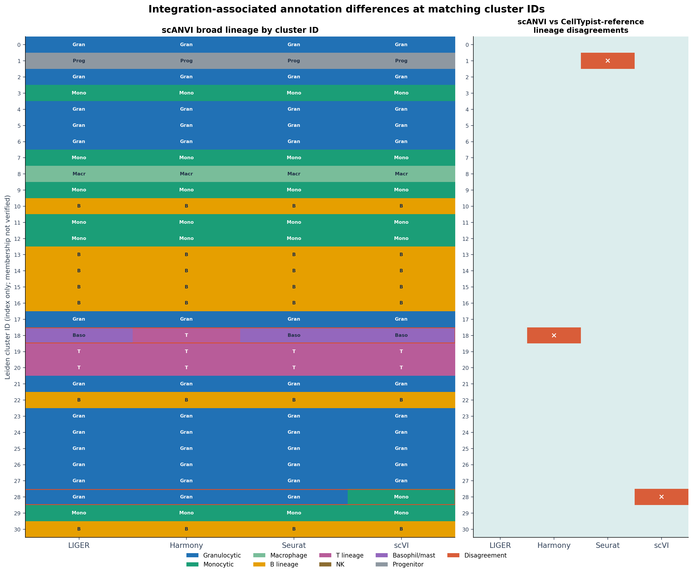
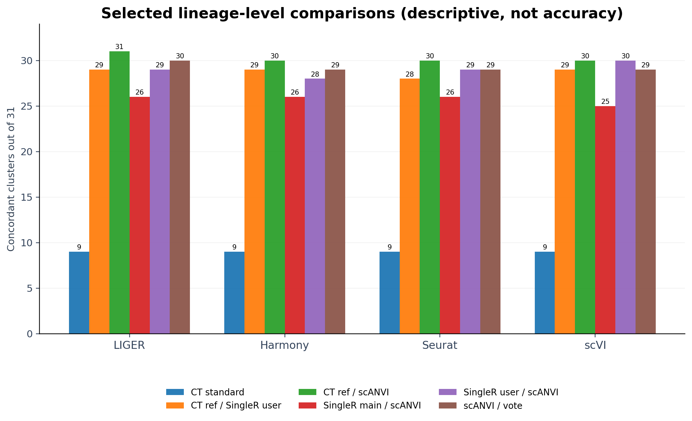

# Comparative analysis of cell-type annotations across integration methods

**Unit of analysis:** 31 reported Leiden clusters per integration, not individual cells.  All observations below are descriptive.

## Executive summary

Four records describe the same mouse bone-marrow dataset (19,448 cells and 1,696 genes), following **LIGER, Harmony, Seurat, and scVI integration**. Each record supplies 31 cluster-level labels. The available annotation engines are **CellTypist, SingleR, and scANVI**.

The strongest descriptive pattern is the divergence of **standard CellTypist** from the reference-based annotations: default CellTypist agrees with reference-based CellTypist at the broad-lineage level for only **9 of 31 clusters** in every integration. By contrast, reference-based CellTypist and scANVI agree in **31/31 LIGER**, **30/31 Harmony**, **30/31 Seurat**, and **30/31 scVI** clusters. These are agreement statistics, **not independently verified accuracy**.

The reported standard CellTypist predictions, SingleR main/fine labels, and SingleR user-reference labels are identical by cluster index across all four integrations. scANVI changes some labels, most noticeably B-cell developmental annotations under Seurat and scVI. Since cluster membership and cell-level labels are not provided here, equal cluster IDs **must not be assumed to contain the same cells** across integration methods.

## Figure 1. Study design and available outputs

**Figure 1.** Four integration records from the same dataset share a 31-row `annotation_panel.table`. CellTypist offers standard and reference-based labels, SingleR offers main, fine, and user-reference labels, and scANVI offers predicted labels and transfer scores.

## Input metadata and analysis settings
| Integration | Cells | Genes | Clusters | Integration filename |
|---|---:|---:|---:|---|
| LIGER | 19,448 | 1,696 | 31 | `LIGER_integration_annotation.h5ad` |
| Harmony | 19,448 | 1,696 | 31 | `HARMONY_integration_annotation.h5ad` |
| Seurat | 19,448 | 1,696 | 31 | `SEURAT_integration_annotation.h5ad` |
| scVI | 19,448 | 1,696 | 31 | `SCVI_integration_annotation.h5ad` |

All records declare `methods = [CellTypist, scANVI, SingleR]`, CellTypist model `Immune_All_Low.pkl`, SingleR reference `mouse_rnaseq`, user label `cell_ontology_class`, `n_neighbors = 30`, `n_pcs = 30`, and Leiden resolution `1`. These are configuration metadata, not proof that the reference labels are independent of the predictions.

## Figure 2. Pairwise agreement between annotators

**Figure 2.** Each cell shows the percentage of the 31 clusters whose labels map to the same broad biological lineage. The normalizations collapse selected synonyms and developmental subtypes, so their agreement rates should not be interpreted as exact cell-type identity. Vote-based labels are not independent of the methods used to form them.

### Key agreement statistics
| Integration | Default CellTypist vs reference CellTypist | Ref CellTypist vs SingleR user ref | Ref CellTypist vs scANVI | SingleR main vs scANVI | scANVI vs vote |
|---|---:|---:|---:|---:|---:|
| LIGER | 9/31 | 29/31 | 31/31 | 26/31 | 30/31 |
| Harmony | 9/31 | 29/31 | 30/31 | 26/31 | 29/31 |
| Seurat | 9/31 | 28/31 | 30/31 | 26/31 | 29/31 |
| scVI | 9/31 | 29/31 | 30/31 | 25/31 | 29/31 |

The reference-configured annotations are considerably more concordant with one another than with default CellTypist, especially on granulocytic populations. This pattern is consistent with an effect of reference choice and label vocabulary, but does not establish which labels are correct.

### Exact cell-type labels versus broad lineages
| Integration | Exact CellTypist-reference vs scANVI | Broad-lineage CellTypist-reference vs scANVI |
|---|---:|---:|
| LIGER | 29/31 | 31/31 |
| Harmony | 27/31 | 30/31 |
| Seurat | 24/31 | 30/31 |
| scVI | 24/31 | 30/31 |

Exact matching preserves developmental annotations such as `late pro-B cell`, `early pro-B cell`, and `immature B cell`, while the lineage measure groups them together. Consequently, the very high lineage agreement masks meaningful subtype-level differences. The provided data do not establish the biological accuracy of those subtypes.

## Figure 3. Biological lineage composition

**Figure 3.** Each horizontal bar counts **clusters**, not cells. Broad categories are granulocytic, monocytic, macrophage, B lineage, T lineage, NK, basophil/mast, and progenitor. The default CellTypist model labels 12/31 clusters as B lineage, 7 as T lineage and 6 as NK, while reference-based annotations emphasize granulocytic and monocytic populations. Because the category mapping merges biologically related but distinct subtypes, use the supplementary CSV for the original labels.

## Figure 4. Recorded scores and uncertainty

**Figure 4.** Each point represents the score attached to one cluster summary. Boxes show the interquartile range. **Scores come from different methods and are not calibrated to the same scale; cross-method numerical comparisons cannot establish superiority.** The default CellTypist score vector is identical across the four records.

| Integration | Median CellTypist default | Median CellTypist reference | Median scANVI transfer | scANVI score < 0.8 |
|---|---:|---:|---:|---:|
| LIGER | 0.022 | 0.160 | 0.979 | 2/31 |
| Harmony | 0.022 | 0.176 | 0.964 | 3/31 |
| Seurat | 0.022 | 0.291 | 0.974 | 3/31 |
| scVI | 0.022 | 0.246 | 0.938 | 5/31 |

scANVI shows high *reported transfer scores* overall, but these scores alone are not estimates of externally validated accuracy. Cluster-level aggregation and possible model overconfidence should be considered.

## Figure 5. Integration-dependent scANVI assignments

**Figure 5.** Left: scANVI broad-lineage assignment for each numerical Leiden cluster ID. Right: disagreement between scANVI and reference CellTypist on the same integration record. **The cluster-ID alignment is index-based only; membership may differ between integrations**. This figure is for identifying rows to inspect, not cross-integration cell-level stability.

The most notable within-record disagreements involve B-lineage maturation states and selected immune populations: cluster IDs 13, 15, 22 and 30 show scANVI calls of `late pro-B cell` under Seurat and/or scVI where reference CellTypist reports `immature B cell` or `early pro-B cell`. These can be lineage-concordant despite differing at the subtype level. In Harmony, scANVI labels cluster 18 as `T cell` while reference CellTypist and SingleR user-reference identify `basophil`; this is a broad-lineage disagreement worth further checking.

## Figure 6. Selected method-pair concordances

**Figure 6.** Agreement counts for a subset of annotation-method pairs. Bars show broad-lineage concordance among 31 clusters in each integration. Since the reference-configured models may rely on related annotation resources, concordance is not proof of independent validation.

## Interpretation and practical next steps

**Reference configuration:** Compare `celltypist_label` against `celltypist_ref_label` before selecting an automated annotation for mouse marrow. The very low default-model concordance suggests the generic `Immune_All_Low.pkl` vocabulary is not well aligned with this reference scheme; it does not, by itself, prove that default CellTypist is inaccurate.

**Annotation refinement:** Prioritize review of rows flagged in `tables/review_flagged_clusters.csv`, particularly T/basophil conflicts and B-cell maturation labels. Validate against marker genes and independent biological references before adopting any disputed subtype.

**Integration ranking:** Do **not** rank LIGER, Harmony, Seurat and scVI by biological accuracy from these tables. The observed differences can reflect downstream model behavior and clustering as well as integration.

**Next data to collect:** export each cell barcode, integration-specific Leiden cluster, per-cell predicted annotations and probabilities, reference cell-type labels, per-cluster cell counts, batch ID, and normalized marker-gene expression. With these fields one could compute cell-weighted concordance, ARI/NMI for cluster stability, balanced classification metrics against independent truth, and a per-cell transition matrix.

## Methods and caveats

1. **Data source:** four cell type annotation records.
2. **Unit:** each integration has one 31-row `annotation_panel.table` keyed by `Cluster`; each row is weighted equally regardless of how many cells belong to the cluster.
3. **Harmonization:** `granulocyte`/`granulocytopoietic cell` are grouped as granulocytic; `monocyte`/`promonocyte` as monocytic; B and T developmental subtypes are grouped into their respective lineages; basophils and mast cells form a separate group; macrophages and NK retain separate groups; `hematopoietic precursor cell` is treated as progenitor. This is a descriptive, purpose-built taxonomy, not a universal ontology or an exact-label comparison.
4. **Agreement:** number of rows (out of 31) with the same coarse lineage for an annotation pair. This measures **agreement** and not accuracy, specificity, sensitivity, ARI, NMI, or statistical significance.
5. **Not independent:** User-reference and model-reference annotations may depend on overlapping training/reference material; treating votes or reference-configured labels as ground truth would be circular.
6. **Score semantics:** Cross-model raw scores are not directly comparable.
7. **Across integrations:** identical cluster integer IDs do not establish identical cell membership. Index-matched panels indicate rows deserving follow-up, not validated inter-integration agreement.
8. **Statistical inference:** there is one dataset, repeated model outputs, and potential dependence across labels. No inferential p-values or confidence intervals are reported.

## Supplementary data

- [`tables/cluster_annotations_124_rows.csv`](tables/cluster_annotations_124_rows.csv) — all 124 cluster records, original labels, coarse lineages, and scores.
- [`tables/pairwise_lineage_agreement.csv`](tables/pairwise_lineage_agreement.csv) — all pairwise annotation agreement statistics within each integration.
- [`tables/integration_summary.csv`](tables/integration_summary.csv) — four-integration summary table.
- [`tables/review_flagged_clusters.csv`](tables/review_flagged_clusters.csv) — flagged disagreement and low-score rows for expert review.
- [`tables/cluster_index_changes_vs_LIGER.csv`](tables/cluster_index_changes_vs_LIGER.csv) — index-based differences relative to LIGER; not cell-matched.
- [`tables/annotation_scores_long.csv`](tables/annotation_scores_long.csv) — all method scores in tidy format.
- [`tables/record_metadata.csv`](tables/record_metadata.csv) — integration paths and declared parameters.
